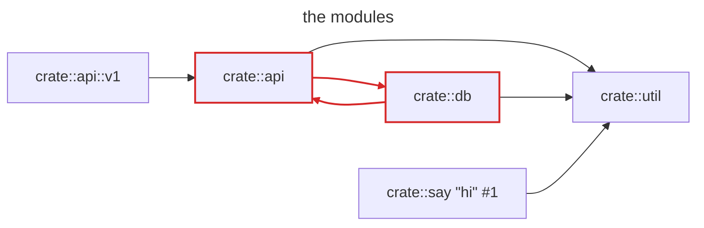
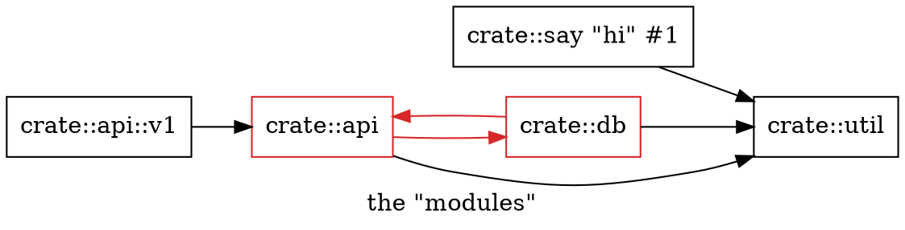
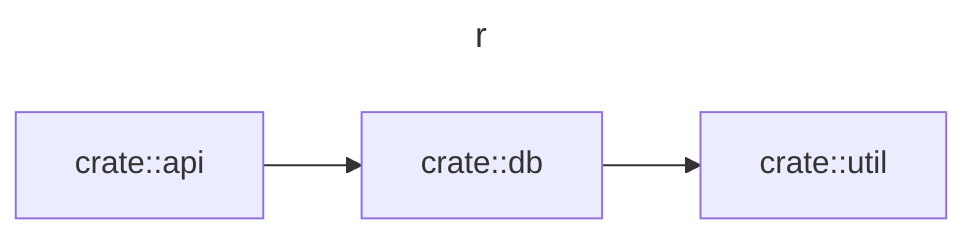
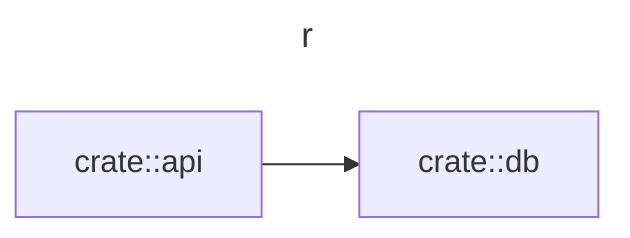
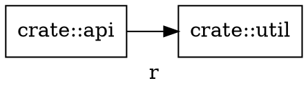
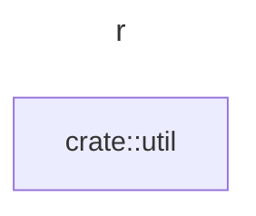
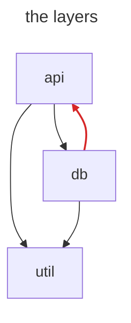
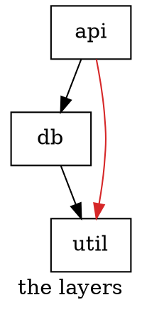
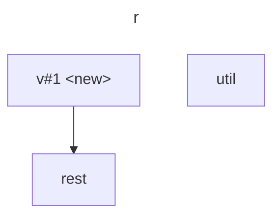

# Conformance cases

This file shows what each case in `cases/` gives: the facts of each file, and for each
case the rule and the report that the Rust core prints. The conformance test of the
`refpact` crate makes this file and fails when it is not up to date. Do not edit it.

`SPEC.md` defines the behaviour. The rule is shown in the JSON encoding of `SPEC.md`,
section 6.

## 01-patterns.json

Patterns: exact match for subjects, match within for targets, globs and `**`.

Paths are printed with the separator `::`.

| # | unit | place | fact | tags |
|---|---|---|---|---|
| 1 | `crate::frontend::passes::inline` | `src/frontend/passes/inline.rs:3:5` | use `crate::codegen::Generator` |  |
| 2 | `crate::frontend::passes::dce_pass` | `src/frontend/passes/dce_pass.rs:7:1` | expr `std::fs::read` |  |
| 3 | `crate::interpreter` | `src/interpreter/mod.rs:2:1` | use `crate::codegen` |  |
| 4 | `crate::interpreter::gc` | `src/interpreter/gc.rs:9:1` | expr `std::fsx::read` |  |
| 5 | `crate::frontend` | `src/frontend/mod.rs:4:1` | expr `std::fs` |  |

### a subject without wildcard selects one unit only

```json
{"must_not_use":{"any_of":["crate::codegen","std::fsx"]},"name":"r","subjects":{"any_of":["crate::interpreter"]}}
```

Result:

```text
rule `r` is violated in 1 place(s):
  src/interpreter/mod.rs:2:1: [r] crate::interpreter uses crate::codegen (use)
```

### `**` at the end selects the unit and all units below it

```json
{"must_not_use":{"any_of":["crate::codegen","std::fsx"]},"name":"r","subjects":{"any_of":["crate::interpreter::**"]}}
```

Result:

```text
rule `r` is violated in 2 place(s):
  src/interpreter/mod.rs:2:1: [r] crate::interpreter uses crate::codegen (use)
  src/interpreter/gc.rs:9:1: [r] crate::interpreter::gc uses std::fsx::read (expr)
```

### `*` is exactly one segment

```json
{"must_not_use":{"any_of":["std::fs","crate::codegen"]},"name":"r","subjects":{"any_of":["crate::frontend::*"]}}
```

Result:

```text
No violation.
```

### `*` inside a segment matches part of the segment

```json
{"must_not_use":{"any_of":["std::fs"]},"name":"r","subjects":{"any_of":["crate::frontend::passes::*_pass"]}}
```

Result:

```text
rule `r` is violated in 1 place(s):
  src/frontend/passes/dce_pass.rs:7:1: [r] crate::frontend::passes::dce_pass uses std::fs::read (expr)
```

### `**` in the middle of a subject

```json
{"must_not_use":{"any_of":["crate::codegen"]},"name":"r","subjects":{"any_of":["crate::**::inline"]}}
```

Result:

```text
rule `r` is violated in 1 place(s):
  src/frontend/passes/inline.rs:3:5: [r] crate::frontend::passes::inline uses crate::codegen::Generator (use)
```

### a target covers the path itself and everything inside, but not a longer name

```json
{"must_not_use":{"any_of":["std::fs"]},"name":"r","subjects":{"all":true}}
```

Result:

```text
rule `r` is violated in 2 place(s):
  src/frontend/passes/dce_pass.rs:7:1: [r] crate::frontend::passes::dce_pass uses std::fs::read (expr)
  src/frontend/mod.rs:4:1: [r] crate::frontend uses std::fs (expr)
```

### a target with `**` at the end is equal to the target without it

```json
{"must_not_use":{"any_of":["crate::codegen::**"]},"name":"r","subjects":{"all":true}}
```

Result:

```text
rule `r` is violated in 2 place(s):
  src/frontend/passes/inline.rs:3:5: [r] crate::frontend::passes::inline uses crate::codegen::Generator (use)
  src/interpreter/mod.rs:2:1: [r] crate::interpreter uses crate::codegen (use)
```

### a target does not cover the thing that contains it

```json
{"must_not_use":{"any_of":["std::fs::read"]},"name":"r","subjects":{"all":true}}
```

Result:

```text
rule `r` is violated in 1 place(s):
  src/frontend/passes/dce_pass.rs:7:1: [r] crate::frontend::passes::dce_pass uses std::fs::read (expr)
```

### a glob in a target segment

```json
{"must_not_use":{"any_of":["std::fs*"]},"name":"r","subjects":{"all":true}}
```

Result:

```text
rule `r` is violated in 3 place(s):
  src/frontend/passes/dce_pass.rs:7:1: [r] crate::frontend::passes::dce_pass uses std::fs::read (expr)
  src/interpreter/gc.rs:9:1: [r] crate::interpreter::gc uses std::fsx::read (expr)
  src/frontend/mod.rs:4:1: [r] crate::frontend uses std::fs (expr)
```

## 02-subjects.json

Subjects: union of patterns, exceptions, and the errors for empty selections.

Paths are printed with the separator `::`.

| # | unit | place | fact | tags |
|---|---|---|---|---|
| 1 | `crate` | `src/lib.rs:1:1` | expr `std::fs::read` |  |
| 2 | `crate::a` | `src/a.rs:2:1` | expr `std::fs::read` |  |
| 3 | `crate::a::x` | `src/a/x.rs:3:1` | expr `std::fs::read` |  |
| 4 | `crate::b` | `src/b.rs:4:1` | expr `std::fs::read` |  |
| 5 | `crate::c` | `src/c.rs:5:1` | expr `std::fs::read` |  |
| 6 | `crate::platform` | `src/platform/mod.rs:6:1` | expr `std::fs::read` |  |
| 7 | `crate::platform::fs` | `src/platform/fs.rs:7:1` | expr `std::fs::read` |  |

### several subject patterns form a union

```json
{"must_not_use":{"any_of":["std::fs"]},"name":"r","subjects":{"any_of":["crate::a","crate::b"]}}
```

Result:

```text
rule `r` is violated in 2 place(s):
  src/a.rs:2:1: [r] crate::a uses std::fs::read (expr)
  src/b.rs:4:1: [r] crate::b uses std::fs::read (expr)
```

### the order of subject patterns does not change the result

```json
{"must_not_use":{"any_of":["std::fs"]},"name":"r","subjects":{"any_of":["crate::b","crate::a"]}}
```

Result:

```text
rule `r` is violated in 2 place(s):
  src/a.rs:2:1: [r] crate::a uses std::fs::read (expr)
  src/b.rs:4:1: [r] crate::b uses std::fs::read (expr)
```

### a unit that two patterns select is reported once

```json
{"must_not_use":{"any_of":["std::fs"]},"name":"r","subjects":{"any_of":["crate::a::**","crate::a::x"]}}
```

Result:

```text
rule `r` is violated in 2 place(s):
  src/a.rs:2:1: [r] crate::a uses std::fs::read (expr)
  src/a/x.rs:3:1: [r] crate::a::x uses std::fs::read (expr)
```

### a subject without wildcard does not select units below it

```json
{"must_not_use":{"any_of":["std::fs"]},"name":"r","subjects":{"any_of":["crate::a"]}}
```

Result:

```text
rule `r` is violated in 1 place(s):
  src/a.rs:2:1: [r] crate::a uses std::fs::read (expr)
```

### all units

```json
{"must_not_use":{"any_of":["std::fs"]},"name":"r","subjects":{"all":true}}
```

Result:

```text
rule `r` is violated in 7 place(s):
  src/lib.rs:1:1: [r] crate uses std::fs::read (expr)
  src/a.rs:2:1: [r] crate::a uses std::fs::read (expr)
  src/a/x.rs:3:1: [r] crate::a::x uses std::fs::read (expr)
  src/b.rs:4:1: [r] crate::b uses std::fs::read (expr)
  src/c.rs:5:1: [r] crate::c uses std::fs::read (expr)
  src/platform/mod.rs:6:1: [r] crate::platform uses std::fs::read (expr)
  src/platform/fs.rs:7:1: [r] crate::platform::fs uses std::fs::read (expr)
```

### all units except one subtree

```json
{"must_not_use":{"any_of":["std::fs"]},"name":"r","subjects":{"all":true,"except":["crate::platform::**"]}}
```

Result:

```text
rule `r` is violated in 5 place(s):
  src/lib.rs:1:1: [r] crate uses std::fs::read (expr)
  src/a.rs:2:1: [r] crate::a uses std::fs::read (expr)
  src/a/x.rs:3:1: [r] crate::a::x uses std::fs::read (expr)
  src/b.rs:4:1: [r] crate::b uses std::fs::read (expr)
  src/c.rs:5:1: [r] crate::c uses std::fs::read (expr)
```

### several exceptions form a union

```json
{"must_not_use":{"any_of":["std::fs"]},"name":"r","subjects":{"all":true,"except":["crate::platform::**","crate::c"]}}
```

Result:

```text
rule `r` is violated in 4 place(s):
  src/lib.rs:1:1: [r] crate uses std::fs::read (expr)
  src/a.rs:2:1: [r] crate::a uses std::fs::read (expr)
  src/a/x.rs:3:1: [r] crate::a::x uses std::fs::read (expr)
  src/b.rs:4:1: [r] crate::b uses std::fs::read (expr)
```

### exceptions are subtracted from a pattern list

```json
{"must_not_use":{"any_of":["std::fs"]},"name":"r","subjects":{"any_of":["crate::a::**"],"except":["crate::a::x"]}}
```

Result:

```text
rule `r` is violated in 1 place(s):
  src/a.rs:2:1: [r] crate::a uses std::fs::read (expr)
```

### error: one of two subject patterns matches nothing

```json
{"must_not_use":{"any_of":["std::fs"]},"name":"r","subjects":{"any_of":["crate::a","crate::zz"]}}
```

Result:

```text
rule `r` cannot be checked:
  subject pattern `crate::zz` matches nothing in the analysed code
```

### error: each subject pattern that matches nothing is reported, in order

```json
{"must_not_use":{"any_of":["std::fs"]},"name":"r","subjects":{"any_of":["crate::zz","crate::a","crate::yy::**"]}}
```

Result:

```text
rule `r` cannot be checked:
  subject pattern `crate::zz` matches nothing in the analysed code
  subject pattern `crate::yy::**` matches nothing in the analysed code
```

### error: an exception that matches nothing

```json
{"must_not_use":{"any_of":["std::fs"]},"name":"r","subjects":{"all":true,"except":["crate::platform::**","crate::gone"]}}
```

Result:

```text
rule `r` cannot be checked:
  subject exception `crate::gone` matches nothing in the analysed code
```

### error: the exceptions remove every selected unit

```json
{"must_not_use":{"any_of":["std::fs"]},"name":"r","subjects":{"any_of":["crate::a::x"],"except":["crate::a::**"]}}
```

Result:

```text
rule `r` cannot be checked:
  the subjects select no unit that the rule can check
```

### error: all units except all units

```json
{"must_not_use":{"any_of":["std::fs"]},"name":"r","subjects":{"all":true,"except":["**"]}}
```

Result:

```text
rule `r` cannot be checked:
  the subjects select no unit that the rule can check
```

### error: an empty subject list

```json
{"must_not_use":{"any_of":["std::fs"]},"name":"r","subjects":{"any_of":[]}}
```

Result:

```text
rule `r` cannot be checked:
  the subject pattern list is empty
```

### error: an empty exception list

```json
{"must_not_use":{"any_of":["std::fs"]},"name":"r","subjects":{"all":true,"except":[]}}
```

Result:

```text
rule `r` cannot be checked:
  the subject exception list is empty
```

## 03-targets.json

Targets: union of several targets, existence checks, aliases, properties, and self-use.

Paths are printed with the separator `::`.

| # | unit | place | fact | tags |
|---|---|---|---|---|
| 1 | `crate::frontend` | `src/frontend.rs:3:1` | type `crate::codegen::Generator`, license `MIT OR Apache-2.0`, version `1.2.0` |  |
| 2 | `crate::frontend` | `src/frontend.rs:8:1` | expr `crate::prelude::Generator`, also `crate::codegen::Generator` |  |
| 3 | `crate::codegen` | `src/codegen.rs:5:1` | expr `crate::codegen::Generator` |  |
| 4 | `crate::frontend` | `src/frontend.rs:12:1` | expr `crate::frontend::helper` |  |
| 5 | `crate::interpreter` | `src/interpreter.rs:2:1` | use `crate::cache::Store` |  |
| 6 | `crate` | `src/lib.rs:1:1` | use `crate::codegen` |  |
| 7 | `crate::codegen` | `src/codegen.rs:9:1` | use `crate::Config` |  |

### one target

```json
{"must_not_use":{"any_of":["crate::codegen"]},"name":"r","subjects":{"any_of":["crate::frontend"]}}
```

Result:

```text
rule `r` is violated in 2 place(s):
  src/frontend.rs:3:1: [r] crate::frontend uses crate::codegen::Generator (type)
  src/frontend.rs:8:1: [r] crate::frontend uses crate::codegen::Generator (expr, written as crate::prelude::Generator)
```

### two targets, the first is violated: same result as one target

```json
{"must_not_use":{"any_of":["crate::codegen","crate::interpreter"]},"name":"r","subjects":{"any_of":["crate::frontend"]}}
```

Result:

```text
rule `r` is violated in 2 place(s):
  src/frontend.rs:3:1: [r] crate::frontend uses crate::codegen::Generator (type)
  src/frontend.rs:8:1: [r] crate::frontend uses crate::codegen::Generator (expr, written as crate::prelude::Generator)
```

### two targets, the second is violated: same result as one target

```json
{"must_not_use":{"any_of":["crate::interpreter","crate::codegen"]},"name":"r","subjects":{"any_of":["crate::frontend"]}}
```

Result:

```text
rule `r` is violated in 2 place(s):
  src/frontend.rs:3:1: [r] crate::frontend uses crate::codegen::Generator (type)
  src/frontend.rs:8:1: [r] crate::frontend uses crate::codegen::Generator (expr, written as crate::prelude::Generator)
```

### error: five targets, one matches nothing, although another is violated

```json
{"must_not_use":{"any_of":["crate::interpreter","crate::cache","crate::prelude::nothing::**","crate::codegen","crate::Config"]},"name":"r","subjects":{"any_of":["crate::frontend"]}}
```

Result:

```text
rule `r` cannot be checked:
  target pattern `crate::prelude::nothing::**` matches nothing in the analysed code
```

### four targets that exist, one is violated

```json
{"must_not_use":{"any_of":["crate::interpreter","crate::cache","crate::codegen","crate::Config"]},"name":"r","subjects":{"any_of":["crate::frontend"]}}
```

Result:

```text
rule `r` is violated in 2 place(s):
  src/frontend.rs:3:1: [r] crate::frontend uses crate::codegen::Generator (type)
  src/frontend.rs:8:1: [r] crate::frontend uses crate::codegen::Generator (expr, written as crate::prelude::Generator)
```

### two subjects and two targets: every pair counts

```json
{"must_not_use":{"any_of":["crate::codegen","crate::cache"]},"name":"r","subjects":{"any_of":["crate::frontend","crate::interpreter"]}}
```

Result:

```text
rule `r` is violated in 3 place(s):
  src/frontend.rs:3:1: [r] crate::frontend uses crate::codegen::Generator (type)
  src/frontend.rs:8:1: [r] crate::frontend uses crate::codegen::Generator (expr, written as crate::prelude::Generator)
  src/interpreter.rs:2:1: [r] crate::interpreter uses crate::cache::Store (use)
```

### error: one of two targets matches nothing in the project

```json
{"must_not_use":{"any_of":["crate::codegen","crate::codgen"]},"name":"r","subjects":{"any_of":["crate::frontend"]}}
```

Result:

```text
rule `r` cannot be checked:
  target pattern `crate::codgen` matches nothing in the analysed code
```

### error: an unknown item in a known unit

```json
{"must_not_use":{"any_of":["crate::codegen::Genrator"]},"name":"r","subjects":{"all":true}}
```

Result:

```text
rule `r` cannot be checked:
  target pattern `crate::codegen::Genrator` matches nothing in the analysed code
```

### a target inside a known item is accepted

```json
{"must_not_use":{"any_of":["crate::codegen::Generator::new"]},"name":"r","subjects":{"all":true}}
```

Result:

```text
No violation.
```

### an unverified target is not checked for existence

```json
{"must_not_use":{"unverified":["crate::codegen::Generated"]},"name":"r","subjects":{"all":true}}
```

Result:

```text
No violation.
```

### an unverified target forbids like any other target

```json
{"must_not_use":{"any_of":["crate::codegen"],"unverified":["crate::cache::Store"]},"name":"r","subjects":{"any_of":["crate::interpreter"]}}
```

Result:

```text
rule `r` is violated in 1 place(s):
  src/interpreter.rs:2:1: [r] crate::interpreter uses crate::cache::Store (use)
```

### a target outside the project is not checked for existence

```json
{"must_not_use":{"any_of":["nosuchcrate::thing"]},"name":"r","subjects":{"all":true}}
```

Result:

```text
No violation.
```

### a target with a wildcard in the first segment is not checked for existence

```json
{"must_not_use":{"any_of":["*::nothing","**::nothing"]},"name":"r","subjects":{"all":true}}
```

Result:

```text
No violation.
```

### a unit may use itself; other units may not

```json
{"must_not_use":{"any_of":["crate::codegen"]},"name":"r","subjects":{"all":true}}
```

Result:

```text
rule `r` is violated in 3 place(s):
  src/frontend.rs:3:1: [r] crate::frontend uses crate::codegen::Generator (type)
  src/frontend.rs:8:1: [r] crate::frontend uses crate::codegen::Generator (expr, written as crate::prelude::Generator)
  src/lib.rs:1:1: [r] crate uses crate::codegen (use)
```

### a rule whose only matches are self-use passes

```json
{"must_not_use":{"unverified":["crate::frontend"]},"name":"r","subjects":{"all":true}}
```

Result:

```text
No violation.
```

### a unit below does not own the items of the unit above

```json
{"must_not_use":{"any_of":["crate::Config"]},"name":"r","subjects":{"all":true}}
```

Result:

```text
rule `r` is violated in 1 place(s):
  src/codegen.rs:9:1: [r] crate::codegen uses crate::Config (use)
```

### when the written path is forbidden, it is reported and not the alias

```json
{"must_not_use":{"any_of":["crate::prelude","crate::codegen"]},"name":"r","subjects":{"any_of":["crate::frontend"]}}
```

Result:

```text
rule `r` is violated in 2 place(s):
  src/frontend.rs:3:1: [r] crate::frontend uses crate::codegen::Generator (type)
  src/frontend.rs:8:1: [r] crate::frontend uses crate::prelude::Generator (expr)
```

### a rule names the properties that its check reads

```json
{"must_not_use":{"any_of":["crate::codegen"]},"name":"r","properties":["license","version"],"subjects":{"any_of":["crate::frontend"]}}
```

Result:

```text
rule `r` is violated in 2 place(s):
  src/frontend.rs:3:1: [r] crate::frontend uses crate::codegen::Generator (type)
  src/frontend.rs:8:1: [r] crate::frontend uses crate::codegen::Generator (expr, written as crate::prelude::Generator)
```

### error: a property that the front end does not produce

```json
{"must_not_use":{"any_of":["crate::codegen"]},"name":"r","properties":["license","licence"],"subjects":{"any_of":["crate::frontend"]}}
```

Result:

```text
rule `r` cannot be checked:
  property `licence` is not known to this front end
```

### error: no target at all

```json
{"must_not_use":{"any_of":[]},"name":"r","subjects":{"all":true}}
```

Result:

```text
rule `r` cannot be checked:
  the target pattern list is empty
```

### error: no target at all, both lists given

```json
{"must_not_use":{"any_of":[],"unverified":[]},"name":"r","subjects":{"all":true}}
```

Result:

```text
rule `r` cannot be checked:
  the target pattern list is empty
```

## 04-filters.json

Filters: reference kinds, tags and candidates.

Paths are printed with the separator `::`.

| # | unit | place | fact | tags |
|---|---|---|---|---|
| 1 | `crate::a` | `src/a.rs:1:1` | use `std::fs` |  |
| 2 | `crate::a` | `src/a.rs:2:1` | expr `std::fs::read` |  |
| 3 | `crate::a` | `src/a.rs:3:1` | type `std::fs::File` | `test` |
| 4 | `crate::a` | `src/a.rs:4:1` | macro-tokens `std::fs::write` |  |
| 5 | `crate::a` | `src/a.rs:5:1` | expr `rand::thread_rng` (candidate) |  |

### by default all kinds and all tags count

```json
{"must_not_use":{"any_of":["std::fs"]},"name":"r","subjects":{"all":true}}
```

Result:

```text
rule `r` is violated in 4 place(s):
  src/a.rs:1:1: [r] crate::a uses std::fs (use)
  src/a.rs:2:1: [r] crate::a uses std::fs::read (expr)
  src/a.rs:3:1: [r] crate::a uses std::fs::File (type)
  src/a.rs:4:1: [r] crate::a uses std::fs::write (macro-tokens)
```

### only one kind

```json
{"kinds":{"only":["use"]},"must_not_use":{"any_of":["std::fs"]},"name":"r","subjects":{"all":true}}
```

Result:

```text
rule `r` is violated in 1 place(s):
  src/a.rs:1:1: [r] crate::a uses std::fs (use)
```

### only two kinds

```json
{"kinds":{"only":["expr","use"]},"must_not_use":{"any_of":["std::fs"]},"name":"r","subjects":{"all":true}}
```

Result:

```text
rule `r` is violated in 2 place(s):
  src/a.rs:1:1: [r] crate::a uses std::fs (use)
  src/a.rs:2:1: [r] crate::a uses std::fs::read (expr)
```

### all kinds except one

```json
{"kinds":{"except":["macro-tokens"]},"must_not_use":{"any_of":["std::fs"]},"name":"r","subjects":{"all":true}}
```

Result:

```text
rule `r` is violated in 3 place(s):
  src/a.rs:1:1: [r] crate::a uses std::fs (use)
  src/a.rs:2:1: [r] crate::a uses std::fs::read (expr)
  src/a.rs:3:1: [r] crate::a uses std::fs::File (type)
```

### an empty `except` list of kinds changes nothing

```json
{"kinds":{"except":[]},"must_not_use":{"any_of":["std::fs"]},"name":"r","subjects":{"all":true}}
```

Result:

```text
rule `r` is violated in 4 place(s):
  src/a.rs:1:1: [r] crate::a uses std::fs (use)
  src/a.rs:2:1: [r] crate::a uses std::fs::read (expr)
  src/a.rs:3:1: [r] crate::a uses std::fs::File (type)
  src/a.rs:4:1: [r] crate::a uses std::fs::write (macro-tokens)
```

### facts with an ignored tag do not count

```json
{"ignore_tags":["test"],"must_not_use":{"any_of":["std::fs"]},"name":"r","subjects":{"all":true}}
```

Result:

```text
rule `r` is violated in 3 place(s):
  src/a.rs:1:1: [r] crate::a uses std::fs (use)
  src/a.rs:2:1: [r] crate::a uses std::fs::read (expr)
  src/a.rs:4:1: [r] crate::a uses std::fs::write (macro-tokens)
```

### candidates count by default, and the note is copied

```json
{"must_not_use":{"any_of":["rand::thread_rng"]},"name":"r","subjects":{"all":true}}
```

Result:

```text
rule `r` is violated in 1 place(s):
  src/a.rs:5:1: [r] crate::a uses rand::thread_rng (expr, candidate, through the glob import at line 1)
```

### candidates can be ignored

```json
{"candidates":"ignore","must_not_use":{"any_of":["rand::thread_rng"]},"name":"r","subjects":{"all":true}}
```

Result:

```text
No violation.
```

### ignoring candidates keeps exact facts

```json
{"candidates":"ignore","must_not_use":{"any_of":["rand","std::fs::read"]},"name":"r","subjects":{"all":true}}
```

Result:

```text
rule `r` is violated in 1 place(s):
  src/a.rs:2:1: [r] crate::a uses std::fs::read (expr)
```

### error: a kind that the front end does not produce

```json
{"kinds":{"only":["use","imports"]},"must_not_use":{"any_of":["std::fs"]},"name":"r","subjects":{"all":true}}
```

Result:

```text
rule `r` cannot be checked:
  kind `imports` is not known to this front end
```

### error: an unknown kind in `except`

```json
{"kinds":{"except":["macro"]},"must_not_use":{"any_of":["std::fs"]},"name":"r","subjects":{"all":true}}
```

Result:

```text
rule `r` cannot be checked:
  kind `macro` is not known to this front end
```

### error: an empty `only` list of kinds

```json
{"kinds":{"only":[]},"must_not_use":{"any_of":["std::fs"]},"name":"r","subjects":{"all":true}}
```

Result:

```text
rule `r` cannot be checked:
  the kind list is empty
```

### error: a tag that the front end does not produce

```json
{"ignore_tags":["tests"],"must_not_use":{"any_of":["std::fs"]},"name":"r","subjects":{"all":true}}
```

Result:

```text
rule `r` cannot be checked:
  tag `tests` is not known to this front end
```

## 05-markers.json

Markers: things a unit contains, such as unsafe code.

Paths are printed with the separator `::`.

| # | unit | place | fact | tags |
|---|---|---|---|---|
| 1 | `crate::codec` | `src/codec.rs:7:5` | marker `unsafe-block` |  |
| 2 | `crate::codec` | `src/codec.rs:12:1` | marker `unsafe-fn` |  |
| 3 | `crate::ffi` | `src/ffi.rs:3:1` | marker `unsafe-block` |  |
| 4 | `crate::codec` | `src/codec.rs:20:1` | marker `unsafe-block` | `test` |
| 5 | `crate::codec` | `src/codec.rs:30:1` | expr `std::mem::transmute` |  |

### two markers form a union

```json
{"must_not_contain":["unsafe-fn","unsafe-block"],"name":"r","subjects":{"any_of":["crate::codec"]}}
```

Result:

```text
rule `r` is violated in 3 place(s):
  src/codec.rs:7:5: [r] crate::codec contains unsafe-block
  src/codec.rs:12:1: [r] crate::codec contains unsafe-fn
  src/codec.rs:20:1: [r] crate::codec contains unsafe-block
```

### one marker

```json
{"must_not_contain":["unsafe-block"],"name":"r","subjects":{"any_of":["crate::codec"]}}
```

Result:

```text
rule `r` is violated in 2 place(s):
  src/codec.rs:7:5: [r] crate::codec contains unsafe-block
  src/codec.rs:20:1: [r] crate::codec contains unsafe-block
```

### markers with an ignored tag do not count

```json
{"ignore_tags":["test"],"must_not_contain":["unsafe-fn","unsafe-block"],"name":"r","subjects":{"any_of":["crate::codec"]}}
```

Result:

```text
rule `r` is violated in 2 place(s):
  src/codec.rs:7:5: [r] crate::codec contains unsafe-block
  src/codec.rs:12:1: [r] crate::codec contains unsafe-fn
```

### violations come in fact order across units

```json
{"must_not_contain":["unsafe-block"],"name":"r","subjects":{"all":true}}
```

Result:

```text
rule `r` is violated in 3 place(s):
  src/codec.rs:7:5: [r] crate::codec contains unsafe-block
  src/ffi.rs:3:1: [r] crate::ffi contains unsafe-block
  src/codec.rs:20:1: [r] crate::codec contains unsafe-block
```

### the kind filter and the candidate setting do not apply to markers

```json
{"candidates":"ignore","kinds":{"only":["expr"]},"must_not_contain":["unsafe-block"],"name":"r","subjects":{"any_of":["crate::ffi"]}}
```

Result:

```text
rule `r` is violated in 1 place(s):
  src/ffi.rs:3:1: [r] crate::ffi contains unsafe-block
```

### a known marker that no fact has gives no violation

```json
{"must_not_contain":["unsafe-impl"],"name":"r","subjects":{"all":true}}
```

Result:

```text
No violation.
```

### a reference rule does not see markers

```json
{"must_not_use":{"any_of":["std::mem"]},"name":"r","subjects":{"all":true}}
```

Result:

```text
rule `r` is violated in 1 place(s):
  src/codec.rs:30:1: [r] crate::codec uses std::mem::transmute (expr)
```

### error: a marker that the front end does not produce

```json
{"must_not_contain":["unsafe-block","unsafe-blok"],"name":"r","subjects":{"all":true}}
```

Result:

```text
rule `r` cannot be checked:
  marker `unsafe-blok` is not known to this front end
```

### error: an empty marker list

```json
{"must_not_contain":[],"name":"r","subjects":{"all":true}}
```

Result:

```text
rule `r` cannot be checked:
  the marker list is empty
```

## 06-invalid-rules.json

Invalid rules: names, invalid patterns, and the order of several errors.

Paths are printed with the separator `::`.

| # | unit | place | fact | tags |
|---|---|---|---|---|
| 1 | `crate::a` | `src/a.rs:1:1` | expr `std::fs::read` |  |

### error: a rule without a name

```json
{"must_not_use":{"any_of":["std::fs"]},"name":"","subjects":{"all":true}}
```

Result:

```text
rule `` cannot be checked:
  the rule has no name
```

### error: a subject pattern with an empty segment

```json
{"must_not_use":{"any_of":["std::fs"]},"name":"r","subjects":{"any_of":["crate::"]}}
```

Result:

```text
rule `r` cannot be checked:
  subject pattern `crate::` is not a valid pattern
```

### error: a subject pattern with no segment

```json
{"must_not_use":{"any_of":["std::fs"]},"name":"r","subjects":{"any_of":[[]]}}
```

Result:

```text
rule `r` cannot be checked:
  subject pattern `` is not a valid pattern
```

### error: `**` together with other characters in one segment

```json
{"must_not_use":{"any_of":["std::fs**"]},"name":"r","subjects":{"all":true}}
```

Result:

```text
rule `r` cannot be checked:
  target pattern `std::fs**` is not a valid pattern
```

### error: an invalid exception

```json
{"must_not_use":{"any_of":["std::fs"]},"name":"r","subjects":{"all":true,"except":["crate::::a"]}}
```

Result:

```text
rule `r` cannot be checked:
  subject exception `crate::::a` is not a valid pattern
```

### error: an invalid unverified target

```json
{"must_not_use":{"unverified":[["crate",""]]},"name":"r","subjects":{"all":true}}
```

Result:

```text
rule `r` cannot be checked:
  unverified target pattern `crate::` is not a valid pattern
```

### error: all problems of one rule are reported in the order of the specification

```json
{"ignore_tags":["nope"],"kinds":{"only":["nope"]},"must_not_use":{"any_of":["crate::nothing","std::fs"],"unverified":["a**"]},"name":"","subjects":{"any_of":["crate::zz","crate::a"],"except":["crate::yy"]}}
```

Result:

```text
rule `` cannot be checked:
  the rule has no name
  subject pattern `crate::zz` matches nothing in the analysed code
  subject exception `crate::yy` matches nothing in the analysed code
  target pattern `crate::nothing` matches nothing in the analysed code
  unverified target pattern `a**` is not a valid pattern
  kind `nope` is not known to this front end
  tag `nope` is not known to this front end
```

### error: an empty subject list does not add `no-subjects`

```json
{"must_not_use":{"any_of":["crate::nothing"]},"name":"r","subjects":{"any_of":[]}}
```

Result:

```text
rule `r` cannot be checked:
  the subject pattern list is empty
  target pattern `crate::nothing` matches nothing in the analysed code
```

### a valid rule on the same facts

```json
{"must_not_use":{"any_of":["std::fs"]},"name":"r","subjects":{"any_of":["crate::a"]}}
```

Result:

```text
rule `r` is violated in 1 place(s):
  src/a.rs:1:1: [r] crate::a uses std::fs::read (expr)
```

## 07-invalid-facts.json

Invalid fact sets: a front end that breaks its own declarations is an error for every rule.

Paths are printed with the separator `::`.

| # | unit | place | fact | tags |
|---|---|---|---|---|
| 1 | `crate::a` | `src/a.rs:1:1` | expr `std::fs::read` |  |
| 2 | `crate::b` | `src/b.rs:2:1` | path `std::fs::read` |  |
| 3 | `crate::b` | `src/b.rs:3:1` | marker `unsafe-fn` | `bench` |
| 4 | `crate::a` | `src/a.rs:4:1` | marker `unsafe-block` | `bench`, `test` |
| 5 | `crate::a` | `src/a.rs:5:1` | expr `serde`, license `MIT`, version `1.0.0` |  |

### error: each undeclared value is reported once, in fact order

```json
{"must_not_use":{"any_of":["std::fs"]},"name":"r","subjects":{"any_of":["crate::a"]}}
```

Result:

```text
rule `r` cannot be checked:
  the fact set is invalid: unit `crate::b` is not declared
  the fact set is invalid: kind `path` is not declared
  the fact set is invalid: marker `unsafe-fn` is not declared
  the fact set is invalid: tag `bench` is not declared
  the fact set is invalid: property `license` is not declared
```

### error: an invalid fact set hides the errors of the rule

```json
{"must_not_contain":[],"name":"","subjects":{"any_of":["crate::zz"]}}
```

Result:

```text
rule `` cannot be checked:
  the fact set is invalid: unit `crate::b` is not declared
  the fact set is invalid: kind `path` is not declared
  the fact set is invalid: marker `unsafe-fn` is not declared
  the fact set is invalid: tag `bench` is not declared
  the fact set is invalid: property `license` is not declared
```

## 08-file-paths.json

File-shaped paths with `/` as separator, and segments that contain the separator. This is the shape of the TypeScript front end: a file is a unit, an export is `#name` below its file, a package is one segment `npm:name`.

Paths are printed with the separator `/`.

| # | unit | place | fact | tags |
|---|---|---|---|---|
| 1 | `src/app/main.ts` | `src/app/main.ts:1:1` | import `npm:lodash/#debounce` |  |
| 2 | `src/app/main.ts` | `src/app/main.ts:2:1` | import `src/db/index.ts/#query`, also `src/db/client.ts/#query` |  |
| 3 | `src/app/util.ts` | `src/app/util.ts:1:1` | import-type `npm:@acme/db/#Client` |  |
| 4 | `src/app/util.ts` | `src/app/util.ts:9:1` | dynamic-import `src/db/client.ts` |  |
| 5 | `src/db/index.ts` | `src/db/index.ts:1:1` | import `src/db/client.ts/#query` |  |

### files under one path must not import one file, also through a barrel file

```json
{"must_not_use":{"any_of":["src/db/client.ts"]},"name":"r","subjects":{"any_of":["src/app/**"]}}
```

Result:

```text
rule `r` is violated in 2 place(s):
  src/app/main.ts:2:1: [r] src/app/main.ts uses src/db/client.ts/#query (import, written as src/db/index.ts/#query)
  src/app/util.ts:9:1: [r] src/app/util.ts uses src/db/client.ts (dynamic-import)
```

### a glob in a file path

```json
{"must_not_use":{"any_of":["src/*/client.ts"]},"name":"r","subjects":{"any_of":["src/*/*.ts"],"except":["src/db/*"]}}
```

Result:

```text
rule `r` is violated in 2 place(s):
  src/app/main.ts:2:1: [r] src/app/main.ts uses src/db/client.ts/#query (import, written as src/db/index.ts/#query)
  src/app/util.ts:9:1: [r] src/app/util.ts uses src/db/client.ts (dynamic-import)
```

### a package is one segment

```json
{"must_not_use":{"any_of":[["npm:lodash"]]},"name":"r","subjects":{"all":true}}
```

Result:

```text
rule `r` is violated in 1 place(s):
  src/app/main.ts:1:1: [r] src/app/main.ts uses npm:lodash/#debounce (import)
```

### one export of a package

```json
{"must_not_use":{"any_of":[["npm:lodash","#debounce"],["npm:lodash","#throttle"]]},"name":"r","subjects":{"all":true}}
```

Result:

```text
rule `r` is violated in 1 place(s):
  src/app/main.ts:1:1: [r] src/app/main.ts uses npm:lodash/#debounce (import)
```

### a segment may contain the separator

```json
{"must_not_use":{"any_of":[["npm:@acme/db"]]},"name":"r","subjects":{"all":true}}
```

Result:

```text
rule `r` is violated in 1 place(s):
  src/app/util.ts:1:1: [r] src/app/util.ts uses npm:@acme/db/#Client (import-type)
```

### a segment that contains the separator is not split when it is compared

```json
{"must_not_use":{"any_of":[["npm:@acme","db"]]},"name":"r","subjects":{"all":true}}
```

Result:

```text
No violation.
```

### type-only imports can be left out

```json
{"kinds":{"except":["import-type"]},"must_not_use":{"any_of":[["npm:@acme/db"]]},"name":"r","subjects":{"all":true}}
```

Result:

```text
No violation.
```

### a file inside the forbidden path may use itself, its neighbour may not

```json
{"must_not_use":{"any_of":["src/db/client.ts"]},"name":"r","subjects":{"all":true}}
```

Result:

```text
rule `r` is violated in 3 place(s):
  src/app/main.ts:2:1: [r] src/app/main.ts uses src/db/client.ts/#query (import, written as src/db/index.ts/#query)
  src/app/util.ts:9:1: [r] src/app/util.ts uses src/db/client.ts (dynamic-import)
  src/db/index.ts:1:1: [r] src/db/index.ts uses src/db/client.ts/#query (import)
```

### error: a project file that does not exist

```json
{"must_not_use":{"any_of":["src/db/gone.ts"]},"name":"r","subjects":{"all":true}}
```

Result:

```text
rule `r` cannot be checked:
  target pattern `src/db/gone.ts` matches nothing in the analysed code
```

### error: an export that the file does not have

```json
{"must_not_use":{"any_of":["src/db/client.ts/#gone"]},"name":"r","subjects":{"all":true}}
```

Result:

```text
rule `r` cannot be checked:
  target pattern `src/db/client.ts/#gone` matches nothing in the analysed code
```

## 09-only.json

`must_only_use`: every reference of the subjects must lead to an allowed target, or stay inside its own unit.

Paths are printed with the separator `::`.

| # | unit | place | fact | tags |
|---|---|---|---|---|
| 1 | `crate::domain` | `crate/domain.rs:1:1` | use `std::fmt` |  |
| 2 | `crate::domain` | `crate/domain.rs:2:1` | use `crate::infra::Db` |  |
| 3 | `crate::domain` | `crate/domain.rs:3:1` | expr `crate::domain::Order` |  |
| 4 | `crate::domain` | `crate/domain.rs:4:1` | use `crate::facade::Thing`, also `crate::infra::Db` |  |
| 5 | `crate::domain` | `crate/domain.rs:5:1` | use `serde::Serialize` (candidate) |  |
| 6 | `crate::domain` | `crate/domain.rs:6:1` | expr `crate::infra::Db` | `test` |
| 7 | `crate::domain` | `crate/domain.rs:7:1` | expr `crate::domain::Order`, also `crate::infra::Db` |  |
| 8 | `crate::domain::model` | `crate/domain/model.rs:1:1` | use `crate::domain::Order` |  |
| 9 | `crate::app` | `crate/app.rs:1:1` | use `crate::infra::Db` |  |

### every reference that is not allowed is a violation

```json
{"must_only_use":{"any_of":["std"]},"name":"r","subjects":{"any_of":["crate::domain"]}}
```

Result:

```text
rule `r` is violated in 4 place(s):
  crate/domain.rs:2:1: [r] crate::domain uses crate::infra::Db (use)
  crate/domain.rs:4:1: [r] crate::domain uses crate::facade::Thing (use)
  crate/domain.rs:5:1: [r] crate::domain uses serde::Serialize (use, candidate)
  crate/domain.rs:6:1: [r] crate::domain uses crate::infra::Db (expr)
```

### a unit may use itself

```json
{"must_only_use":{"any_of":["std","crate::infra","crate::facade","serde"]},"name":"r","subjects":{"any_of":["crate::domain"]}}
```

Result:

```text
No violation.
```

### a reference is allowed when the definition behind it is allowed

```json
{"must_only_use":{"any_of":["std","crate::infra"]},"name":"r","subjects":{"any_of":["crate::domain"]}}
```

Result:

```text
rule `r` is violated in 1 place(s):
  crate/domain.rs:5:1: [r] crate::domain uses serde::Serialize (use, candidate)
```

### a reference is allowed when the name in the code is allowed

```json
{"must_only_use":{"any_of":["std","crate::facade","serde"]},"name":"r","subjects":{"any_of":["crate::domain"]}}
```

Result:

```text
rule `r` is violated in 2 place(s):
  crate/domain.rs:2:1: [r] crate::domain uses crate::infra::Db (use)
  crate/domain.rs:6:1: [r] crate::domain uses crate::infra::Db (expr)
```

### a second allowed target does not allow more than itself

```json
{"must_only_use":{"any_of":["std","serde"]},"name":"r","subjects":{"any_of":["crate::domain"]}}
```

Result:

```text
rule `r` is violated in 3 place(s):
  crate/domain.rs:2:1: [r] crate::domain uses crate::infra::Db (use)
  crate/domain.rs:4:1: [r] crate::domain uses crate::facade::Thing (use)
  crate/domain.rs:6:1: [r] crate::domain uses crate::infra::Db (expr)
```

### the parent of a unit is not the unit

```json
{"must_only_use":{"any_of":["std"]},"name":"r","subjects":{"any_of":["crate::domain::model"]}}
```

Result:

```text
rule `r` is violated in 1 place(s):
  crate/domain/model.rs:1:1: [r] crate::domain::model uses crate::domain::Order (use)
```

### all subjects

```json
{"must_only_use":{"any_of":["std","crate"]},"name":"r","subjects":{"all":true}}
```

Result:

```text
rule `r` is violated in 1 place(s):
  crate/domain.rs:5:1: [r] crate::domain uses serde::Serialize (use, candidate)
```

### candidates can be left out

```json
{"candidates":"ignore","must_only_use":{"any_of":["std","crate::infra"]},"name":"r","subjects":{"any_of":["crate::domain"]}}
```

Result:

```text
No violation.
```

### tags and kinds filter as in must_not_use

```json
{"ignore_tags":["test"],"kinds":{"only":["use"]},"must_only_use":{"any_of":["std"]},"name":"r","subjects":{"any_of":["crate::domain"]}}
```

Result:

```text
rule `r` is violated in 3 place(s):
  crate/domain.rs:2:1: [r] crate::domain uses crate::infra::Db (use)
  crate/domain.rs:4:1: [r] crate::domain uses crate::facade::Thing (use)
  crate/domain.rs:5:1: [r] crate::domain uses serde::Serialize (use, candidate)
```

### unverified targets are allowed and not checked

```json
{"must_only_use":{"any_of":["std"],"unverified":["crate::generated","serde"]},"name":"r","subjects":{"any_of":["crate::domain"]}}
```

Result:

```text
rule `r` is violated in 3 place(s):
  crate/domain.rs:2:1: [r] crate::domain uses crate::infra::Db (use)
  crate/domain.rs:4:1: [r] crate::domain uses crate::facade::Thing (use)
  crate/domain.rs:6:1: [r] crate::domain uses crate::infra::Db (expr)
```

### an empty allow-list is an error

```json
{"must_only_use":{"any_of":[]},"name":"r","subjects":{"any_of":["crate::domain"]}}
```

Result:

```text
rule `r` cannot be checked:
  the target pattern list is empty
```

### an allowed target that matches nothing is an error

```json
{"must_only_use":{"any_of":["std","crate::nope"]},"name":"r","subjects":{"any_of":["crate::domain"]}}
```

Result:

```text
rule `r` cannot be checked:
  target pattern `crate::nope` matches nothing in the analysed code
```

### an invalid allowed target is an error

```json
{"must_only_use":{"any_of":[["a**"]]},"name":"r","subjects":{"any_of":["crate::domain"]}}
```

Result:

```text
rule `r` cannot be checked:
  target pattern `a**` is not a valid pattern
```

## 10-cycles.json

`must_be_acyclic`: cycles between units, and between slices of units.

Paths are printed with the separator `/`.

| # | unit | place | fact | tags |
|---|---|---|---|---|
| 1 | `a.ts` | `a.ts:1:1` | import `b.ts/#f` |  |
| 2 | `a.ts` | `a.ts:2:1` | import `c.ts/#g` |  |
| 3 | `b.ts` | `b.ts:1:1` | import `c.ts/#g` |  |
| 4 | `c.ts` | `c.ts:1:1` | import `a.ts/#h` |  |
| 5 | `c.ts` | `c.ts:2:1` | import-type `d.ts/#T` |  |
| 6 | `d.ts` | `d.ts:1:1` | import `c.ts/#g` |  |
| 7 | `e.ts` | `e.ts:1:1` | import `a.ts/#h` |  |
| 8 | `features/x/one.ts` | `features/x/one.ts:1:1` | import `features/x/two.ts/#p` |  |
| 9 | `features/x/two.ts` | `features/x/two.ts:1:1` | import `features/y/one.ts/#q` |  |
| 10 | `features/x/two.ts` | `features/x/two.ts:2:1` | import `shared/util.ts/#u` |  |
| 11 | `features/y/one.ts` | `features/y/one.ts:1:1` | import `features/x/one.ts/#r` | `test` |
| 12 | `features/y/one.ts` | `features/y/one.ts:2:1` | import `npm:lib`, also `features/z/one.ts/#s` |  |
| 13 | `features/z/one.ts` | `features/z/one.ts:1:1` | import `features/y/one.ts/#q` (candidate) |  |
| 14 | `shared/util.ts` | `shared/util.ts:1:1` | import `features/x/one.ts/#r` |  |
| 15 | `g/one.ts` | `g/one.ts:1:1` | import `g/index.ts/#t`, also `g/two.ts/#t` |  |
| 16 | `g/two.ts` | `g/two.ts:1:1` | import `g/one.ts/#o` |  |

### a tangle gives one violation with a shortest cycle through its first unit

```json
{"must_be_acyclic":{},"name":"r","subjects":{"any_of":["*.ts"]}}
```

Result:

```text
rule `r` is violated in 1 place(s):
  a.ts:2:1: [r] a.ts is in a cycle of 2 (the tangle has 4 in all):
      a.ts -> c.ts  at a.ts:2:1, uses c.ts/#g (import)
      c.ts -> a.ts  at c.ts:1:1, uses a.ts/#h (import)
```

### a kind that is left out gives no edge

```json
{"kinds":{"except":["import-type"]},"must_be_acyclic":{},"name":"r","subjects":{"any_of":["*.ts"]}}
```

Result:

```text
rule `r` is violated in 1 place(s):
  a.ts:2:1: [r] a.ts is in a cycle of 2 (the tangle has 3 in all):
      a.ts -> c.ts  at a.ts:2:1, uses c.ts/#g (import)
      c.ts -> a.ts  at c.ts:1:1, uses a.ts/#h (import)
```

### a unit that is not selected is not in the graph

```json
{"must_be_acyclic":{},"name":"r","subjects":{"any_of":["a.ts","b.ts","d.ts","e.ts"]}}
```

Result:

```text
No violation.
```

### each tangle gives a violation, in the order of the units

```json
{"must_be_acyclic":{},"name":"r","subjects":{"all":true}}
```

Result:

```text
rule `r` is violated in 3 place(s):
  a.ts:2:1: [r] a.ts is in a cycle of 2 (the tangle has 4 in all):
      a.ts -> c.ts  at a.ts:2:1, uses c.ts/#g (import)
      c.ts -> a.ts  at c.ts:1:1, uses a.ts/#h (import)
  features/x/one.ts:1:1: [r] features/x/one.ts is in a cycle of 3 (the tangle has 5 in all):
      features/x/one.ts -> features/x/two.ts  at features/x/one.ts:1:1, uses features/x/two.ts/#p (import)
      features/x/two.ts -> features/y/one.ts  at features/x/two.ts:1:1, uses features/y/one.ts/#q (import)
      features/y/one.ts -> features/x/one.ts  at features/y/one.ts:1:1, uses features/x/one.ts/#r (import)
  g/one.ts:1:1: [r] g/one.ts is in a cycle of 2 (the tangle has 2 in all):
      g/one.ts -> g/two.ts  at g/one.ts:1:1, uses g/two.ts/#t (import)
      g/two.ts -> g/one.ts  at g/two.ts:1:1, uses g/one.ts/#o (import)
```

### each path of a reference gives an edge, also when the owner of the first path is not selected

```json
{"must_be_acyclic":{},"name":"r","subjects":{"any_of":["g/one.ts","g/two.ts"]}}
```

Result:

```text
rule `r` is violated in 1 place(s):
  g/one.ts:1:1: [r] g/one.ts is in a cycle of 2 (the tangle has 2 in all):
      g/one.ts -> g/two.ts  at g/one.ts:1:1, uses g/two.ts/#t (import)
      g/two.ts -> g/one.ts  at g/two.ts:1:1, uses g/one.ts/#o (import)
```

### slices are the nodes, and references inside a slice give no edge

```json
{"must_be_acyclic":{"slices":["features/*"]},"name":"r","subjects":{"any_of":["features/**"]}}
```

Result:

```text
rule `r` is violated in 1 place(s):
  features/x/two.ts:1:1: [r] features/x is in a cycle of 2 (the tangle has 3 in all):
      features/x -> features/y  at features/x/two.ts:1:1, uses features/y/one.ts/#q (import)
      features/y -> features/x  at features/y/one.ts:1:1, uses features/x/one.ts/#r (import)
```

### a tag that is ignored gives no edge, and an alias with an owner gives one

```json
{"ignore_tags":["test"],"must_be_acyclic":{"slices":["features/*"]},"name":"r","subjects":{"any_of":["features/**"]}}
```

Result:

```text
rule `r` is violated in 1 place(s):
  features/y/one.ts:2:1: [r] features/y is in a cycle of 2 (the tangle has 2 in all):
      features/y -> features/z  at features/y/one.ts:2:1, uses features/z/one.ts/#s (import)
      features/z -> features/y  at features/z/one.ts:1:1, uses features/y/one.ts/#q (import)
```

### candidates can be left out

```json
{"candidates":"ignore","ignore_tags":["test"],"must_be_acyclic":{"slices":["features/*"]},"name":"r","subjects":{"any_of":["features/**"]}}
```

Result:

```text
No violation.
```

### several slice patterns form a union, and units without a slice are not nodes

```json
{"must_be_acyclic":{"slices":["features/*","shared"]},"name":"r","subjects":{"all":true}}
```

Result:

```text
rule `r` is violated in 1 place(s):
  features/x/two.ts:1:1: [r] features/x is in a cycle of 2 (the tangle has 4 in all):
      features/x -> features/y  at features/x/two.ts:1:1, uses features/y/one.ts/#q (import)
      features/y -> features/x  at features/y/one.ts:1:1, uses features/x/one.ts/#r (import)
```

### a slice is the shortest prefix that matches

```json
{"must_be_acyclic":{"slices":["features/**"]},"name":"r","subjects":{"any_of":["features/**"]}}
```

Result:

```text
rule `r` cannot be checked:
  fewer than two units or slices are selected, so the rule cannot fail
```

### one unit cannot form a cycle

```json
{"must_be_acyclic":{},"name":"r","subjects":{"any_of":["a.ts"]}}
```

Result:

```text
rule `r` cannot be checked:
  fewer than two units or slices are selected, so the rule cannot fail
```

### selected units without a slice give no node

```json
{"must_be_acyclic":{"slices":["features/*"]},"name":"r","subjects":{"any_of":["*.ts"]}}
```

Result:

```text
rule `r` cannot be checked:
  fewer than two units or slices are selected, so the rule cannot fail
```

### an empty slice list is an error

```json
{"must_be_acyclic":{"slices":[]},"name":"r","subjects":{"any_of":["features/**"]}}
```

Result:

```text
rule `r` cannot be checked:
  the slice pattern list is empty
```

### a slice pattern that matches nothing is an error, also beside one that matches

```json
{"must_be_acyclic":{"slices":["features/*","nothing/*"]},"name":"r","subjects":{"any_of":["features/**"]}}
```

Result:

```text
rule `r` cannot be checked:
  slice pattern `nothing/*` matches nothing in the analysed code
```

### an invalid slice pattern is an error

```json
{"must_be_acyclic":{"slices":[["a**"]]},"name":"r","subjects":{"any_of":["features/**"]}}
```

Result:

```text
rule `r` cannot be checked:
  slice pattern `a**` is not a valid pattern
```

### the filters are checked after the nodes

```json
{"kinds":{"only":["nope"]},"must_be_acyclic":{},"name":"r","subjects":{"any_of":["a.ts"]}}
```

Result:

```text
rule `r` cannot be checked:
  fewer than two units or slices are selected, so the rule cannot fail
  kind `nope` is not known to this front end
```

## 11-baseline.json

Baselines (SPEC section 7): accepted violations, keys without line numbers, and stale entries.

Paths are printed with the separator `::`.

| # | unit | place | fact | tags |
|---|---|---|---|---|
| 1 | `crate::c` | `crate/c.rs:1:1` | use `std::fs` |  |
| 2 | `crate::c` | `crate/c.rs:2:1` | use `crate::a::Y` |  |
| 3 | `crate::a` | `crate/a.rs:1:1` | use `crate::b::X` |  |
| 4 | `crate::a` | `crate/a.rs:2:1` | expr `crate::b::X` |  |
| 5 | `crate::a` | `crate/a.rs:3:1` | use `crate::b::X` |  |
| 6 | `crate::a` | `crate/a.rs:4:1` | marker `unsafe-block` |  |
| 7 | `crate::a` | `crate/a.rs:5:1` | use `crate::c::Z` |  |
| 8 | `crate::b` | `crate/b.rs:1:1` | use `crate::a::Y` |  |

### without a baseline the violations are reported

```json
{"must_not_use":{"any_of":["crate::b"]},"name":"no b","subjects":{"any_of":["crate::a"]}}
```

Result:

```text
rule `no b` is violated in 3 place(s):
  crate/a.rs:1:1: [no b] crate::a uses crate::b::X (use)
  crate/a.rs:2:1: [no b] crate::a uses crate::b::X (expr)
  crate/a.rs:3:1: [no b] crate::a uses crate::b::X (use)
```

### a baseline that accepts all violations leaves none

```json
{"must_not_use":{"any_of":["crate::b"]},"name":"no b","subjects":{"any_of":["crate::a"]}}
```

Baseline:

```text
no b	crate::a	uses use crate::b::X	2
no b	crate::a	uses expr crate::b::X	1
```

Result:

```text
No violation.
```

### comments and empty lines are ignored

```json
{"must_not_use":{"any_of":["crate::b"]},"name":"no b","subjects":{"any_of":["crate::a"]}}
```

Baseline:

```text
# a comment

no b	crate::a	uses use crate::b::X	2

# another
no b	crate::a	uses expr crate::b::X	1
```

Result:

```text
No violation.
```

### a file without a line break at the end, and with Windows line breaks

```json
{"must_not_use":{"any_of":["crate::b"]},"name":"no b","subjects":{"any_of":["crate::a"]}}
```

Baseline:

```text
no b	crate::a	uses use crate::b::X	2
no b	crate::a	uses expr crate::b::X	1
```

Result:

```text
No violation.
```

### more violations than the count: all with that key remain

```json
{"must_not_use":{"any_of":["crate::b"]},"name":"no b","subjects":{"any_of":["crate::a"]}}
```

Baseline:

```text
no b	crate::a	uses use crate::b::X	1
no b	crate::a	uses expr crate::b::X	1
```

Result:

```text
rule `no b` is violated in 2 place(s):
  crate/a.rs:1:1: [no b] crate::a uses crate::b::X (use)
  crate/a.rs:3:1: [no b] crate::a uses crate::b::X (use)
```

### a key that is not in the baseline remains

```json
{"must_not_use":{"any_of":["crate::b"]},"name":"no b","subjects":{"any_of":["crate::a"]}}
```

Baseline:

```text
no b	crate::a	uses use crate::b::X	2
```

Result:

```text
rule `no b` is violated in 1 place(s):
  crate/a.rs:2:1: [no b] crate::a uses crate::b::X (expr)
```

### fewer violations than the count: the entry is stale

```json
{"must_not_use":{"any_of":["crate::b"]},"name":"no b","subjects":{"any_of":["crate::a"]}}
```

Baseline:

```text
no b	crate::a	uses use crate::b::X	3
no b	crate::a	uses expr crate::b::X	1
```

Result:

```text
No violation.

Stale baseline entry: crate::a / uses use crate::b::X accepts 3, the code has 2.
```

### an entry for a violation that is gone is stale

```json
{"must_not_use":{"any_of":["crate::b"]},"name":"no b","subjects":{"any_of":["crate::a"]}}
```

Baseline:

```text
no b	crate::a	uses use crate::gone	1
no b	crate::a	uses use crate::b::X	2
no b	crate::a	uses expr crate::b::X	1
```

Result:

```text
No violation.

Stale baseline entry: crate::a / uses use crate::gone accepts 1, the code has 0.
```

### entries of other rules do not count and are not stale

```json
{"must_not_use":{"any_of":["crate::b"]},"name":"no b","subjects":{"any_of":["crate::a"]}}
```

Baseline:

```text
another rule	crate::a	uses use crate::b::X	2
another rule	crate::a	uses use crate::gone	1
```

Result:

```text
rule `no b` is violated in 3 place(s):
  crate/a.rs:1:1: [no b] crate::a uses crate::b::X (use)
  crate/a.rs:2:1: [no b] crate::a uses crate::b::X (expr)
  crate/a.rs:3:1: [no b] crate::a uses crate::b::X (use)
```

### entries of other units do not count

```json
{"must_not_use":{"any_of":["crate::b"]},"name":"no b","subjects":{"any_of":["crate::a"]}}
```

Baseline:

```text
no b	crate::c	uses use crate::b::X	2
no b	crate::a	uses expr crate::b::X	1
```

Result:

```text
rule `no b` is violated in 2 place(s):
  crate/a.rs:1:1: [no b] crate::a uses crate::b::X (use)
  crate/a.rs:3:1: [no b] crate::a uses crate::b::X (use)
Stale baseline entry: crate::c / uses use crate::b::X accepts 2, the code has 0.
```

### entries with the same key are added

```json
{"must_not_use":{"any_of":["crate::b"]},"name":"no b","subjects":{"any_of":["crate::a"]}}
```

Baseline:

```text
no b	crate::a	uses use crate::b::X	1
no b	crate::a	uses use crate::b::X	1
no b	crate::a	uses expr crate::b::X	1
```

Result:

```text
No violation.
```

### a marker has the key `contains`

```json
{"must_not_contain":["unsafe-block"],"name":"no unsafe","subjects":{"all":true}}
```

Baseline:

```text
no unsafe	crate::a	contains unsafe-block	1
```

Result:

```text
No violation.
```

### an allow-list violation has the key `uses`

```json
{"must_only_use":{"any_of":["std"]},"name":"only std","subjects":{"any_of":["crate::b"]}}
```

Baseline:

```text
only std	crate::b	uses use crate::a::Y	1
```

Result:

```text
No violation.
```

### a cycle has its nodes as key, from the smallest

```json
{"must_be_acyclic":{},"name":"no cycles","subjects":{"any_of":["crate::c","crate::a"]}}
```

Baseline:

```text
no cycles	crate::a	cycle crate::a > crate::c	2
```

Result:

```text
No violation.
```

### a cycle counts for the nodes of its tangle, so a tangle that grows is not accepted

```json
{"must_be_acyclic":{},"name":"no cycles","subjects":{"any_of":["crate::c","crate::a","crate::b"]}}
```

Baseline:

```text
no cycles	crate::a	cycle crate::a > crate::c	2
```

Result:

```text
rule `no cycles` is violated in 1 place(s):
  crate/c.rs:2:1: [no cycles] crate::c is in a cycle of 2 (the tangle has 3 in all, the baseline accepts a tangle of 2):
      crate::c -> crate::a  at crate/c.rs:2:1, uses crate::a::Y (use)
      crate::a -> crate::c  at crate/a.rs:5:1, uses crate::c::Z (use)
```

### a cycle entry with a count of 1 is from before the count was the size of the tangle, and the note says so

```json
{"must_be_acyclic":{},"name":"no cycles","subjects":{"any_of":["crate::c","crate::a"]}}
```

Baseline:

```text
no cycles	crate::a	cycle crate::a > crate::c	1
```

Result:

```text
rule `no cycles` is violated in 1 place(s):
  crate/c.rs:2:1: [no cycles] crate::c is in a cycle of 2 (the tangle has 2 in all, the baseline accepts a tangle of 1: a baseline of a version before 0.2.0 has the number of cycles there, write it again):
      crate::c -> crate::a  at crate/c.rs:2:1, uses crate::a::Y (use)
      crate::a -> crate::c  at crate/a.rs:5:1, uses crate::c::Z (use)
```

### a tangle that loses a node makes its entry stale

```json
{"must_be_acyclic":{},"name":"no cycles","subjects":{"any_of":["crate::c","crate::a"]}}
```

Baseline:

```text
no cycles	crate::a	cycle crate::a > crate::c	3
```

Result:

```text
No violation.

Stale baseline entry: crate::a / cycle crate::a > crate::c accepts 3, the code has 2.
```

### a cycle that is written from another node is another key

```json
{"must_be_acyclic":{},"name":"no cycles","subjects":{"any_of":["crate::c","crate::a"]}}
```

Baseline:

```text
no cycles	crate::c	cycle crate::c > crate::a	1
```

Result:

```text
rule `no cycles` is violated in 1 place(s):
  crate/c.rs:2:1: [no cycles] crate::c is in a cycle of 2 (the tangle has 2 in all):
      crate::c -> crate::a  at crate/c.rs:2:1, uses crate::a::Y (use)
      crate::a -> crate::c  at crate/a.rs:5:1, uses crate::c::Z (use)
Stale baseline entry: crate::c / cycle crate::c > crate::a accepts 1, the code has 0.
```

### a rule with errors gives the same errors with a baseline

```json
{"must_not_use":{"any_of":["crate::nope"]},"name":"no b","subjects":{"any_of":["crate::a"]}}
```

Baseline:

```text
no b	crate::a	uses use crate::b::X	2
```

Result:

```text
rule `no b` cannot be checked:
  target pattern `crate::nope` matches nothing in the analysed code
```

### a line with three values is invalid

```json
{"must_not_use":{"any_of":["crate::b"]},"name":"no b","subjects":{"any_of":["crate::a"]}}
```

Baseline:

```text
no b	crate::a	uses use crate::b::X	2
no b	crate::a	uses expr crate::b::X
```

Result:

```text
The baseline is invalid at line 2.
```

### a line with five values is invalid

```json
{"must_not_use":{"any_of":["crate::b"]},"name":"no b","subjects":{"any_of":["crate::a"]}}
```

Baseline:

```text
no b	crate::a	uses expr crate::b::X	1	1
```

Result:

```text
The baseline is invalid at line 1.
```

### a count of zero is invalid

```json
{"must_not_use":{"any_of":["crate::b"]},"name":"no b","subjects":{"any_of":["crate::a"]}}
```

Baseline:

```text
no b	crate::a	uses use crate::b::X	0
```

Result:

```text
The baseline is invalid at line 1.
```

### a count that is not in digits is invalid

```json
{"must_not_use":{"any_of":["crate::b"]},"name":"no b","subjects":{"any_of":["crate::a"]}}
```

Baseline:

```text
# header

no b	crate::a	uses use crate::b::X	+2
```

Result:

```text
The baseline is invalid at line 3.
```

### an empty value is invalid

```json
{"must_not_use":{"any_of":["crate::b"]},"name":"no b","subjects":{"any_of":["crate::a"]}}
```

Baseline:

```text
no b		uses use crate::b::X	1
```

Result:

```text
The baseline is invalid at line 1.
```

### a line of spaces is invalid

```json
{"must_not_use":{"any_of":["crate::b"]},"name":"no b","subjects":{"any_of":["crate::a"]}}
```

Baseline:

```text
no b	crate::a	uses use crate::b::X	2
  
```

Result:

```text
The baseline is invalid at line 2.
```

## 12-independent.json

`must_be_independent`: no reference from one slice to another slice.

Paths are printed with the separator `/`.

| # | unit | place | fact | tags |
|---|---|---|---|---|
| 1 | `features/cart/index.ts` | `features/cart/index.ts:1:1` | import `features/cart/total.ts/#total` |  |
| 2 | `features/cart/index.ts` | `features/cart/index.ts:2:1` | import `features/pay/index.ts/#pay` |  |
| 3 | `features/cart/total.ts` | `features/cart/total.ts:1:1` | import `features/shared/format.ts/#fmt` |  |
| 4 | `features/cart/total.ts` | `features/cart/total.ts:2:1` | import `npm:lodash` |  |
| 5 | `features/pay/index.ts` | `features/pay/index.ts:1:1` | import `features/pay/card.ts/#card` |  |
| 6 | `features/pay/card.ts` | `features/pay/card.ts:1:1` | import-type `features/cart/total.ts/#Total` |  |
| 7 | `features/pay/card.ts` | `features/pay/card.ts:2:1` | import `features/pay/index.ts/#again`, also `features/cart/index.ts/#again` | `test` |
| 8 | `app/main.ts` | `app/main.ts:1:1` | import `features/cart/index.ts/#cart` |  |
| 9 | `features/shared/format.ts` | `features/shared/format.ts:1:1` | import `features/pay/card.ts/#card` (candidate) |  |
| 10 | `lib.ts` | `lib.ts:1:1` | import `app/main.ts/#main` |  |

### a reference to another slice is a violation, a reference inside a slice is not

```json
{"must_be_independent":{"slices":["features/*"]},"name":"r","subjects":{"all":true}}
```

Result:

```text
rule `r` is violated in 5 place(s):
  features/cart/index.ts:2:1: [r] features/cart/index.ts uses features/pay/index.ts/#pay (import)
  features/cart/total.ts:1:1: [r] features/cart/total.ts uses features/shared/format.ts/#fmt (import)
  features/pay/card.ts:1:1: [r] features/pay/card.ts uses features/cart/total.ts/#Total (import-type)
  features/pay/card.ts:2:1: [r] features/pay/card.ts uses features/cart/index.ts/#again (import, written as features/pay/index.ts/#again)
  features/shared/format.ts:1:1: [r] features/shared/format.ts uses features/pay/card.ts/#card (import, candidate)
```

### a unit that is not selected is in no slice

```json
{"must_be_independent":{"slices":["features/*"]},"name":"r","subjects":{"all":true,"except":["features/shared/**"]}}
```

Result:

```text
rule `r` is violated in 3 place(s):
  features/cart/index.ts:2:1: [r] features/cart/index.ts uses features/pay/index.ts/#pay (import)
  features/pay/card.ts:1:1: [r] features/pay/card.ts uses features/cart/total.ts/#Total (import-type)
  features/pay/card.ts:2:1: [r] features/pay/card.ts uses features/cart/index.ts/#again (import, written as features/pay/index.ts/#again)
```

### the kind filter applies

```json
{"kinds":{"except":["import-type"]},"must_be_independent":{"slices":["features/*"]},"name":"r","subjects":{"all":true}}
```

Result:

```text
rule `r` is violated in 4 place(s):
  features/cart/index.ts:2:1: [r] features/cart/index.ts uses features/pay/index.ts/#pay (import)
  features/cart/total.ts:1:1: [r] features/cart/total.ts uses features/shared/format.ts/#fmt (import)
  features/pay/card.ts:2:1: [r] features/pay/card.ts uses features/cart/index.ts/#again (import, written as features/pay/index.ts/#again)
  features/shared/format.ts:1:1: [r] features/shared/format.ts uses features/pay/card.ts/#card (import, candidate)
```

### ignored tags apply

```json
{"ignore_tags":["test"],"must_be_independent":{"slices":["features/*"]},"name":"r","subjects":{"all":true}}
```

Result:

```text
rule `r` is violated in 4 place(s):
  features/cart/index.ts:2:1: [r] features/cart/index.ts uses features/pay/index.ts/#pay (import)
  features/cart/total.ts:1:1: [r] features/cart/total.ts uses features/shared/format.ts/#fmt (import)
  features/pay/card.ts:1:1: [r] features/pay/card.ts uses features/cart/total.ts/#Total (import-type)
  features/shared/format.ts:1:1: [r] features/shared/format.ts uses features/pay/card.ts/#card (import, candidate)
```

### candidates can be ignored

```json
{"candidates":"ignore","must_be_independent":{"slices":["features/*"]},"name":"r","subjects":{"all":true}}
```

Result:

```text
rule `r` is violated in 4 place(s):
  features/cart/index.ts:2:1: [r] features/cart/index.ts uses features/pay/index.ts/#pay (import)
  features/cart/total.ts:1:1: [r] features/cart/total.ts uses features/shared/format.ts/#fmt (import)
  features/pay/card.ts:1:1: [r] features/pay/card.ts uses features/cart/total.ts/#Total (import-type)
  features/pay/card.ts:2:1: [r] features/pay/card.ts uses features/cart/index.ts/#again (import, written as features/pay/index.ts/#again)
```

### a unit without a slice may use the slices until a pattern gives it one

```json
{"must_be_independent":{"slices":["features/*","app"]},"name":"r","subjects":{"all":true}}
```

Result:

```text
rule `r` is violated in 6 place(s):
  features/cart/index.ts:2:1: [r] features/cart/index.ts uses features/pay/index.ts/#pay (import)
  features/cart/total.ts:1:1: [r] features/cart/total.ts uses features/shared/format.ts/#fmt (import)
  features/pay/card.ts:1:1: [r] features/pay/card.ts uses features/cart/total.ts/#Total (import-type)
  features/pay/card.ts:2:1: [r] features/pay/card.ts uses features/cart/index.ts/#again (import, written as features/pay/index.ts/#again)
  app/main.ts:1:1: [r] app/main.ts uses features/cart/index.ts/#cart (import)
  features/shared/format.ts:1:1: [r] features/shared/format.ts uses features/pay/card.ts/#card (import, candidate)
```

### the first path in another slice is reported

```json
{"must_be_independent":{"slices":["features/*/*"]},"name":"r","subjects":{"all":true}}
```

Result:

```text
rule `r` is violated in 7 place(s):
  features/cart/index.ts:1:1: [r] features/cart/index.ts uses features/cart/total.ts/#total (import)
  features/cart/index.ts:2:1: [r] features/cart/index.ts uses features/pay/index.ts/#pay (import)
  features/cart/total.ts:1:1: [r] features/cart/total.ts uses features/shared/format.ts/#fmt (import)
  features/pay/index.ts:1:1: [r] features/pay/index.ts uses features/pay/card.ts/#card (import)
  features/pay/card.ts:1:1: [r] features/pay/card.ts uses features/cart/total.ts/#Total (import-type)
  features/pay/card.ts:2:1: [r] features/pay/card.ts uses features/pay/index.ts/#again (import)
  features/shared/format.ts:1:1: [r] features/shared/format.ts uses features/pay/card.ts/#card (import, candidate)
```

### targets that are not selected give no violation

```json
{"must_be_independent":{"slices":["features/*","app"]},"name":"r","subjects":{"any_of":["features/pay/index.ts","app/**"]}}
```

Result:

```text
No violation.
```

### an empty slice list is an error

```json
{"must_be_independent":{"slices":[]},"name":"r","subjects":{"all":true}}
```

Result:

```text
rule `r` cannot be checked:
  the slice pattern list is empty
```

### an invalid slice pattern is an error

```json
{"must_be_independent":{"slices":[["a**"]]},"name":"r","subjects":{"all":true}}
```

Result:

```text
rule `r` cannot be checked:
  slice pattern `a**` is not a valid pattern
```

### each slice pattern must match something

```json
{"must_be_independent":{"slices":["features/*","nothing/*"]},"name":"r","subjects":{"all":true}}
```

Result:

```text
rule `r` cannot be checked:
  slice pattern `nothing/*` matches nothing in the analysed code
```

### one slice cannot use another

```json
{"must_be_independent":{"slices":["features/*"]},"name":"r","subjects":{"any_of":["features/cart/**"]}}
```

Result:

```text
rule `r` cannot be checked:
  fewer than two units or slices are selected, so the rule cannot fail
```

### a baseline accepts a reference between slices

```json
{"must_be_independent":{"slices":["features/*"]},"name":"r","subjects":{"all":true,"except":["features/shared/**"]}}
```

Baseline:

```text
r	features/cart/index.ts	uses import features/pay/index.ts/#pay	1
```

Result:

```text
rule `r` is violated in 2 place(s):
  features/pay/card.ts:1:1: [r] features/pay/card.ts uses features/cart/total.ts/#Total (import-type)
  features/pay/card.ts:2:1: [r] features/pay/card.ts uses features/cart/index.ts/#again (import, written as features/pay/index.ts/#again)
```

### a unit that is in no place has no note when a place matches a start of its path that is no unit

```json
{"must_be_in":{"places":["*/*"]},"name":"r","subjects":{"any_of":["features/cart/total.ts"]}}
```

Result:

```text
rule `r` is violated in 1 place(s):
  features/cart/total.ts: [r] features/cart/total.ts is in none of the places of the rule
```

## 13-used.json

`must_be_used`: each unit is referred to from outside itself and the units below it.

Paths are printed with the separator `::`.

| # | unit | place | fact | tags |
|---|---|---|---|---|
| 1 | `crate` | `src/lib.rs:1:1` | use `crate::api::http::serve` |  |
| 2 | `crate::api::http` | `src/api/http.rs:1:1` | use `crate::core::model::Order` |  |
| 3 | `crate::core::model` | `src/core/model.rs:1:1` | use `crate::core::helper` |  |
| 4 | `crate::dead` | `src/dead/mod.rs:1:1` | use `crate::dead::inner::x` |  |
| 5 | `crate::island` | `src/island/mod.rs:1:1` | use `crate::island::part::p` |  |
| 6 | `crate::island::part` | `src/island/part.rs:1:1` | use `crate::island::q` |  |
| 7 | `crate::core` | `src/core/mod.rs:1:1` | use `crate::testonly::fixture` | `test` |
| 8 | `crate::api` | `src/api/mod.rs:1:1` | type `crate::typed::T` |  |
| 9 | `crate::core` | `src/core/mod.rs:2:1` | use `crate::maybe::m` (candidate) |  |
| 10 | `crate::api` | `src/api/mod.rs:2:1` | use `crate::facade::B`, also `crate::behind::B` |  |
| 11 | `crate::core::model` | `src/core/model.rs:2:1` | use `crate::api::Config` |  |

### a unit that only itself and the units below it use is unused

```json
{"must_be_used":{},"name":"r","subjects":{"all":true}}
```

Result:

```text
rule `r` is violated in 3 place(s):
  src/lib.rs: [r] crate is not used from outside
  src/dead/mod.rs: [r] crate::dead is not used from outside
  src/island/mod.rs: [r] crate::island is not used from outside
```

### the root is left out by an exception

```json
{"must_be_used":{},"name":"r","subjects":{"all":true,"except":["crate"]}}
```

Result:

```text
rule `r` is violated in 2 place(s):
  src/dead/mod.rs: [r] crate::dead is not used from outside
  src/island/mod.rs: [r] crate::island is not used from outside
```

### ignored tags apply to the uses

```json
{"ignore_tags":["test"],"must_be_used":{},"name":"r","subjects":{"all":true,"except":["crate"]}}
```

Result:

```text
rule `r` is violated in 3 place(s):
  src/dead/mod.rs: [r] crate::dead is not used from outside
  src/island/mod.rs: [r] crate::island is not used from outside
  [r] crate::testonly is not used from outside
```

### the kind filter applies to the uses

```json
{"kinds":{"except":["type"]},"must_be_used":{},"name":"r","subjects":{"all":true,"except":["crate"]}}
```

Result:

```text
rule `r` is violated in 3 place(s):
  src/dead/mod.rs: [r] crate::dead is not used from outside
  src/island/mod.rs: [r] crate::island is not used from outside
  [r] crate::typed is not used from outside
```

### candidates can be ignored

```json
{"candidates":"ignore","must_be_used":{},"name":"r","subjects":{"all":true,"except":["crate"]}}
```

Result:

```text
rule `r` is violated in 3 place(s):
  src/dead/mod.rs: [r] crate::dead is not used from outside
  src/island/mod.rs: [r] crate::island is not used from outside
  [r] crate::maybe is not used from outside
```

### the unit that uses does not have to be selected

```json
{"must_be_used":{},"name":"r","subjects":{"any_of":["crate::dead::inner","crate::behind"]}}
```

Result:

```text
No violation.
```

### only selected units are reported

```json
{"must_be_used":{},"name":"r","subjects":{"any_of":["crate::dead","crate::typed"]}}
```

Result:

```text
rule `r` is violated in 1 place(s):
  src/dead/mod.rs: [r] crate::dead is not used from outside
```

### the errors of the subjects apply

```json
{"must_be_used":{},"name":"r","subjects":{"any_of":["crate::nothing"]}}
```

Result:

```text
rule `r` cannot be checked:
  subject pattern `crate::nothing` matches nothing in the analysed code
```

### a baseline accepts an unused unit

```json
{"must_be_used":{},"name":"r","subjects":{"all":true,"except":["crate"]}}
```

Baseline:

```text
r	crate::dead	unused	1
```

Result:

```text
rule `r` is violated in 1 place(s):
  src/island/mod.rs: [r] crate::island is not used from outside
```

### a unit that is used again makes the entry stale

```json
{"must_be_used":{},"name":"r","subjects":{"all":true,"except":["crate"]}}
```

Baseline:

```text
r	crate::dead	unused	1
r	crate::typed	unused	1
r	crate::island	unused	1
```

Result:

```text
No violation.

Stale baseline entry: crate::typed / unused accepts 1, the code has 0.
```

## 14-reach.json

`must_not_reach`: no chain of references leads to a target.

Paths are printed with the separator `/`.

| # | unit | place | fact | tags |
|---|---|---|---|---|
| 1 | `ui/page.ts` | `ui/page.ts:1:1` | import `app/service.ts/#run` |  |
| 2 | `ui/page.ts` | `ui/page.ts:2:1` | import `ui/widget.ts/#W` |  |
| 3 | `ui/widget.ts` | `ui/widget.ts:1:1` | import `util/log.ts/#log` |  |
| 4 | `app/service.ts` | `app/service.ts:1:1` | import `util/log.ts/#log` |  |
| 5 | `app/service.ts` | `app/service.ts:2:1` | import `app/repo.ts/#find` |  |
| 6 | `app/repo.ts` | `app/repo.ts:1:1` | import `db/index.ts/#query`, also `db/client.ts/#query` |  |
| 7 | `app/repo.ts` | `app/repo.ts:2:1` | import-type `npm:pg` |  |
| 8 | `db/index.ts` | `db/index.ts:1:1` | import `db/client.ts/#query` |  |
| 9 | `db/client.ts` | `db/client.ts:1:1` | import `npm:pg/#Pool` |  |
| 10 | `util/log.ts` | `util/log.ts:1:1` | import `node:fs` | `test` |
| 11 | `loop/a.ts` | `loop/a.ts:1:1` | import `loop/b.ts/#b` |  |
| 12 | `loop/b.ts` | `loop/b.ts:1:1` | import `loop/a.ts/#a` |  |
| 13 | `ui/widget.ts` | `ui/widget.ts:2:1` | import-type `db/client.ts/#Row` |  |
| 14 | `db/client.ts` | `db/client.ts:2:1` | import `npm:pg/#Client` |  |

### the nearest unit that uses the target ends the chain

```json
{"must_not_reach":{"any_of":[["npm:pg"]]},"name":"r","subjects":{"any_of":["ui/**"]}}
```

Result:

```text
rule `r` is violated in 2 place(s):
  ui/page.ts:1:1: [r] ui/page.ts reaches npm:pg in 3 step(s):
      ui/page.ts -> app/service.ts  at ui/page.ts:1:1, uses app/service.ts/#run (import)
      app/service.ts -> app/repo.ts  at app/service.ts:2:1, uses app/repo.ts/#find (import)
      app/repo.ts uses npm:pg  at app/repo.ts:2:1 (import-type)
  ui/widget.ts:2:1: [r] ui/widget.ts reaches npm:pg/#Pool in 2 step(s):
      ui/widget.ts -> db/client.ts  at ui/widget.ts:2:1, uses db/client.ts/#Row (import-type)
      db/client.ts uses npm:pg/#Pool  at db/client.ts:1:1 (import)
```

### the kind filter applies to the chain and to its end

```json
{"kinds":{"except":["import-type"]},"must_not_reach":{"any_of":[["npm:pg"]]},"name":"r","subjects":{"any_of":["ui/**"]}}
```

Result:

```text
rule `r` is violated in 1 place(s):
  ui/page.ts:1:1: [r] ui/page.ts reaches npm:pg/#Pool in 4 step(s):
      ui/page.ts -> app/service.ts  at ui/page.ts:1:1, uses app/service.ts/#run (import)
      app/service.ts -> app/repo.ts  at app/service.ts:2:1, uses app/repo.ts/#find (import)
      app/repo.ts -> db/client.ts  at app/repo.ts:1:1, uses db/client.ts/#query (import)
      db/client.ts uses npm:pg/#Pool  at db/client.ts:1:1 (import)
```

### a unit that uses the target itself has an empty chain

```json
{"must_not_reach":{"any_of":[["npm:pg"]]},"name":"r","subjects":{"any_of":["db/client.ts"]}}
```

Result:

```text
rule `r` is violated in 1 place(s):
  db/client.ts:1:1: [r] db/client.ts reaches npm:pg/#Pool in 1 step(s):
      db/client.ts uses npm:pg/#Pool  at db/client.ts:1:1 (import)
```

### a target inside the project, also behind an alias

```json
{"must_not_reach":{"any_of":["db/client.ts"]},"name":"r","subjects":{"any_of":["ui/**","app/repo.ts"]}}
```

Result:

```text
rule `r` is violated in 3 place(s):
  ui/page.ts:2:1: [r] ui/page.ts reaches db/client.ts/#Row in 2 step(s):
      ui/page.ts -> ui/widget.ts  at ui/page.ts:2:1, uses ui/widget.ts/#W (import)
      ui/widget.ts uses db/client.ts/#Row  at ui/widget.ts:2:1 (import-type)
  ui/widget.ts:2:1: [r] ui/widget.ts reaches db/client.ts/#Row in 1 step(s):
      ui/widget.ts uses db/client.ts/#Row  at ui/widget.ts:2:1 (import-type)
  app/repo.ts:1:1: [r] app/repo.ts reaches db/client.ts/#query in 1 step(s):
      app/repo.ts uses db/client.ts/#query  at app/repo.ts:1:1 (import)
```

### a unit may use itself at the end of a chain

```json
{"must_not_reach":{"any_of":["db/client.ts"]},"name":"r","subjects":{"any_of":["db/client.ts","db/index.ts"]}}
```

Result:

```text
rule `r` is violated in 1 place(s):
  db/index.ts:1:1: [r] db/index.ts reaches db/client.ts/#query in 1 step(s):
      db/index.ts uses db/client.ts/#query  at db/index.ts:1:1 (import)
```

### only the selected units are reported

```json
{"must_not_reach":{"any_of":[["node:fs"]]},"name":"r","subjects":{"any_of":["app/**"]}}
```

Result:

```text
rule `r` is violated in 1 place(s):
  app/service.ts:1:1: [r] app/service.ts reaches node:fs in 2 step(s):
      app/service.ts -> util/log.ts  at app/service.ts:1:1, uses util/log.ts/#log (import)
      util/log.ts uses node:fs  at util/log.ts:1:1 (import)
```

### ignored tags apply

```json
{"ignore_tags":["test"],"must_not_reach":{"any_of":[["node:fs"]]},"name":"r","subjects":{"any_of":["app/**"]}}
```

Result:

```text
No violation.
```

### a cycle ends the search

```json
{"must_not_reach":{"any_of":[["npm:pg"]]},"name":"r","subjects":{"any_of":["loop/**"]}}
```

Result:

```text
No violation.
```

### no target is an error

```json
{"must_not_reach":{},"name":"r","subjects":{"any_of":["ui/**"]}}
```

Result:

```text
rule `r` cannot be checked:
  the target pattern list is empty
```

### a target inside the project must exist

```json
{"must_not_reach":{"any_of":["db/nothing.ts"]},"name":"r","subjects":{"any_of":["ui/**"]}}
```

Result:

```text
rule `r` cannot be checked:
  target pattern `db/nothing.ts` matches nothing in the analysed code
```

### an unverified target is not checked

```json
{"must_not_reach":{"unverified":["db/nothing.ts"]},"name":"r","subjects":{"any_of":["ui/**"]}}
```

Result:

```text
No violation.
```

### a baseline accepts a chain by its start and its target

```json
{"must_not_reach":{"any_of":[["npm:pg"]]},"name":"r","subjects":{"any_of":["ui/**"]}}
```

Baseline:

```text
r	ui/page.ts	reaches npm:pg	1
```

Result:

```text
rule `r` is violated in 1 place(s):
  ui/widget.ts:2:1: [r] ui/widget.ts reaches npm:pg/#Pool in 2 step(s):
      ui/widget.ts -> db/client.ts  at ui/widget.ts:2:1, uses db/client.ts/#Row (import-type)
      db/client.ts uses npm:pg/#Pool  at db/client.ts:1:1 (import)
```

### an entry for a chain that is gone is stale

```json
{"must_not_reach":{"any_of":[["npm:pg"]]},"name":"r","subjects":{"any_of":["ui/**"]}}
```

Baseline:

```text
r	loop/a.ts	reaches npm:pg	1
r	ui/widget.ts	reaches npm:pg/#Pool	1
```

Result:

```text
rule `r` is violated in 1 place(s):
  ui/page.ts:1:1: [r] ui/page.ts reaches npm:pg in 3 step(s):
      ui/page.ts -> app/service.ts  at ui/page.ts:1:1, uses app/service.ts/#run (import)
      app/service.ts -> app/repo.ts  at app/service.ts:2:1, uses app/repo.ts/#find (import)
      app/repo.ts uses npm:pg  at app/repo.ts:2:1 (import-type)
Stale baseline entry: loop/a.ts / reaches npm:pg accepts 1, the code has 0.
```

## 15-reachable.json

`must_be_reachable_from`: a chain of references leads from a root to each unit.

Paths are printed with the separator `::`.

| # | unit | place | fact | tags |
|---|---|---|---|---|
| 1 | `crate` | `src/lib.rs:1:1` | use `crate::api::http::serve` |  |
| 2 | `crate::api::http` | `src/api/http.rs:1:1` | use `crate::core::model::Order` |  |
| 3 | `crate::dead` | `src/dead/mod.rs:1:1` | use `crate::dead::inner::x` |  |
| 4 | `crate::island` | `src/island/mod.rs:1:1` | use `crate::island::part::p` |  |
| 5 | `crate::island::part` | `src/island/part.rs:1:1` | use `crate::island::q` |  |
| 6 | `crate::tools::cli` | `src/tools/cli.rs:1:1` | use `crate::core::model::Order` |  |
| 7 | `crate::core::model` | `src/core/model.rs:1:1` | use `crate::testonly::f` | `test` |
| 8 | `crate::dead::inner` | `src/dead/inner.rs:1:1` | use `crate::core::helper` |  |
| 9 | `crate::api::http` | `src/api/http.rs:2:1` | use `crate::facade::X`, also `crate::behind::X` |  |

### a unit that no chain from a root leads to is a violation

```json
{"must_be_reachable_from":{"roots":["crate"]},"name":"r","subjects":{"all":true}}
```

Result:

```text
rule `r` is violated in 6 place(s):
  src/dead/mod.rs: [r] crate::dead cannot be reached from the roots
  src/dead/inner.rs: [r] crate::dead::inner cannot be reached from the roots
  src/island/mod.rs: [r] crate::island cannot be reached from the roots
  src/island/part.rs: [r] crate::island::part cannot be reached from the roots
  [r] crate::tools cannot be reached from the roots
  src/tools/cli.rs: [r] crate::tools::cli cannot be reached from the roots
```

### several roots form a union, and a unit above a reached unit is reachable

```json
{"must_be_reachable_from":{"roots":["crate","crate::tools::cli"]},"name":"r","subjects":{"all":true}}
```

Result:

```text
rule `r` is violated in 4 place(s):
  src/dead/mod.rs: [r] crate::dead cannot be reached from the roots
  src/dead/inner.rs: [r] crate::dead::inner cannot be reached from the roots
  src/island/mod.rs: [r] crate::island cannot be reached from the roots
  src/island/part.rs: [r] crate::island::part cannot be reached from the roots
```

### ignored tags apply to the edges

```json
{"ignore_tags":["test"],"must_be_reachable_from":{"roots":["crate"]},"name":"r","subjects":{"all":true}}
```

Result:

```text
rule `r` is violated in 7 place(s):
  src/dead/mod.rs: [r] crate::dead cannot be reached from the roots
  src/dead/inner.rs: [r] crate::dead::inner cannot be reached from the roots
  src/island/mod.rs: [r] crate::island cannot be reached from the roots
  src/island/part.rs: [r] crate::island::part cannot be reached from the roots
  [r] crate::tools cannot be reached from the roots
  src/tools/cli.rs: [r] crate::tools::cli cannot be reached from the roots
  [r] crate::testonly cannot be reached from the roots
```

### a unit above a root is reachable, a unit below a reached unit is not

```json
{"must_be_reachable_from":{"roots":["crate::dead"]},"name":"r","subjects":{"any_of":["crate","crate::core","crate::core::model","crate::api"]}}
```

Result:

```text
rule `r` is violated in 2 place(s):
  [r] crate::api cannot be reached from the roots
  src/core/model.rs: [r] crate::core::model cannot be reached from the roots
```

### only selected units are reported

```json
{"must_be_reachable_from":{"roots":["crate"]},"name":"r","subjects":{"any_of":["crate::api::**","crate::core::**","crate::island"]}}
```

Result:

```text
rule `r` is violated in 1 place(s):
  src/island/mod.rs: [r] crate::island cannot be reached from the roots
```

### a rule that selects only roots is an error

```json
{"must_be_reachable_from":{"roots":["crate"]},"name":"r","subjects":{"any_of":["crate"]}}
```

Result:

```text
rule `r` cannot be checked:
  the subjects select no unit that the rule can check
```

### an empty root list is an error

```json
{"must_be_reachable_from":{"roots":[]},"name":"r","subjects":{"all":true}}
```

Result:

```text
rule `r` cannot be checked:
  the root pattern list is empty
```

### each root pattern must match a unit

```json
{"must_be_reachable_from":{"roots":["crate","crate::nothing"]},"name":"r","subjects":{"all":true}}
```

Result:

```text
rule `r` cannot be checked:
  root pattern `crate::nothing` matches nothing in the analysed code
```

### an invalid root pattern is an error

```json
{"must_be_reachable_from":{"roots":[["a**"]]},"name":"r","subjects":{"all":true}}
```

Result:

```text
rule `r` cannot be checked:
  root pattern `a**` is not a valid pattern
```

### a baseline accepts unreachable units

```json
{"must_be_reachable_from":{"roots":["crate","crate::tools::cli"]},"name":"r","subjects":{"all":true}}
```

Baseline:

```text
r	crate::dead	unreachable	1
r	crate::dead::inner	unreachable	1
```

Result:

```text
rule `r` is violated in 2 place(s):
  src/island/mod.rs: [r] crate::island cannot be reached from the roots
  src/island/part.rs: [r] crate::island::part cannot be reached from the roots
```

## 16-in.json

`must_be_in`: each selected unit is in one of the places.

Paths are printed with the separator `::`.

| # | unit | place | fact | tags |
|---|---|---|---|---|
| 1 | `crate` | `src/lib.rs:1:1` | use `crate::api::http::serve` |  |
| 2 | `crate::api::http` | `src/api/http.rs:1:1` | use `crate::domain::Order` |  |
| 3 | `crate::util` | `src/util.rs:1:1` | use `crate::domain::Order` |  |

### a unit in no place is reported

```json
{"must_be_in":{"places":["crate::api::**","crate::domain::**"]},"name":"r","subjects":{"all":true}}
```

Result:

```text
rule `r` is violated in 3 place(s):
  src/lib.rs: [r] crate is in none of the places of the rule
  src/util.rs: [r] crate::util is in none of the places of the rule
  [r] crate::orphan is in none of the places of the rule
```

### only the selected units must be in a place

```json
{"must_be_in":{"places":["crate::api::**","crate::domain::**"]},"name":"r","subjects":{"all":true,"except":["crate","crate::orphan"]}}
```

Result:

```text
rule `r` is violated in 1 place(s):
  src/util.rs: [r] crate::util is in none of the places of the rule
```

### places match exactly, and a unit below a place has a note

```json
{"must_be_in":{"places":["crate::api"]},"name":"r","subjects":{"any_of":["crate::api::**"]}}
```

Result:

```text
rule `r` is violated in 1 place(s):
  src/api/http.rs: [r] crate::api::http is in none of the places of the rule (a place matches a unit above it: a pattern that ends in `**` also matches the units below)
```

### a unit below a place has no note when the places divide what is below that place

```json
{"must_be_in":{"places":["crate","crate::api::**","crate::domain::**"]},"name":"r","subjects":{"all":true}}
```

Result:

```text
rule `r` is violated in 2 place(s):
  src/util.rs: [r] crate::util is in none of the places of the rule
  [r] crate::orphan is in none of the places of the rule
```

### units that are all in places pass

```json
{"must_be_in":{"places":["crate","crate::api::**","crate::domain","crate::util","crate::orphan"]},"name":"r","subjects":{"all":true}}
```

Result:

```text
No violation.
```

### a baseline accepts a unit outside the places

```json
{"must_be_in":{"places":["crate::api::**","crate::domain::**"]},"name":"r","subjects":{"all":true,"except":["crate","crate::orphan"]}}
```

Baseline:

```text
r	crate::util	outside	1
```

Result:

```text
No violation.
```

### no places is an error

```json
{"must_be_in":{"places":[]},"name":"r","subjects":{"all":true}}
```

Result:

```text
rule `r` cannot be checked:
  the place pattern list is empty
```

### a place that matches no unit is an error

```json
{"must_be_in":{"places":["crate::api::**","crate::nothing"]},"name":"r","subjects":{"all":true}}
```

Result:

```text
rule `r` cannot be checked:
  place pattern `crate::nothing` matches nothing in the analysed code
```

### an invalid place is an error

```json
{"must_be_in":{"places":[["a**"]]},"name":"r","subjects":{"all":true}}
```

Result:

```text
rule `r` cannot be checked:
  place pattern `a**` is not a valid pattern
```

## 17-used-by.json

`must_only_be_used_by`: only the users, and the protected units themselves, refer to the protected units.

Paths are printed with the separator `::`.

| # | unit | place | fact | tags |
|---|---|---|---|---|
| 1 | `crate::api` | `src/api.rs:1:1` | use `crate::db::query` |  |
| 2 | `crate::jobs` | `src/jobs.rs:1:1` | type `crate::db::pool::Pool` |  |
| 3 | `crate::facade` | `src/facade.rs:1:1` | use `crate::db::query` |  |
| 4 | `crate::util` | `src/util.rs:1:1` | use `crate::facade::query`, also `crate::db::query` |  |
| 5 | `crate::db` | `src/db/mod.rs:1:1` | use `crate::util::retry` |  |
| 6 | `crate::jobs` | `src/jobs.rs:2:1` | use `crate::db::query` | `test` |
| 7 | `crate::util` | `src/util.rs:2:1` | use `crate::db::maybe` (candidate) |  |
| 8 | `crate::db::pool` | `src/db/pool.rs:1:1` | use `crate::db::query` |  |

### a unit that is neither a user nor protected must not refer to a protected unit

```json
{"must_only_be_used_by":{"users":["crate::api"]},"name":"r","subjects":{"any_of":["crate::db::**"]}}
```

Result:

```text
rule `r` is violated in 5 place(s):
  src/jobs.rs:1:1: [r] crate::jobs uses crate::db::pool::Pool (type)
  src/facade.rs:1:1: [r] crate::facade uses crate::db::query (use)
  src/util.rs:1:1: [r] crate::util uses crate::db::query (use, written as crate::facade::query)
  src/jobs.rs:2:1: [r] crate::jobs uses crate::db::query (use)
  src/util.rs:2:1: [r] crate::util uses crate::db::maybe (use, candidate)
```

### a barrel that is a user does not make its own users users

```json
{"must_only_be_used_by":{"users":["crate::api","crate::facade"]},"name":"r","subjects":{"any_of":["crate::db::**"]}}
```

Result:

```text
rule `r` is violated in 4 place(s):
  src/jobs.rs:1:1: [r] crate::jobs uses crate::db::pool::Pool (type)
  src/util.rs:1:1: [r] crate::util uses crate::db::query (use, written as crate::facade::query)
  src/jobs.rs:2:1: [r] crate::jobs uses crate::db::query (use)
  src/util.rs:2:1: [r] crate::util uses crate::db::maybe (use, candidate)
```

### a unit below a protected unit is protected only when it is selected

```json
{"must_only_be_used_by":{"users":["crate::api"]},"name":"r","subjects":{"any_of":["crate::db"]}}
```

Result:

```text
rule `r` is violated in 5 place(s):
  src/facade.rs:1:1: [r] crate::facade uses crate::db::query (use)
  src/util.rs:1:1: [r] crate::util uses crate::db::query (use, written as crate::facade::query)
  src/jobs.rs:2:1: [r] crate::jobs uses crate::db::query (use)
  src/util.rs:2:1: [r] crate::util uses crate::db::maybe (use, candidate)
  src/db/pool.rs:1:1: [r] crate::db::pool uses crate::db::query (use)
```

### the filters apply

```json
{"candidates":"ignore","ignore_tags":["test"],"kinds":{"only":["use"]},"must_only_be_used_by":{"users":["crate::api"]},"name":"r","subjects":{"any_of":["crate::db::**"]}}
```

Result:

```text
rule `r` is violated in 2 place(s):
  src/facade.rs:1:1: [r] crate::facade uses crate::db::query (use)
  src/util.rs:1:1: [r] crate::util uses crate::db::query (use, written as crate::facade::query)
```

### a baseline accepts a use

```json
{"must_only_be_used_by":{"users":["crate::api","crate::facade","crate::util"]},"name":"r","subjects":{"any_of":["crate::db::**"]}}
```

Baseline:

```text
r	crate::jobs	uses type crate::db::pool::Pool	1
r	crate::jobs	uses use crate::db::query	1
```

Result:

```text
No violation.
```

### no users is an error

```json
{"must_only_be_used_by":{"users":[]},"name":"r","subjects":{"any_of":["crate::db::**"]}}
```

Result:

```text
rule `r` cannot be checked:
  the user pattern list is empty
```

### a user that matches no unit is an error

```json
{"must_only_be_used_by":{"users":["crate::api","crate::nothing"]},"name":"r","subjects":{"any_of":["crate::db::**"]}}
```

Result:

```text
rule `r` cannot be checked:
  user pattern `crate::nothing` matches nothing in the analysed code
```

### an invalid user is an error

```json
{"must_only_be_used_by":{"users":[["a**"]]},"name":"r","subjects":{"any_of":["crate::db::**"]}}
```

Result:

```text
rule `r` cannot be checked:
  user pattern `a**` is not a valid pattern
```

## 18-exemptions.json

Exemptions: a rule does not see the references that an exemption lets pass, and an exemption that lets nothing pass is an error.

Paths are printed with the separator `::`.

| # | unit | place | fact | tags |
|---|---|---|---|---|
| 1 | `crate::config` | `src/config.rs:1:1` | expr `std::fs::read_to_string` |  |
| 2 | `crate::ui` | `src/ui.rs:1:1` | expr `std::fs::write` |  |
| 3 | `crate::a` | `src/a.rs:1:1` | use `crate::b::f` |  |
| 4 | `crate::b` | `src/b.rs:1:1` | use `crate::a::g` |  |
| 5 | `crate::config` | `src/config.rs:2:1` | expr `std::fs::read` | `test` |
| 6 | `crate::ui` | `src/ui.rs:2:1` | marker `unsafe` |  |
| 7 | `crate::ui` | `src/ui.rs:3:1` | use `crate::config::open`, also `std::fs::File` |  |

### an exempt reference is not a violation

```json
{"exemptions":[{"from":{"any_of":["crate::config"]},"to":["std::fs::read_to_string"]}],"must_not_use":{"any_of":["std::fs"]},"name":"r","subjects":{"all":true}}
```

Result:

```text
rule `r` is violated in 3 place(s):
  src/ui.rs:1:1: [r] crate::ui uses std::fs::write (expr)
  src/config.rs:2:1: [r] crate::config uses std::fs::read (expr)
  src/ui.rs:3:1: [r] crate::ui uses std::fs::File (use, written as crate::config::open)
```

### an exemption needs both its unit and its path

```json
{"exemptions":[{"from":{"any_of":["crate::config"]},"to":["std::fs::read_to_string"]},{"from":{"any_of":["crate::ui"]},"to":["std::fs::read_to_string","std::fs::write"]}],"must_not_use":{"any_of":["std::fs"]},"name":"r","subjects":{"all":true}}
```

Result:

```text
rule `r` is violated in 2 place(s):
  src/config.rs:2:1: [r] crate::config uses std::fs::read (expr)
  src/ui.rs:3:1: [r] crate::ui uses std::fs::File (use, written as crate::config::open)
```

### the path of an exemption can be any path of the reference

```json
{"exemptions":[{"from":{"any_of":["crate::ui"]},"to":["crate::config"]}],"must_not_use":{"any_of":["std::fs"]},"name":"r","subjects":{"any_of":["crate::ui"]}}
```

Result:

```text
rule `r` is violated in 1 place(s):
  src/ui.rs:1:1: [r] crate::ui uses std::fs::write (expr)
```

### an exemption of all units

```json
{"exemptions":[{"from":{"all":true},"to":["std::fs::write"]}],"must_not_use":{"any_of":["std::fs"]},"name":"r","subjects":{"all":true}}
```

Result:

```text
rule `r` is violated in 3 place(s):
  src/config.rs:1:1: [r] crate::config uses std::fs::read_to_string (expr)
  src/config.rs:2:1: [r] crate::config uses std::fs::read (expr)
  src/ui.rs:3:1: [r] crate::ui uses std::fs::File (use, written as crate::config::open)
```

### an exception takes units out of an exemption

```json
{"exemptions":[{"from":{"any_of":["crate::config","crate::ui"],"except":["crate::ui"]},"to":["std::fs"]}],"must_not_use":{"any_of":["std::fs"]},"name":"r","subjects":{"all":true}}
```

Result:

```text
rule `r` is violated in 2 place(s):
  src/ui.rs:1:1: [r] crate::ui uses std::fs::write (expr)
  src/ui.rs:3:1: [r] crate::ui uses std::fs::File (use, written as crate::config::open)
```

### an exemption whose exceptions leave no reference is an error

```json
{"exemptions":[{"from":{"all":true,"except":["crate::config"]},"to":["std::fs::read_to_string"]},{"from":{"any_of":["crate::config","crate::ui"],"except":["crate::ui"]},"to":["std::fs::write"]}],"must_not_use":{"any_of":["std::fs"]},"name":"r","subjects":{"all":true}}
```

Result:

```text
rule `r` cannot be checked:
  exemption `all except crate::config -> std::fs::read_to_string` lets no reference pass; remove it
  exemption `crate::config, crate::ui except crate::ui -> std::fs::write` lets no reference pass; remove it
```

### an exemption takes an edge out of a cycle

```json
{"exemptions":[{"from":{"any_of":["crate::b"]},"to":["crate::a"]}],"must_be_acyclic":{},"name":"r","subjects":{"any_of":["crate::a","crate::b"]}}
```

Result:

```text
No violation.
```

### without the exemption the cycle is there

```json
{"must_be_acyclic":{},"name":"r","subjects":{"any_of":["crate::a","crate::b"]}}
```

Result:

```text
rule `r` is violated in 1 place(s):
  src/a.rs:1:1: [r] crate::a is in a cycle of 2 (the tangle has 2 in all):
      crate::a -> crate::b  at src/a.rs:1:1, uses crate::b::f (use)
      crate::b -> crate::a  at src/b.rs:1:1, uses crate::a::g (use)
```

### an exempt reference is not a use

```json
{"exemptions":[{"from":{"any_of":["crate::a"]},"to":["crate::b"]}],"must_be_used":{},"name":"r","subjects":{"any_of":["crate::a","crate::b"]}}
```

Result:

```text
rule `r` is violated in 1 place(s):
  src/b.rs: [r] crate::b is not used from outside
```

### an exempt reference is not an edge of a chain

```json
{"exemptions":[{"from":{"any_of":["crate::b"]},"to":["crate::a"]}],"must_not_reach":{"any_of":["crate::b::f"]},"name":"r","subjects":{"any_of":["crate::b"]}}
```

Result:

```text
No violation.
```

### an exempt reference is not the end of a chain

```json
{"exemptions":[{"from":{"any_of":["crate::a"]},"to":["crate::b::f"]}],"must_not_reach":{"any_of":["crate::b::f"]},"name":"r","subjects":{"any_of":["crate::a"]}}
```

Result:

```text
No violation.
```

### an exemption applies to the users of a unit

```json
{"exemptions":[{"from":{"any_of":["crate::a"]},"to":["crate::b::f"]}],"must_only_be_used_by":{"users":["crate::ui"]},"name":"r","subjects":{"any_of":["crate::b"]}}
```

Result:

```text
No violation.
```

### an exemption that lets no reference pass is an error

```json
{"exemptions":[{"from":{"any_of":["crate::config"]},"to":["std::fs::read_to_string"]},{"from":{"any_of":["crate::config","crate::a"]},"to":["std::fs::write","std::net"]}],"must_not_use":{"any_of":["std::fs"]},"name":"r","subjects":{"all":true}}
```

Result:

```text
rule `r` cannot be checked:
  exemption `crate::config, crate::a -> std::fs::write, std::net` lets no reference pass; remove it
```

### an exemption counts only references that pass the filters

```json
{"exemptions":[{"from":{"any_of":["crate::config"]},"to":["std::fs::read"]}],"ignore_tags":["test"],"must_not_use":{"any_of":["std::fs"]},"name":"r","subjects":{"all":true}}
```

Result:

```text
rule `r` cannot be checked:
  exemption `crate::config -> std::fs::read` lets no reference pass; remove it
```

### a rule about markers has no use for an exemption

```json
{"exemptions":[{"from":{"any_of":["crate::ui"]},"to":["std::fs::write"]}],"must_not_contain":["unsafe"],"name":"r","subjects":{"all":true}}
```

Result:

```text
rule `r` cannot be checked:
  exemption `crate::ui -> std::fs::write` lets no reference pass; remove it
```

### a baseline applies after the exemptions

```json
{"exemptions":[{"from":{"any_of":["crate::config","crate::ui"]},"to":["std::fs::read_to_string","std::fs::File"]}],"must_not_use":{"any_of":["std::fs"]},"name":"r","subjects":{"all":true}}
```

Baseline:

```text
r	crate::ui	uses expr std::fs::write	1
r	crate::config	uses expr std::fs::read	1
```

Result:

```text
No violation.
```

### empty lists in an exemption are errors

```json
{"exemptions":[{"from":{"any_of":[],"except":[]},"to":[]}],"must_not_use":{"any_of":["std::fs"]},"name":"r","subjects":{"all":true}}
```

Result:

```text
rule `r` cannot be checked:
  the exemption unit pattern list is empty
  the exemption exception list is empty
  the exemption target pattern list is empty
```

### patterns of an exemption that match nothing are errors

```json
{"exemptions":[{"from":{"any_of":["crate::nothing",["a**"]],"except":["crate::nowhere"]},"to":["crate::config::shut",["b**"],"std::anything"]}],"must_not_use":{"any_of":["std::fs"]},"name":"r","subjects":{"all":true}}
```

Result:

```text
rule `r` cannot be checked:
  exemption unit pattern `crate::nothing` matches nothing in the analysed code
  exemption unit pattern `a**` is not a valid pattern
  exemption exception `crate::nowhere` matches nothing in the analysed code
  exemption target pattern `crate::config::shut` matches nothing in the analysed code
  exemption target pattern `b**` is not a valid pattern
```

## 19-items.json

`items`: rules about the declarations of the units, selected by name, kind, visibility and relation.

Paths are printed with the separator `::`.

| # | unit | place | fact | tags |
|---|---|---|---|---|
| 1 | `crate::api` | `src/api.rs:1:1` | use `crate::domain::Repository` |  |

| # | item | unit | place | end line | kind | visibility | relations | modifiers | tags |
|---|---|---|---|---|---|---|---|---|---|
| 1 | `crate::domain::Repository` | `crate::domain` | `src/domain.rs:1:1` |  | `trait` | `pub` |  |  |  |
| 2 | `crate::storage::PgRepository` | `crate::storage` | `src/storage.rs:2:1` |  | `struct` | `pub` | implements `crate::domain::Repository`, derives `std::fmt::Debug` |  |  |
| 3 | `crate::api::MemRepository` | `crate::api` | `src/api.rs:3:1` |  | `struct` | `pub` | implements `crate::domain::Repository` |  |  |
| 4 | `crate::storage::Cache` | `crate::storage` | `src/storage.rs:5:1` |  | `struct` | `pub(crate)` | implements `crate::domain::Repository` |  |  |
| 5 | `crate::internal::Helper` | `crate::internal` | `src/internal.rs:1:1` |  | `struct` | `pub` | derives `serde::Serialize` |  |  |
| 6 | `crate::internal::helper` | `crate::internal` | `src/internal.rs:4:1` |  | `fn` | `private` |  |  |  |
| 7 | `crate::api::Dto` | `crate::api` | `src/api.rs:6:1` |  | `struct` | `pub` | derives `serde::Serialize`, derives `std::fmt::Debug` |  |  |
| 8 | `crate::internal::test_helper` | `crate::internal` | `src/internal.rs:9:1` |  | `fn` | `pub` |  |  | `test` |

### the items that implement a trait must reside in some units

```json
{"items":{"must":{"reside_in":["crate::storage::**"]},"related":[{"any_of":["crate::domain::Repository"],"relation":"implements"}]},"name":"r","subjects":{"all":true}}
```

Result:

```text
rule `r` is violated in 1 place(s):
  src/api.rs:3:1: [r] crate::api declares struct crate::api::MemRepository
```

### the items that implement a trait must have names of a form

```json
{"items":{"must":{"be_named":["*Repository"]},"related":[{"any_of":["crate::domain::Repository"],"relation":"implements"}]},"name":"r","subjects":{"all":true}}
```

Result:

```text
rule `r` is violated in 1 place(s):
  src/storage.rs:5:1: [r] crate::storage declares struct crate::storage::Cache
```

### a related pattern matches within the target

```json
{"items":{"must":{"be_named":["*Repository"]},"related":[{"any_of":["crate::domain"],"relation":"implements"}]},"name":"r","subjects":{"all":true}}
```

Result:

```text
rule `r` is violated in 1 place(s):
  src/storage.rs:5:1: [r] crate::storage declares struct crate::storage::Cache
```

### no item of a unit may have a visibility

```json
{"items":{"must":"not_exist","visibilities":["pub"]},"name":"r","subjects":{"any_of":["crate::internal"]}}
```

Result:

```text
rule `r` is violated in 2 place(s):
  src/internal.rs:1:1: [r] crate::internal declares struct crate::internal::Helper
  src/internal.rs:9:1: [r] crate::internal declares fn crate::internal::test_helper
```

### ignored tags apply to declarations

```json
{"ignore_tags":["test"],"items":{"must":"not_exist","visibilities":["pub"]},"name":"r","subjects":{"any_of":["crate::internal"]}}
```

Result:

```text
rule `r` is violated in 1 place(s):
  src/internal.rs:1:1: [r] crate::internal declares struct crate::internal::Helper
```

### an item may derive a trait only in some units

```json
{"items":{"must":"not_exist","related":[{"any_of":["serde::Serialize"],"relation":"derives"}]},"name":"r","subjects":{"all":true,"except":["crate::api"]}}
```

Result:

```text
rule `r` is violated in 1 place(s):
  src/internal.rs:1:1: [r] crate::internal declares struct crate::internal::Helper
```

### the items of a kind must have a relation

```json
{"items":{"kinds":["struct"],"must":{"have":{"any_of":["std::fmt::Debug"],"relation":"derives"}}},"name":"r","subjects":{"all":true}}
```

Result:

```text
rule `r` is violated in 3 place(s):
  src/api.rs:3:1: [r] crate::api declares struct crate::api::MemRepository
  src/storage.rs:5:1: [r] crate::storage declares struct crate::storage::Cache
  src/internal.rs:1:1: [r] crate::internal declares struct crate::internal::Helper
```

### several kinds and several visibilities form unions

```json
{"items":{"kinds":["struct","fn"],"must":"not_exist","visibilities":["private","pub(crate)"]},"name":"r","subjects":{"all":true}}
```

Result:

```text
rule `r` is violated in 2 place(s):
  src/storage.rs:5:1: [r] crate::storage declares struct crate::storage::Cache
  src/internal.rs:4:1: [r] crate::internal declares fn crate::internal::helper
```

### names select items

```json
{"items":{"kinds":["struct"],"must":{"reside_in":["crate::storage"]},"named":["*Repository","Dto"]},"name":"r","subjects":{"all":true}}
```

Result:

```text
rule `r` is violated in 2 place(s):
  src/api.rs:3:1: [r] crate::api declares struct crate::api::MemRepository
  src/api.rs:6:1: [r] crate::api declares struct crate::api::Dto
```

### several related entries must all hold

```json
{"items":{"must":{"reside_in":["crate::api"]},"related":[{"any_of":["crate::domain::Repository"],"relation":"implements"},{"any_of":["std::fmt::Debug"],"relation":"derives"}]},"name":"r","subjects":{"all":true}}
```

Result:

```text
rule `r` is violated in 1 place(s):
  src/storage.rs:2:1: [r] crate::storage declares struct crate::storage::PgRepository
```

### a relation counts only with its own kind

```json
{"items":{"must":{"have":{"any_of":["crate::domain::Repository"],"relation":"derives"}},"related":[{"any_of":["crate::domain::Repository"],"relation":"implements"}]},"name":"r","subjects":{"all":true}}
```

Result:

```text
rule `r` is violated in 3 place(s):
  src/storage.rs:2:1: [r] crate::storage declares struct crate::storage::PgRepository
  src/api.rs:3:1: [r] crate::api declares struct crate::api::MemRepository
  src/storage.rs:5:1: [r] crate::storage declares struct crate::storage::Cache
```

### a selection without items passes

```json
{"items":{"must":{"reside_in":["crate::storage"]},"named":["Pg*"]},"name":"r","subjects":{"all":true}}
```

Result:

```text
No violation.
```

### a baseline accepts an item

```json
{"items":{"must":{"reside_in":["crate::storage::**"]},"related":[{"any_of":["crate::domain::Repository"],"relation":"implements"}]},"name":"r","subjects":{"all":true}}
```

Baseline:

```text
r	crate::api	item crate::api::MemRepository	1
```

Result:

```text
No violation.
```

### names that are empty, invalid or match nothing are errors

```json
{"items":{"must":"not_exist","named":[]},"name":"r","subjects":{"all":true}}
```

Result:

```text
rule `r` cannot be checked:
  the name list is empty
```

### a name that matches nothing is an error

```json
{"items":{"must":"not_exist","named":["Repo*","Nope*",["**"],["a**"]]},"name":"r","subjects":{"all":true}}
```

Result:

```text
rule `r` cannot be checked:
  name `Nope*` matches nothing in the analysed code
  name `**` is not a valid pattern
  name `a**` is not a valid pattern
```

### item kinds and visibilities must be known

```json
{"items":{"kinds":["class"],"must":"not_exist","visibilities":["exported"]},"name":"r","subjects":{"all":true}}
```

Result:

```text
rule `r` cannot be checked:
  item kind `class` is not known to this front end
  visibility `exported` is not known to this front end
```

### empty lists of kinds and visibilities are errors

```json
{"items":{"kinds":[],"must":"not_exist","visibilities":[]},"name":"r","subjects":{"all":true}}
```

Result:

```text
rule `r` cannot be checked:
  the item kind list is empty
  the visibility list is empty
```

### a related filter must be known and match

```json
{"items":{"must":"not_exist","related":[{"any_of":["crate::domain::Nothing",["a**"]],"relation":"extends"}]},"name":"r","subjects":{"all":true}}
```

Result:

```text
rule `r` cannot be checked:
  relation `extends` is not known to this front end
  related pattern `crate::domain::Nothing` matches nothing in the analysed code
  related pattern `a**` is not a valid pattern
```

### an empty related list is an error

```json
{"items":{"must":"not_exist","related":[{"any_of":[],"relation":"derives"}]},"name":"r","subjects":{"all":true}}
```

Result:

```text
rule `r` cannot be checked:
  the related pattern list is empty
```

### places must match units

```json
{"items":{"must":{"reside_in":["crate::nothing"]}},"name":"r","subjects":{"all":true}}
```

Result:

```text
rule `r` cannot be checked:
  place pattern `crate::nothing` matches nothing in the analysed code
```

### required names must be valid

```json
{"items":{"must":{"be_named":["Good*",["**"]]}},"name":"r","subjects":{"all":true}}
```

Result:

```text
rule `r` cannot be checked:
  required name `**` is not a valid pattern
```

### required names need not exist

```json
{"items":{"kinds":["trait"],"must":{"be_named":["*Port"]}},"name":"r","subjects":{"all":true}}
```

Result:

```text
rule `r` is violated in 1 place(s):
  src/domain.rs:1:1: [r] crate::domain declares trait crate::domain::Repository
```

### a required relation must be known, and internal targets must exist

```json
{"items":{"must":{"have":{"any_of":["crate::domain::Nothing","std::fmt::Display"],"relation":"extends"}}},"name":"r","subjects":{"all":true}}
```

Result:

```text
rule `r` cannot be checked:
  relation `extends` is not known to this front end
  required pattern `crate::domain::Nothing` matches nothing in the analysed code
```

### an empty required list is an error

```json
{"items":{"must":{"have":{"any_of":[],"relation":"derives"}}},"name":"r","subjects":{"all":true}}
```

Result:

```text
rule `r` cannot be checked:
  the required pattern list is empty
```

### an exemption has no use in a rule about items

```json
{"exemptions":[{"from":{"any_of":["crate::api"]},"to":["crate::domain"]}],"items":{"must":"not_exist"},"name":"r","subjects":{"all":true}}
```

Result:

```text
rule `r` cannot be checked:
  exemption `crate::api -> crate::domain` lets no reference pass; remove it
```

### a demand about uses cannot fail when no fact is inside an item

```json
{"items":{"must":{"not_use":{"any_of":["crate::domain"]}}},"name":"r","subjects":{"all":true}}
```

Result:

```text
rule `r` cannot be checked:
  the subjects select no unit that the rule can check
```

## 20-invalid-declarations.json

A fact set is invalid when a declaration names a unit, an item kind, a visibility, a relation, a tag or a modifier that it does not declare.

Paths are printed with the separator `::`.

| # | unit | place | fact | tags |
|---|---|---|---|---|

| # | item | unit | place | end line | kind | visibility | relations | modifiers | tags |
|---|---|---|---|---|---|---|---|---|---|
| 1 | `crate::a::A` | `crate::a` | `src/a.rs:1:1` |  | `struct` | `pub` |  |  |  |
| 2 | `crate::b::B` | `crate::b` | `src/b.rs:1:1` |  | `class` | `exported` | extends `crate::a::A` | `async`, `pure` | `slow` |
| 3 | `crate::a::C` | `crate::a` | `src/a.rs:2:1` |  | `class` | `pub` |  |  |  |

### every offending value of a declaration is reported once

```json
{"items":{"must":"not_exist"},"name":"r","subjects":{"all":true}}
```

Result:

```text
rule `r` cannot be checked:
  the fact set is invalid: unit `crate::b` is not declared
  the fact set is invalid: item kind `class` is not declared
  the fact set is invalid: visibility `exported` is not declared
  the fact set is invalid: relation `extends` is not declared
  the fact set is invalid: tag `slow` is not declared
  the fact set is invalid: modifier `pure` is not declared
```

### a rule about references also fails on invalid declarations

```json
{"must_be_used":{},"name":"r","subjects":{"all":true}}
```

Result:

```text
rule `r` cannot be checked:
  the fact set is invalid: unit `crate::b` is not declared
  the fact set is invalid: item kind `class` is not declared
  the fact set is invalid: visibility `exported` is not declared
  the fact set is invalid: relation `extends` is not declared
  the fact set is invalid: tag `slow` is not declared
  the fact set is invalid: modifier `pure` is not declared
```

## 21-item-uses.json

`items` with a demand about uses: the references inside the selected declarations, and the reason of a rule.

Paths are printed with the separator `::`.

| # | unit | place | fact | tags |
|---|---|---|---|---|
| 1 | `crate::domain` | `src/domain.rs:1:1` | use `crate::db::Pool` |  |
| 2 | `crate::domain` | `src/domain.rs:4:1` | type `crate::db::Id`, in `crate::domain::Order::id` |  |
| 3 | `crate::domain` | `src/domain.rs:7:1` | type `std::fmt::Display`, in `crate::domain::price` |  |
| 4 | `crate::domain` | `src/domain.rs:8:1` | type `crate::domain::Order`, in `crate::domain::price` |  |
| 5 | `crate::db` | `src/db.rs:3:1` | expr `crate::db::Pool`, in `crate::domain::Order::save` |  |
| 6 | `crate::api` | `src/api.rs:2:1` | type `crate::db::Pool`, in `crate::api::Handler` | `test` |

| # | item | unit | place | end line | kind | visibility | relations | modifiers | tags |
|---|---|---|---|---|---|---|---|---|---|
| 1 | `crate::domain::Order` | `crate::domain` | `src/domain.rs:3:1` |  | `struct` | `pub` | derives `serde::Serialize` |  |  |
| 2 | `crate::domain::Order::id` | `crate::domain` | `src/domain.rs:4:1` |  | `field` | `pub` |  |  |  |
| 3 | `crate::domain::price` | `crate::domain` | `src/domain.rs:6:1` |  | `fn` | `pub` |  |  |  |
| 4 | `crate::domain::Order::save` | `crate::db` | `src/db.rs:2:1` |  | `method` | `pub` |  |  |  |
| 5 | `crate::api::Handler` | `crate::api` | `src/api.rs:1:1` |  | `struct` | `pub` |  |  |  |

### the code inside the selected items must not use a target

```json
{"items":{"must":{"not_use":{"any_of":["crate::db"]}},"related":[{"any_of":["serde::Serialize"],"relation":"derives"}]},"name":"r","subjects":{"all":true}}
```

Result:

```text
rule `r` is violated in 2 place(s):
  src/domain.rs:4:1: [r] crate::domain::Order::id uses crate::db::Id (type)
  src/db.rs:3:1: [r] crate::domain::Order::save uses crate::db::Pool (expr)
```

### a declaration selects the code of the members below its path

```json
{"items":{"must":{"not_use":{"any_of":["crate::db::Id"]}},"named":["Order"]},"name":"r","subjects":{"any_of":["crate::domain"]}}
```

Result:

```text
rule `r` is violated in 1 place(s):
  src/domain.rs:4:1: [r] crate::domain::Order::id uses crate::db::Id (type)
```

### the unit of the declaration selects it, not the unit of the reference

```json
{"items":{"kinds":["method"],"must":{"not_use":{"any_of":["crate::db"]}}},"name":"r","subjects":{"any_of":["crate::db"]}}
```

Result:

```text
rule `r` is violated in 1 place(s):
  src/db.rs:3:1: [r] crate::domain::Order::save uses crate::db::Pool (expr)
```

### ignored tags apply to the references inside items

```json
{"ignore_tags":["test"],"items":{"must":{"not_use":{"any_of":["crate::db"]}},"named":["Handler"]},"name":"r","subjects":{"all":true}}
```

Result:

```text
No violation.
```

### the references inside items with tags count without the filter

```json
{"items":{"must":{"not_use":{"any_of":["crate::db"]}},"named":["Handler"]},"name":"r","subjects":{"all":true}}
```

Result:

```text
rule `r` is violated in 1 place(s):
  src/api.rs:2:1: [r] crate::api::Handler uses crate::db::Pool (type)
```

### every reference inside the items must lead to a target or stay in its unit

```json
{"items":{"kinds":["fn"],"must":{"only_use":{"any_of":["crate::db"]}}},"name":"r","subjects":{"all":true}}
```

Result:

```text
rule `r` is violated in 1 place(s):
  src/domain.rs:7:1: [r] crate::domain::price uses std::fmt::Display (type)
```

### the kinds of a rule apply to the references inside items

```json
{"items":{"must":{"not_use":{"any_of":["crate::db"]}}},"kinds":{"only":["expr"]},"name":"r","subjects":{"all":true}}
```

Result:

```text
rule `r` is violated in 1 place(s):
  src/db.rs:3:1: [r] crate::domain::Order::save uses crate::db::Pool (expr)
```

### an exemption lets a reference inside an item pass

```json
{"exemptions":[{"from":{"any_of":["crate::db"]},"to":["crate::db::Pool"]}],"items":{"must":{"not_use":{"any_of":["crate::db"]}},"named":["Order"]},"name":"r","subjects":{"all":true}}
```

Result:

```text
rule `r` is violated in 1 place(s):
  src/domain.rs:4:1: [r] crate::domain::Order::id uses crate::db::Id (type)
```

### a target outside the analysed code can be used inside an item

```json
{"items":{"must":{"not_use":{"any_of":["std::fmt"]}},"named":["price"]},"name":"r","subjects":{"all":true}}
```

Result:

```text
rule `r` is violated in 1 place(s):
  src/domain.rs:7:1: [r] crate::domain::price uses std::fmt::Display (type)
```

### a target inside the analysed code must exist

```json
{"items":{"must":{"not_use":{"any_of":["crate::cache"]}}},"name":"r","subjects":{"all":true}}
```

Result:

```text
rule `r` cannot be checked:
  target pattern `crate::cache` matches nothing in the analysed code
```

### an empty list of targets is an error

```json
{"items":{"must":{"only_use":{"any_of":[]}}},"name":"r","subjects":{"all":true}}
```

Result:

```text
rule `r` cannot be checked:
  the target pattern list is empty
```

### the reason of a rule is printed with its violations

```json
{"items":{"must":{"not_use":{"any_of":["crate::db::Id"]}},"named":["Order"]},"name":"r","reason":"what is sent over the wire knows no database","subjects":{"any_of":["crate::domain"]}}
```

Result:

```text
rule `r` is violated in 1 place(s):
  because what is sent over the wire knows no database
  src/domain.rs:4:1: [r] crate::domain::Order::id uses crate::db::Id (type)
```

## 22-lengths.json

`must_not_exceed_lines` and `not_exceed_lines`: a unit or an item must not have more lines than a limit.

Paths are printed with the separator `::`.

| # | unit | place | fact | tags |
|---|---|---|---|---|
| 1 | `crate::api` | `src/api.rs:1:1` | use `crate::domain::Order` |  |

| unit | lines |
|---|---|
| `crate` | 10 |
| `crate::api` | 120 |
| `crate::domain` | 40 |

| # | item | unit | place | end line | kind | visibility | relations | modifiers | tags |
|---|---|---|---|---|---|---|---|---|---|
| 1 | `crate::api::serve` | `crate::api` | `src/api.rs:10:1` | 70 | `fn` | `pub` |  |  |  |
| 2 | `crate::api::route` | `crate::api` | `src/api.rs:80:1` | 84 | `fn` | `pub` |  |  |  |
| 3 | `crate::api::long_test` | `crate::api` | `src/api.rs:90:1` | 119 | `fn` | `pub` |  |  | `test` |
| 4 | `crate::domain::Order` | `crate::domain` | `src/domain.rs:3:1` | 22 | `struct` | `pub` |  |  |  |
| 5 | `crate::domain::total` | `crate::domain` | `src/domain.rs:30:1` | 30 | `fn` | `pub` |  |  |  |
| 6 | `crate::util::helper` | `crate::util` | `src/util.rs:1:1` |  | `fn` | `pub` |  |  |  |

### a unit with more lines than the limit is reported

```json
{"must_not_exceed_lines":{"lines":100},"name":"r","subjects":{"all":true}}
```

Result:

```text
rule `r` is violated in 1 place(s):
  src/api.rs: [r] crate::api has 120 lines, and the limit is 100
```

### a unit with as many lines as the limit is not reported

```json
{"must_not_exceed_lines":{"lines":120},"name":"r","subjects":{"all":true}}
```

Result:

```text
No violation.
```

### each unit that is too long is reported, in the order of the units, and a unit without facts has the file of a declaration

```json
{"must_not_exceed_lines":{"lines":9},"name":"r","subjects":{"all":true}}
```

Result:

```text
rule `r` is violated in 3 place(s):
  [r] crate has 10 lines, and the limit is 9
  src/api.rs: [r] crate::api has 120 lines, and the limit is 9
  src/domain.rs: [r] crate::domain has 40 lines, and the limit is 9
```

### only the selected units are checked

```json
{"must_not_exceed_lines":{"lines":9},"name":"r","subjects":{"any_of":["crate::domain"]}}
```

Result:

```text
rule `r` is violated in 1 place(s):
  src/domain.rs: [r] crate::domain has 40 lines, and the limit is 9
```

### a unit whose lines are not counted is not reported

```json
{"must_not_exceed_lines":{"lines":0},"name":"r","subjects":{"any_of":["crate::domain","crate::util"]}}
```

Result:

```text
rule `r` is violated in 1 place(s):
  src/domain.rs: [r] crate::domain has 40 lines, and the limit is 0
```

### without a selected unit whose lines are counted, the rule cannot fail

```json
{"must_not_exceed_lines":{"lines":0},"name":"r","subjects":{"any_of":["crate::util"]}}
```

Result:

```text
rule `r` cannot be checked:
  the subjects select no unit that the rule can check
```

### an item with more lines than the limit is reported at its name

```json
{"items":{"must":{"not_exceed_lines":50}},"name":"r","subjects":{"all":true}}
```

Result:

```text
rule `r` is violated in 1 place(s):
  src/api.rs:10:1: [r] crate::api declares fn crate::api::serve, which has 61 lines, and the limit is 50
```

### the lines of an item are counted from the line of its name to its end line

```json
{"items":{"must":{"not_exceed_lines":5}},"name":"r","subjects":{"all":true}}
```

Result:

```text
rule `r` is violated in 3 place(s):
  src/api.rs:10:1: [r] crate::api declares fn crate::api::serve, which has 61 lines, and the limit is 5
  src/api.rs:90:1: [r] crate::api declares fn crate::api::long_test, which has 30 lines, and the limit is 5
  src/domain.rs:3:1: [r] crate::domain declares struct crate::domain::Order, which has 20 lines, and the limit is 5
```

### an item with as many lines as the limit is not reported

```json
{"items":{"must":{"not_exceed_lines":61}},"name":"r","subjects":{"all":true}}
```

Result:

```text
No violation.
```

### an item on one line has one line

```json
{"items":{"kinds":["fn"],"must":{"not_exceed_lines":0}},"name":"r","subjects":{"any_of":["crate::domain"]}}
```

Result:

```text
rule `r` is violated in 1 place(s):
  src/domain.rs:30:1: [r] crate::domain declares fn crate::domain::total, which has 1 lines, and the limit is 0
```

### the filters of a rule about items select the items that are measured

```json
{"ignore_tags":["test"],"items":{"kinds":["fn"],"must":{"not_exceed_lines":10}},"name":"r","subjects":{"all":true}}
```

Result:

```text
rule `r` is violated in 1 place(s):
  src/api.rs:10:1: [r] crate::api declares fn crate::api::serve, which has 61 lines, and the limit is 10
```

### an item without an end line is not reported

```json
{"items":{"must":{"not_exceed_lines":0}},"name":"r","subjects":{"any_of":["crate::util"]}}
```

Result:

```text
No violation.
```

### a baseline counts a long unit and a long item by their names, not by their lines

```json
{"items":{"must":{"not_exceed_lines":50}},"name":"r","subjects":{"all":true}}
```

Baseline:

```text
r	crate::api	long item crate::api::serve	1
```

Result:

```text
No violation.
```

## 23-modifiers.json

Modifiers: what a declaration says of its item besides its kind and its visibility, selected by `modifiers` and demanded by `have_modifier`.

Paths are printed with the separator `::`.

| # | unit | place | fact | tags |
|---|---|---|---|---|

| # | item | unit | place | end line | kind | visibility | relations | modifiers | tags |
|---|---|---|---|---|---|---|---|---|---|
| 1 | `crate::api::serve` | `crate::api` | `src/api.rs:1:1` |  | `fn` | `pub` |  | `async`, `documented` |  |
| 2 | `crate::api::Handler` | `crate::api` | `src/api.rs:4:1` |  | `struct` | `pub` |  | `documented` |  |
| 3 | `crate::api::helper` | `crate::api` | `src/api.rs:8:1` |  | `fn` | `pub` |  |  |  |
| 4 | `crate::db::POOL` | `crate::db` | `src/db.rs:1:1` |  | `static` | `private` |  | `mut` |  |
| 5 | `crate::db::connect` | `crate::db` | `src/db.rs:3:1` |  | `fn` | `pub` |  | `async`, `unsafe` |  |
| 6 | `crate::db::test_connect` | `crate::db` | `src/db.rs:9:1` |  | `fn` | `pub` |  | `async` | `test` |

### a modifier selects the items that have it

```json
{"items":{"modifiers":["async"],"must":"not_exist"},"name":"r","subjects":{"all":true}}
```

Result:

```text
rule `r` is violated in 3 place(s):
  src/api.rs:1:1: [r] crate::api declares fn crate::api::serve
  src/db.rs:3:1: [r] crate::db declares fn crate::db::connect
  src/db.rs:9:1: [r] crate::db declares fn crate::db::test_connect
```

### the modifiers of the filter form a union

```json
{"items":{"modifiers":["unsafe","mut"],"must":"not_exist"},"name":"r","subjects":{"all":true}}
```

Result:

```text
rule `r` is violated in 2 place(s):
  src/db.rs:1:1: [r] crate::db declares static crate::db::POOL
  src/db.rs:3:1: [r] crate::db declares fn crate::db::connect
```

### the modifier filter narrows the other filters

```json
{"ignore_tags":["test"],"items":{"kinds":["fn"],"modifiers":["async"],"must":"not_exist"},"name":"r","subjects":{"any_of":["crate::db"]}}
```

Result:

```text
rule `r` is violated in 1 place(s):
  src/db.rs:3:1: [r] crate::db declares fn crate::db::connect
```

### each selected item must have one of the modifiers

```json
{"items":{"must":{"have_modifier":["documented"]},"visibilities":["pub"]},"name":"r","subjects":{"all":true}}
```

Result:

```text
rule `r` is violated in 3 place(s):
  src/api.rs:8:1: [r] crate::api declares fn crate::api::helper
  src/db.rs:3:1: [r] crate::db declares fn crate::db::connect
  src/db.rs:9:1: [r] crate::db declares fn crate::db::test_connect
```

### have_modifier takes any of its modifiers

```json
{"items":{"kinds":["fn"],"must":{"have_modifier":["documented","unsafe"]}},"name":"r","subjects":{"all":true}}
```

Result:

```text
rule `r` is violated in 2 place(s):
  src/api.rs:8:1: [r] crate::api declares fn crate::api::helper
  src/db.rs:9:1: [r] crate::db declares fn crate::db::test_connect
```

### an item without modifiers does not match the filter

```json
{"items":{"modifiers":["documented"],"must":{"have_modifier":["async"]}},"name":"r","subjects":{"any_of":["crate::api"]}}
```

Result:

```text
rule `r` is violated in 1 place(s):
  src/api.rs:4:1: [r] crate::api declares struct crate::api::Handler
```

### an empty list of modifiers is an error

```json
{"items":{"modifiers":[],"must":{"have_modifier":[]}},"name":"r","subjects":{"all":true}}
```

Result:

```text
rule `r` cannot be checked:
  the modifier list is empty
  the required modifier list is empty
```

### a modifier that the front end does not produce is an error

```json
{"items":{"modifiers":["asycn"],"must":{"have_modifier":["const"]}},"name":"r","subjects":{"all":true}}
```

Result:

```text
rule `r` cannot be checked:
  modifier `asycn` is not known to this front end
  required modifier `const` is not known to this front end
```

## 24-severity.json

`severity`: a warning has the violations of an error. Only the heading of its report differs; a binding does not fail a check on it.

Paths are printed with the separator `::`.

| # | unit | place | fact | tags |
|---|---|---|---|---|
| 1 | `crate::api` | `src/api.rs:2:1` | use `crate::db::query` |  |
| 2 | `crate::api` | `src/api.rs:7:1` | use `std::fs::read` |  |

### a warning has the violations of an error

```json
{"must_not_use":{"any_of":["crate::db"]},"name":"r","severity":"warning","subjects":{"any_of":["crate::api"]}}
```

Result:

```text
warning: rule `r` is violated in 1 place(s):
  src/api.rs:2:1: [r] crate::api uses crate::db::query (use)
```

### a warning gives the reason

```json
{"must_not_use":{"any_of":["std::fs"]},"name":"r","reason":"the api will move to the services","severity":"warning","subjects":{"any_of":["crate::api"]}}
```

Result:

```text
warning: rule `r` is violated in 1 place(s):
  because the api will move to the services
  src/api.rs:7:1: [r] crate::api uses std::fs::read (use)
```

### an error is the default

```json
{"must_not_use":{"any_of":["crate::db"]},"name":"r","subjects":{"any_of":["crate::api"]}}
```

Result:

```text
rule `r` is violated in 1 place(s):
  src/api.rs:2:1: [r] crate::api uses crate::db::query (use)
```

### a warning that cannot fail is an error

```json
{"must_not_use":{"any_of":["crate::db"]},"name":"r","severity":"warning","subjects":{"any_of":["crate::web"]}}
```

Result:

```text
rule `r` cannot be checked:
  subject pattern `crate::web` matches nothing in the analysed code
```

## 25-diagrams.json

Diagrams (section 4.17): the graph that a rule sees, as Mermaid or DOT text. The constraint of the rule is not evaluated; only the slices of `must_be_acyclic` and `must_be_independent`, or the `layers` of the case, change the nodes.

Paths are printed with the separator `::`.

| # | unit | place | fact | tags |
|---|---|---|---|---|
| 1 | `crate::api` | `src/api.rs:1:1` | use `crate::db::query` |  |
| 2 | `crate::api` | `src/api.rs:2:1` | path `crate::util::log` |  |
| 3 | `crate::api` | `src/api.rs:3:1` | path `crate::db::Row` |  |
| 4 | `crate::api::v1` | `src/api/v1.rs:1:1` | use `crate::api::get` |  |
| 5 | `crate::db` | `src/db.rs:1:1` | use `crate::api::get` | `test` |
| 6 | `crate::db` | `src/db.rs:2:1` | use `crate::util::log` |  |
| 7 | `crate::say "hi" #1` | `src/say.rs:1:1` | use `crate::util::log` |  |

### the subjects are the nodes, and the nodes and edges of a cycle are red

```json
{"must_be_acyclic":{},"name":"the modules","subjects":{"all":true,"except":["crate"]}}
```

The case asks for the diagram in `mermaid`.

Result:



### the same graph in DOT

```json
{"must_be_acyclic":{},"name":"the \"modules\"","subjects":{"all":true,"except":["crate"]}}
```

The case asks for the diagram in `dot`.

Result:



### a diagram has the edges that the filters let pass

```json
{"ignore_tags":["test"],"kinds":{"only":["use"]},"must_not_use":{"any_of":["std"]},"name":"r","subjects":{"any_of":["crate::api","crate::db","crate::util"]}}
```

The case asks for the diagram in `mermaid`.

Result:



### an exemption takes its edge away

```json
{"exemptions":[{"from":{"any_of":["crate::db"]},"to":["crate::api"]}],"must_be_acyclic":{},"name":"r","subjects":{"any_of":["crate::api","crate::db"]}}
```

The case asks for the diagram in `mermaid`.

Result:



### slices are the nodes

```json
{"must_be_independent":{"slices":["crate::api","crate::util"]},"name":"r","subjects":{"all":true}}
```

The case asks for the diagram in `dot`.

Result:



### a diagram of one node is no error

```json
{"must_be_acyclic":{},"name":"r","subjects":{"any_of":["crate::util"]}}
```

The case asks for the diagram in `mermaid`.

Result:



### the errors of the subjects and the slices are those of the rule

```json
{"must_be_acyclic":{"slices":["crate::nothing"]},"name":"r","subjects":{"any_of":["crate::web"]}}
```

The case asks for the diagram in `mermaid`.

Result:

```text
rule `r` cannot be checked:
  subject pattern `crate::web` matches nothing in the analysed code
  slice pattern `crate::nothing` matches nothing in the analysed code
```

### the constraint is not checked

```json
{"must_not_use":{"any_of":["crate::nothing"]},"name":"r","subjects":{"any_of":["crate::util"]}}
```

The case asks for the diagram in `mermaid`.

Result:


### layers are the nodes, from the top to the bottom, and the uses they forbid are red

```json
{"must_be_used":{},"name":"the layers","subjects":{"all":true}}
```

The case asks for the diagram in `mermaid`.

The nodes are these layers:

```json
[{"name":"api","units":["crate::api::**"]},{"must_not_use":[0],"name":"db","units":["crate::db"]},{"must_not_use":[0,1],"name":"util","units":["crate::util"]}]
```

Result:



### a diagram of layers has the edges that the filters let pass

```json
{"ignore_tags":["test"],"must_be_used":{},"name":"the layers","subjects":{"all":true}}
```

The case asks for the diagram in `dot`.

The nodes are these layers:

```json
[{"must_not_use":[2],"name":"api","units":["crate::api::**"]},{"must_not_use":[0],"name":"db","units":["crate::db"]},{"must_not_use":[0,1],"name":"util","units":["crate::util"]}]
```

Result:



### a subject is in the first layer that matches it, and a unit that is no subject is in no layer

```json
{"must_be_used":{},"name":"r","subjects":{"any_of":["crate::api","crate::api::v1","crate::db"]}}
```

The case asks for the diagram in `mermaid`.

The nodes are these layers:

```json
[{"name":"v#1 <new>","units":["crate::api::v1"]},{"must_not_use":[0,7],"name":"rest","units":["crate::api::**","crate::db"]},{"name":"util","units":["crate::util"]}]
```

Result:



### the errors of the patterns of the layers follow those of the rule

```json
{"must_be_used":{},"name":"r","subjects":{"any_of":["crate::web"]}}
```

The case asks for the diagram in `mermaid`.

The nodes are these layers:

```json
[{"name":"a","units":[]},{"name":"b","units":["crate::nothing"]}]
```

Result:

```text
rule `r` cannot be checked:
  subject pattern `crate::web` matches nothing in the analysed code
  the layer pattern list is empty
  layer pattern `crate::nothing` matches nothing in the analysed code
```
