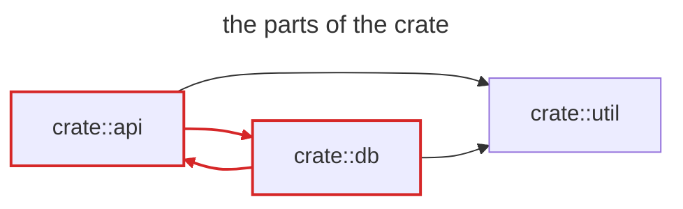
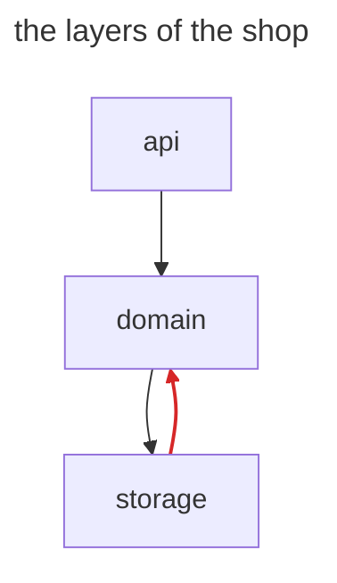

# refpact for Rust

[Back to the README](../README.md)

This document has the full rule vocabulary for Rust, what the analysis counts as a use, and
the limits of the analysis.

## Quick start

Add the crate as a dev-dependency:

```sh
cargo add --dev refpact
```

That is the whole setup. The crate runs `cargo` and `rustc`, and `rust-analyzer` when you load
with [`resolving_members()`](#method-calls-and-fields). It does not use Node or npm.

Write rules in a test file, for example `tests/architecture.rs`:

```rust
use std::sync::LazyLock;

use refpact::{all_except, any_of, rule, unsafe_code, Crate};

static APP: LazyLock<Crate> = LazyLock::new(|| Crate::load(env!("CARGO_MANIFEST_DIR")).unwrap());

#[test]
fn frontend_passes_do_not_use_the_back_ends() {
    rule("frontend passes do not use the back ends")
        .modules(any_of(["crate::frontend::passes::**"]))
        .must_not_use(any_of(["crate::codegen", "crate::interpreter", "crate::cache"]))
        .check(&APP);
}

#[test]
fn files_are_opened_in_the_platform_layer_only() {
    rule("files are opened in the platform layer only")
        .modules(all_except(["crate::platform::**"]))
        .must_not_use(any_of(["std::fs", "std::env"]))
        .except_in_test_code()
        .check(&APP);
}

#[test]
fn no_unsafe_code_in_the_interpreter() {
    rule("no unsafe code in the interpreter")
        .modules(any_of(["crate::interpreter::**"]))
        .must_not_contain(unsafe_code())
        .check(&APP);
}
```

A violation fails the test with one line for each place:

```text
rule `files are opened in the platform layer only` is violated in 2 place(s):
  src/cache.rs:3:5: [files are opened in the platform layer only] crate::cache uses std::fs (use)
  src/cache.rs:17:9: [files are opened in the platform layer only] crate::cache uses std::fs::write (expr, through the `use` at line 3)
```

A test build has no optimization, so refpact runs at about half of its speed. A few lines in
`Cargo.toml` change that: see [speed of the tests](#speed-of-the-tests).

Five example rules, as a project writes them, are in
[`crates/refpact/tests/five_rules.rs`](../crates/refpact/tests/five_rules.rs).

## Rule vocabulary

A rule is a plain value. There is no configuration file.

```text
rule(name)
    .modules(SELECTION)                which modules the rule constrains
    .must_not_use(TARGETS)             no reference to these paths, in any form
  | .must_only_use(TARGETS)            every reference leads to these paths
  | .must_not_contain(MARKERS)         no unsafe code of these kinds
  | .must_be_acyclic()                 the modules form no cycle
  | .must_be_acyclic_between(SLICES)   the slices of modules form no cycle
  | .must_be_independent_between(SLICES)   no slice uses another slice
  | .must_be_used()                    something outside each module uses it
  | .must_not_reach(TARGETS)           no chain of references leads to these paths
  | .must_be_reachable_from(ROOTS)     a chain of references leads from the roots to each module
  | .must_only_be_used_by(USERS)       only these modules may refer to the modules
  | .must_not_exceed_lines(LINES)      no module has more lines than this
    .except_in_test_code()             optional filters
    .ignoring_candidates()
    .only_kinds([..]) | .ignoring_kinds([..])
    .ignoring_use(FROM, TO)            one known use that the rule allows
    .because(REASON)                   why the rule exists, printed with its violations
    .check(&code)                      panics with a report
  | .verify(&code)                     Result<(), Failure>
  | .evaluate(&code)                   Result<Vec<Violation>, Vec<RuleError>>
  | .check_with_baseline(&code, &baseline)     as check, with accepted violations

rules(name, [rule, ..]).check(&code)   checks all, reports every rule that fails
onion_architecture(name)               the domain at the centre, adapters outside

rule(name)
    .items(SELECTION)                  the items that these modules declare
    .named([..]) .of_kind([..]) .with_visibility([..]) .exported()
    .implementing(TRAITS) .deriving(DERIVES) .with_attribute(ATTRIBUTES)
    .returning(TYPES) .taking(TYPES) .of_type(TYPES)
    .must_not_exist()                  optional filters, then one demand
  | .must_reside_in(MODULES)
  | .must_be_named([..])
  | .must_implement(TRAITS) | .must_derive(DERIVES) | .must_have_attribute(ATTRIBUTES)
  | .must_be_exported()
  | .must_not_use(TARGETS)             the code of the items: no reference to these paths
  | .must_only_use(TARGETS)            the code of the items: every reference leads to these
  | .must_not_exceed_lines(LINES)      no item has more lines than this
```

`code` is a `Crate` or a `Workspace`. See [allow-lists](#allow-lists), [cycles](#cycles),
[layers](#layers), [only some modules may use a module](#only-some-modules-may-use-a-module),
[rules about items](#rules-about-items), [fields and methods](#fields-and-methods),
[what the code of an item uses](#what-the-code-of-an-item-uses),
[several rules at once](#several-rules-at-once),
[the onion architecture](#the-onion-architecture), [conventions of the code](#conventions-of-the-code),
[why a rule exists](#why-a-rule-exists),
[independent slices](#independent-slices),
[unused and unreachable modules](#unused-and-unreachable-modules), [chains](#chains),
[lengths](#lengths), [method calls and fields](#method-calls-and-fields),
[workspaces](#workspaces) and [baselines](#baselines).

| Selection of modules | Meaning |
|---|---|
| `any_of([a, b])` | modules that match `a` or `b` |
| `all()` | all modules |
| `all_except([a, b])` | all modules that match neither `a` nor `b` |
| `any_of([a]).except([b])` | modules that match `a` and do not match `b` |

| Targets | Meaning |
|---|---|
| `any_of([a, b])` | a reference to `a` or to `b` |
| `any_of([a]).and_unverified([c])`, `unverified([c])` | as above; `c` is not checked for existence |

| Markers | Meaning |
|---|---|
| `unsafe_code()` | all of the following |
| `Marker::UnsafeFn`, `UnsafeBlock`, `UnsafeImpl`, `UnsafeTrait`, `UnsafeExtern`, `UnsafeAttr` | `unsafe fn`, `unsafe { }`, `unsafe impl`, `unsafe trait`, `unsafe extern`, `#[unsafe(..)]` |

### Patterns

A pattern is a path with `::` between segments.

- `*` matches one segment, or a part of one segment: `crate::*`, `crate::frontend::*_pass`.
- `**` matches zero or more segments: `crate::interpreter::**` is `crate::interpreter` and all
  modules below it.

**Module patterns match exactly.** `crate::interpreter` is one module. It does not select
`crate::interpreter::heap`. Write `crate::interpreter::**` for the subtree.

**Targets cover what is inside them.** `std::fs` covers `std::fs::read`, and `rand::rngs::OsRng`
covers `rand::rngs::OsRng::default`. A reference to an item is a reference to the module that
contains the item. So `crate::codegen` and `crate::codegen::**` are the same target.

A module may always use itself. A module is "itself" for its own items only, not for its
child modules.

### A rule that cannot fail is an error

Each of these makes the test fail with an error, not a pass:

- A module pattern that matches no module. This applies to every pattern of a list by itself,
  and to every exception.
- Exceptions that leave no module.
- A target inside the analysed crate (it starts with `crate`) that names no module and no
  item. This also applies to every target of a list by itself.
- An empty list, an empty rule name, a pattern with an empty segment.

A longer list never makes a rule weaker: lists are unions, and there is no implicit
intersection. `must_not_use(any_of([a, b]))` reports everything that
`must_not_use(any_of([a]))` reports.

Targets in other crates (`std::fs`, `rand::thread_rng`) cannot be checked for existence,
because the library does not read crates outside the [workspace](#workspaces). An item that a
macro makes from its arguments is known with [`resolving_members()`](#method-calls-and-fields). For another name inside your
crate that the source does not show, such as an item that a derive generates, use
`unverified([..])`.

### Allow-lists

`must_only_use` turns a rule around: it names what the modules may use, and every other
reference is a violation.

```rust
rule("the domain uses only itself and the standard library")
    .modules(any_of(["crate::domain::**"]))
    .must_only_use(any_of(["std", "core", "alloc", "crate::domain"]))
    .check(&app);
```

- The list must name everything, also `std` and `core`. Names of the prelude count:
  `Option` is `std::option::Option`, and `vec!` is `std::vec!`.
- A module may always use its own items. A child module is another module: a `tests` module
  that uses its parent needs the parent in the list, or `except_in_test_code()`.
- A reference is allowed when the path in the code is allowed, or when the definition behind
  a re-export is. With `pub use crate::codegen::Generator` in `crate::facade`, a use of
  `crate::facade::Generator` passes a list that has `crate::facade`, and it passes a list
  that has `crate::codegen`.
- The checks of [a rule that cannot fail](#a-rule-that-cannot-fail-is-an-error) are the same
  as for `must_not_use`. An allowed target inside the crate that names nothing is an error.

### Cycles

```rust
rule("the parts of the crate form no cycle")
    .modules(all_except(["crate"]))
    .must_be_acyclic_between(any_of(["crate::*"]))
    .except_in_test_code()
    .check(&app);
```

- `must_be_acyclic()` takes each selected module as a node. In Rust, a module and its
  children often use each other, so this form fits a flat set of modules.
- `must_be_acyclic_between(any_of([..]))` takes slices as nodes. The slice of a module is the
  shortest start of its path that matches one of the patterns. With `crate::*`,
  `crate::frontend::passes::inline` is in the slice `crate::frontend`. References inside a
  slice do not count. A selected module without a slice is left out; the crate root has none
  with `crate::*`.
- A reference from a selected module to an item of another selected module is an edge. The
  filters apply: `except_in_test_code()` removes the edges that only tests make.
- A reference through a re-export gives two edges: one to the module that re-exports, and one
  to the module of the definition. With `pub use members::Member` in the crate root, a use of
  `crate::Member` is an edge to `crate::members`, also when the rule does not select the root.
- A *tangle* is a group of nodes that all reach each other. Each tangle gives one violation,
  which shows one shortest cycle through its first node, the file and line of every step,
  and the size of the tangle. One tangle can hold many cycles. When the shown cycle is
  broken, the next run shows another one if the tangle remains.
- A rule with fewer than two nodes cannot fail, and is an error. So is a slice pattern that
  matches nothing.

```text
rule `no cycles` is violated in 1 place(s):
  src/rings/alpha.rs:1:18: [no cycles] crate::rings::alpha is in a cycle of 3 (the tangle has 3 in all):
      crate::rings::alpha -> crate::rings::beta  at src/rings/alpha.rs:1:18, uses crate::rings::beta::Beta (use)
      crate::rings::beta -> crate::rings::gamma  at src/rings/beta.rs:1:32, uses crate::rings::gamma::Gamma (type)
      crate::rings::gamma -> crate::rings::alpha  at src/rings/gamma.rs:4:29, uses crate::rings::alpha::Alpha (type)
```

### Layers

`layers` is a short form. It makes one `must_not_use` rule for each layer except the top
one: the layer must not use a layer above it.

```rust
layers("the layers of the shop")
    .layer("api", any_of(["crate::api::**"]))          // the top
    .layer("domain", any_of(["crate::domain::**"]))
    .layer("storage", any_of(["crate::storage::**"]))  // the bottom
    .check(&app);
```

- A layer may use every layer below it, not only the next one.
- The rule of a layer has the name of the layers and the name of the layer:
  `the layers of the shop: domain does not use the layers above it`. A baseline uses these
  names.
- `check` reports all layers that fail, not only the first.
- The layers have every [filter](#filters) of a rule, such as `except_in_test_code()`,
  `ignoring_kinds(..)`, `ignoring_use(..)`, `because(..)` and `as_warning()`. A filter applies
  to all layers and to their diagram. `rules()` gives the rules as values.
- Fewer than two layers cannot fail, and are an error. A layer whose pattern matches nothing
  is an error, as in every rule.
- A module that is in no layer is not checked, and may be used by all layers, unless
  `every_module_in_a_layer` demands otherwise.

More options narrow down what a layer may use:

```rust
layers("the layers of the shop")
    .layer("api", any_of(["crate::api::**"]))
    .layer("jobs", any_of(["crate::jobs::**"]))
    .layer("domain", any_of(["crate::domain::**"]))
    .layer("storage", any_of(["crate::storage::**"]))
    .may_only_use("jobs", ["domain"])                 // not the storage
    .may_only_be_used_by("storage", ["domain"])       // not the api, not the jobs
    .every_module_in_a_layer(all_except(["crate"]))
    .check(&app);
```

| Option | Meaning |
|---|---|
| `strict()` | A layer may use only the layer right below it. |
| `may_only_use(layer, [layers])` | The layer may use only these layers. They must be below it. |
| `may_only_be_used_by(layer, [layers])` | Only these layers may use the layer. They must be above it. |
| `every_module_in_a_layer(SELECTION)` | Each selected module must be in a layer. A new module cannot stay out of the architecture unseen. |

- A layer that these options restrict has a rule with another name: `the layers of the
  shop: jobs uses only the layers it may use`. The rule of `every_module_in_a_layer` is
  `the layers of the shop: every module is in a layer`, and it reports each module that is
  in no layer. A layer pattern matches exactly, so `crate::jobs` does not hold
  `crate::jobs::mail`. The report says so when a module is below a layer; write
  `crate::jobs::**`.
- An option can only narrow the order. A layer named in `may_only_use` that is above the
  layer, or a name that is not a layer, is an error. So is a second list for one layer.
- `may_only_be_used_by` is about the layers. To keep every other module away as well, use
  [`must_only_be_used_by`](#only-some-modules-may-use-a-module).

### Only some modules may use a module

`must_only_be_used_by` turns `must_not_use` around: it names the modules that may use the
modules of the rule. Every other module that refers to them breaks the rule.

```rust
rule("only the domain uses the storage")
    .modules(any_of(["crate::storage::**"]))
    .must_only_be_used_by(any_of(["crate::domain::**"]))
    .check(&app);
```

- The modules of the rule may use each other. Users match modules exactly, as the modules of
  a rule do: `crate::storage` without `::**` does not protect `crate::storage::disk`.
- A re-export does not hide a use. A module that uses `crate::facade::Disk`, where the facade
  re-exports `crate::storage::Disk`, breaks the rule unless it is a user. The facade itself
  is a user only when the list names it.
- A user pattern that matches no module is an error.

### Rules about items

The other rules are about what code uses. Rules about items are about what code declares:
where an item is, what it is named, and what it implements, derives or has as an attribute.

```rust
rule("repositories live in the storage")
    .items(all())
    .implementing(any_of(["crate::domain::Repository"]))
    .must_reside_in(any_of(["crate::storage::**"]))
    .check(&app);

rule("nothing in internal is public")
    .items(any_of(["crate::internal::**"]))
    .with_visibility([Visibility::Pub])
    .must_not_exist()
    .check(&app);

rule("internal items are not exported")
    .items(any_of(["crate::internal::**"]))
    .exported()
    .must_not_exist()
    .check(&app);

rule("only the api derives Serialize")
    .items(all_except(["crate::api::**"]))
    .deriving(any_of(["serde::Serialize"]))
    .must_not_exist()
    .check(&app);

rule("repositories are named so")
    .items(all())
    .implementing(any_of(["crate::domain::Repository"]))
    .must_be_named(["*Repository"])
    .check(&app);
```

| Filter | Selects |
|---|---|
| `named(["*Repository"])` | items whose name a glob matches; `*` matches any run of characters |
| `of_kind([ItemKind::Struct])` | `Fn`, `Struct`, `Enum`, `Union`, `Trait`, `Type`, `Const`, `Static`, `Macro`, and the members `Field` and `Method` |
| `with_visibility([Visibility::Pub])` | `Pub`, `PubCrate`, `PubRestricted` (`pub(super)`, `pub(in ..)`), `Private` |
| `exported()` | items that other crates can name: `pub`, and reached from the crate root through `pub mod` and `pub use` |
| `implementing(TRAITS)` | types with an `impl Trait for Type` in the crate, or in another member of the workspace |
| `deriving(DERIVES)` | items with `#[derive(..)]` of one of these: `std::fmt::Debug`, `serde::Serialize` |
| `with_attribute(ATTRIBUTES)` | built-in attributes by name (`non_exhaustive`), others by path (`tokio::main`) |
| `returning(TYPES)` | functions and methods with one of these paths in the return type |
| `taking(TYPES)` | functions and methods with one of these paths in the type of a parameter |
| `of_type(TYPES)` | fields with one of these paths in their type |
| `with_modifier([Modifier::Async])` | items with one of these modifiers; see below |

- Each filter narrows the selection. The values of one filter form a union, and calling a
  filter again adds values. A name or a trait, derive or attribute pattern that matches
  nothing in the crate is an error, as in every rule.
- The demands are `must_not_exist`, `must_reside_in(MODULES)`, `must_be_named([..])`,
  `must_implement`, `must_derive`, `must_have_attribute`, `must_have_modifier` and
  `must_be_exported`. Modules
  match exactly. `must_not_use` and `must_only_use` are about the code of the items, see
  [what the code of an item uses](#what-the-code-of-an-item-uses).
- A selection that is empty passes: no repository yet breaks no rule about repositories.
- A trait counts through a re-export: `impl Repo for X`, where `Repo` is a re-export of
  `crate::domain::Repository`, implements both.
- `except_in_test_code()` leaves out items in `#[cfg(test)]` code.
- The report names the item: `src/storage.rs:6:19: [..] crate::storage declares struct
  crate::storage::Cache`. A baseline key is `item crate::storage::Cache`.

What is an item:

- The items of a module: functions, structs, enums, unions, traits, type aliases, constants,
  statics and `macro_rules!` macros. Not the items in function bodies, the associated types
  and constants of an `impl` or a trait, or the variants of an enum.
- The members of an item: the fields of a struct or a union, and the methods. See
  [fields and methods](#fields-and-methods). A selection holds them only when `of_kind`
  names them.
- The visibility is as written: a `pub` item in a private module is `pub`. Use `exported()`
  for what other crates can name. `with_visibility([Visibility::Pub]).must_be_exported()`
  finds `pub` items that no other crate can reach.
- An item is exported when a chain of `pub mod`, `pub use` and `pub use` globs leads to it
  from the crate root. A binary crate is treated as a library would be.
- A `macro_rules!` macro with `#[macro_export]` is `pub`, and its path is that of the crate
  root: `crate::shout`.
- There is no `assignable_to`, as TypeScript has `assignableTo`: a Rust type has an `impl`
  of its own for each trait, also for the supertraits, so `implementing` finds each trait
  directly and there is no chain to follow.
- `implementing` sees `impl Trait for Type` where `Type` is a path to an item of the same
  crate, or a type of another member of a workspace. A blanket `impl<T: Bound> Trait for T`
  names no item, so it is not seen.

The modifiers of an item:

| Modifier | The item |
|---|---|
| `Async` | an `async fn` or an `async` method |
| `Const` | a `const fn` or a `const` method; not a `const` item, which is of the kind `Const` |
| `Unsafe` | an `unsafe fn`, an `unsafe` method, or an `unsafe trait` |
| `Extern` | a function with an ABI: `extern "C" fn` |
| `Mut` | a `static mut` |
| `Documented` | has a doc comment (`///`, `/** */`) or a `#[doc = ".."]`, also `#[doc = include_str!(..)]` |
| `Hidden` | has `#[doc(hidden)]` |

```rust
rule("the public API is documented")
    .items(all())
    .of_kind([ItemKind::Fn, ItemKind::Struct, ItemKind::Method])
    .with_visibility([Visibility::Pub])
    .must_have_modifier([Modifier::Documented, Modifier::Hidden])
    .check(&app);

rule("no async in the domain")
    .items(any_of(["crate::domain::**"]))
    .of_kind([ItemKind::Fn, ItemKind::Method])
    .with_modifier([Modifier::Async])
    .must_not_exist()
    .check(&app);
```

- `//!` in a file documents its module, and a module is no item, so it has no modifier.
- A doc comment that a macro writes, or a `#[cfg_attr(.., doc = "..")]`, is not seen.

### Fields and methods

The fields and the methods of the items are items too, of the kinds `ItemKind::Field` and
`ItemKind::Method`. A selection holds them only when `of_kind` names them, so the rules
above see the items of modules only.

```rust
rule("the domain has no public fields")
    .items(any_of(["crate::domain::**"]))
    .of_kind([ItemKind::Field])
    .with_visibility([Visibility::Pub])
    .must_not_exist()
    .check(&app);

rule("public functions do not return anyhow errors")
    .items(all())
    .of_kind([ItemKind::Fn, ItemKind::Method])
    .with_visibility([Visibility::Pub])
    .returning(any_of(["anyhow::Error"]))
    .must_not_exist()
    .check(&app);
```

- A field is at the path of its type and its name: `crate::domain::Order::id`. A field of a
  tuple struct has its number: `crate::db::Id::0`.
- A method is a function of an inherent `impl`, at the path of the type:
  `crate::domain::Order::new`, also when the `impl` is in another module. A function of a
  trait is a method of the trait, as visible as the trait. The functions of an
  `impl Trait for Type` are no methods: the trait fixes their signature and visibility.
- `returning`, `taking` and `of_type` see every path in the type: `-> Result<Order,
  anyhow::Error>` returns `std::result::Result`, `crate::domain::Order` and `anyhow::Error`.
  The generic parameters of the item, `Self` and the primitive types are no paths. `taking`
  does not see `self`. A pattern covers the paths inside it, as a target does.
- A field and a method can have the same path, as `Order::total` for a field `total` and a
  method `total()`. They are two items of different kinds.

### What the code of an item uses

`must_not_use` and `must_only_use` after `items(..)` are about the references inside the
selected items: their signatures, their bodies, their fields, and the `impl` blocks of a
type with their methods, also in other modules.

```rust
rule("what is sent over the wire knows no database")
    .items(all())
    .deriving(any_of(["serde::Serialize"]))
    .must_not_use(any_of(["crate::db"]))
    .check(&app);

rule("the handlers use only the services")
    .items(any_of(["crate::api"]))
    .named(["*Handler"])
    .must_only_use(any_of(["std", "crate::services"]))
    .check(&app);
```

- A `use` at the top of a module is in no item. The rule sees the paths that the code of
  the item writes, resolved through the `use`: `Pool` after `use crate::db::Pool;` is
  `crate::db::Pool`.
- The code of a type holds its members, so a rule about `Order` also sees the code of
  `Order::save`. The report names the innermost item: `src/db.rs:6:27: [..]
  crate::domain::Order::save uses crate::db::Pool (type)`. A baseline key is
  `crate::domain::Order::save` and `uses type crate::db::Pool`.
- The subjects select the items by the module that declares them. An `impl` of the type in
  another module still belongs to the type.
- `must_only_use` allows every path of the module of the reference, as for modules. In
  `must_not_use`, a path of the own module breaks the rule like any other.
- The filters `except_in_test_code`, `only_kinds`, `ignoring_kinds`, `ignoring_candidates` and
  `ignoring_use` apply.

### Several rules at once

`check` on a rule stops the test at the first rule that fails. `rules` groups rules, and one
check reports every rule of the group that fails, in the order of the rules.

```rust
let mut platform = vec![
    rule("files are opened in the platform layer only")
        .modules(all_except(["crate::platform::**"]))
        .must_not_use(any_of(["std::fs"])),
    rule("the platform layer forms no cycle")
        .modules(any_of(["crate::platform::**"]))
        .must_be_acyclic(),
];
platform.extend(
    layers("the layers of the shop")
        .layer("api", any_of(["crate::api::**"]))
        .layer("domain", any_of(["crate::domain::**"]))
        .rules()
        .unwrap(),
);
rules("the platform rules", platform).check(&app);
```

- `verify`, `check_with_baseline` and `verify_with_baseline` work as on a rule. Each rule
  keeps its own name, also in a baseline.
- One failure is reported as itself; more are `Failure::Several`.
- A group without rules cannot fail, and is an error.
- `layers` is such a group: the rules of its layers.

### The onion architecture

`onion_architecture` is a short form of [layers](#layers) for the onion architecture, also
called the hexagonal architecture or ports and adapters. From the inside out, its parts are
the domain models, the domain services, the application services and the adapters.

```rust
onion_architecture("the shop")
    .domain_models(any_of(["crate::domain::model::**"]))
    .domain_services(any_of(["crate::domain::service::**"]))
    .application_services(any_of(["crate::application::**"]))
    .adapter("web", any_of(["crate::adapter::web::**"]))
    .adapter("database", any_of(["crate::adapter::db::**"]))
    .check(&app);
```

- Each part may use the parts inside it. An adapter may use the application services and
  the domain, but not another adapter.
- Give the parts that the code has; fewer than two are an error, as for layers.
- Each part is a layer, and each adapter a layer of its own, named `adapter <name>`. The
  rules have the names of layers: `the shop: adapter web uses only the layers it may use`.
- The [filters](#filters) and `every_module_in_a_layer(..)` work as for layers.
  `as_layers()` gives the layers, and `rules()` the rules as values.

### Conventions of the code

refpact has no rules of its own for the conventions of code, such as "no `println!`" or
"no `todo!`". Clippy has them for a whole crate (`print_stdout`, `todo`, `exit`), and it is
the better tool for that. A rule of refpact is for a convention that depends on the
module: a macro, a function or a marker that only some modules may use.

```rust
rule("only the command line prints")
    .modules(all_except(["crate::cli::**"]))
    .must_not_use(any_of(["std::print!", "std::println!", "std::eprint!", "std::eprintln!", "std::dbg!"]))
    .except_in_test_code()
    .check(&app);

rule("only the command line ends the process")
    .modules(all_except(["crate::cli::**"]))
    .must_not_use(any_of(["std::process::exit", "std::process::abort"]))
    .check(&app);

rule("unsafe code is in the allocator only")
    .modules(all_except(["crate::alloc::**"]))
    .must_not_contain(unsafe_code())
    .check(&app);
```

- A macro is known by its path, so `println!` and `std::println!` are the same use.
- [`rules`](#several-rules-at-once) checks several such rules as one group.

### Why a rule exists

`because` gives a rule a reason. The report prints it below the heading, so whoever breaks
the rule learns what it protects.

```rust
rule("the domain knows no database")
    .modules(any_of(["crate::domain::**"]))
    .must_not_use(any_of(["crate::db"]))
    .because("the domain runs in tests without a database")
    .check(&app);
```

```text
rule `the domain knows no database` is violated in 1 place(s):
  because the domain runs in tests without a database
  src/domain/order.rs:3:5: [the domain knows no database] crate::domain::order uses crate::db::Pool (use)
```

- `Failure::Violated` has the reason as `reason`.
- `layers(..).because(..)` and `onion_architecture(..).because(..)` give every rule of the
  layers the reason.
- A reason is not part of a baseline key.

### Warnings

`as_warning` makes a rule a warning. Its violations are reported, and the check passes. A
new rule can then go in before the code meets it, without a baseline file.

```rust
rule("new code does not print")
    .modules(all())
    .must_not_use(any_of(["std::println!"]))
    .as_warning()
    .check(&app);
```

```text
warning: rule `new code does not print` is violated in 1 place(s):
  src/cli.rs:9:5: [new code does not print] crate::cli uses std::println! (macro)
```

- `check` and `verify` write the report to stderr. The test harness of Rust shows the output
  of a test that passes only with `cargo test -- --show-output`.
- `evaluate` gives the violations of a warning as of any rule, for a test that wants them.
- A warning that cannot fail as written is still an error: a pattern that matches nothing
  fails the check.
- With a baseline, the violations that the file does not accept are reported, and a stale
  entry still fails.
- In a set of rules, such as `rules(..)`, each warning is reported and only the errors fail.
  Call `as_warning` on each rule that is to be a warning.

### Diagrams

`diagram` draws what a rule sees, as Mermaid or as DOT for Graphviz. The nodes are the
modules of the rule, or its slices when the rule is about slices. An edge is a reference
between two nodes that the filters and the exemptions of the rule let pass. The modules and
the references of a cycle are red.

```rust
let text = rule("the parts of the crate")
    .modules(all())
    .must_be_acyclic_between(any_of(["crate::*"]))
    .diagram(&app, DiagramFormat::Mermaid)
    .unwrap();
```



- A Markdown viewer that knows Mermaid, such as GitHub's, draws the text in a block
  ` ```mermaid `. Graphviz draws the DOT text: `dot -Tsvg architecture.dot`.
- The constraint of the rule is not evaluated, so a rule of any kind draws its modules: a
  rule that the code breaks draws its graph too.
- A rule that cannot fail as written gives `Failure::Invalid`, as `verify` does. A graph of
  one node is no error.

`check_diagram` keeps a diagram that is committed with the code current. The test fails
when the file does not hold the diagram of the rule, so a change of the architecture shows
in the diagram, and in the review of the change:

```rust
rule("the parts of the crate")
    .modules(all())
    .must_be_acyclic_between(any_of(["crate::*"]))
    .check_diagram(&app, concat!(env!("CARGO_MANIFEST_DIR"), "/docs/architecture.md"));
```

```sh
REFPACT_DIAGRAM=update cargo test    # writes each diagram file that is not current
```

- The name of the file gives the format: `.md` is a Markdown file with the Mermaid diagram
  in a block ` ```mermaid `, `.mmd` and `.mermaid` are Mermaid, `.dot` and `.gv` are DOT.
  `DiagramFormat::Markdown` gives the text of the `.md` file from `diagram`.
- The diagram is the whole file. A file that is not there is not current.
- `check_diagram` does not check the constraint of the rule. Call `check` for that.
- `verify_diagram` gives the failure as a value: `Failure::StaleDiagram`, or
  `Failure::Diagram` when the file cannot be read or written or its name gives no format.

`layers(..)` and `onion_architecture(..)` draw the whole architecture in one diagram, from
the top to the bottom. Each layer is a node, and an edge is a use between two layers. A use
that the layers forbid is red:

```rust
let text = layers("the layers of the shop")
    .layer("api", any_of(["crate::api::**"]))
    .layer("domain", any_of(["crate::domain::**"]))
    .layer("storage", any_of(["crate::storage::**"]))
    .diagram(&app, DiagramFormat::Mermaid)
    .unwrap();
```



A module is in the first layer that matches it. A module in no layer is not drawn.
`except_in_test_code()`, `strict()`, `may_only_use` and `may_only_be_used_by` apply to the
diagram as they do to the rules. Layers and an onion architecture have `check_diagram` and
`verify_diagram` too.

### Rules of your own

`must_satisfy` takes a check of your own: a closure that gets the `Scope` of the rule and
returns the violations. The rule does the rest, as for a built-in rule: it selects the
modules, applies `except_in_test_code`, the kind filters and the exemptions, reports the
violations with the reason, and baselines them. The built-in rules are checks of the same
kind, so a check of your own sees what they see.

```rust
rule("a module uses at most ten other modules")
    .modules(all_except(["crate"]))
    .must_satisfy(|scope: &Scope<'_>| -> Vec<Violation> {
        let units = &scope.facts().units;
        scope
            .subjects()
            .filter_map(|unit| {
                let mut used: Vec<usize> = scope
                    .references()
                    .filter(|seen| seen.unit == unit)
                    .flat_map(|seen| scope.owners(&seen).filter_map(|(_, owner)| owner))
                    .filter(|&owner| owner != unit)
                    .collect();
                used.sort_unstable();
                used.dedup();
                (used.len() > 10).then(|| {
                    let message = format!("uses {} modules", used.len());
                    scope.violation_of_unit(unit, Detail::custom_with_key(message, "uses too many modules"))
                })
            })
            .collect()
    })
    .except_in_test_code()
    .check(&app);
```

```text
rule `a module uses at most ten other modules` is violated in 1 place(s):
  src/app.rs: [a module uses at most ten other modules] crate::app uses 12 modules
```

What a `Scope` has:

| Method | Gives |
|---|---|
| `subjects()` | the modules that the rule selects, by number: the position in `facts().units` |
| `references()` | the references that the rule sees, of all modules, in the order of the facts. Each has `position`, `unit`, `fact` and `reference`. |
| `owners(&seen)` | each path of a reference with the module that has it |
| `hit(&seen, patterns)` | the first path of a reference that a pattern covers, outside the own module |
| `markers()`, `declarations()` | the unsafe markers and the items of the selected modules that the rule sees |
| `unit_graph()`, `subject_graph(slices)` | the graph of all modules, and the graph of the selected modules or of their slices. See [graphs](#graphs-in-a-check) |
| `violation_at(fact, detail)`, `violation_of_item(item, detail)`, `violation_of_unit(unit, detail)` | a violation at the place of a fact or of an item, or about a module as a whole |

- `Detail::custom(message)` prints the message after the module. A baseline counts the
  violation by its message, or by the key of `Detail::custom_with_key`. Give a key when the
  message has a number in it, so that the baseline stays when the number changes.
- A check may give any other `Detail`, such as `Detail::Uses`. It is then printed and
  baselined like the violations of the built-in rules.
- A check that reads no references can say so with `NoReferences`. An exemption of its rule
  is then an error, as for `must_not_contain`.

#### A check with arguments

`must_meet` takes a `Check`: a value that reads its own arguments first, through `Setup`.
A pattern that matches nothing is then an error of the rule, as it is for the built-in
rules. The `Checker` that it returns finds the violations.

```rust
/// The modules use the targets in `use` declarations only.
struct OnlyImported(core::Targets);

impl Check for OnlyImported {
    fn prepare<'c>(&'c self, setup: &mut Setup<'_>) -> Box<dyn Checker + 'c> {
        let targets = setup.targets(&self.0);
        Box::new(move |scope: &Scope<'_>| -> Vec<Violation> {
            scope
                .references()
                .filter(|seen| scope.selects(seen.unit) && seen.reference.kind != "use")
                .filter(|seen| scope.hit(seen, &targets).is_some())
                .map(|seen| scope.violation_at(seen.fact, Detail::custom("names the path in full")))
                .collect()
        })
    }
}

let targets = core::Targets {
    any_of: vec![core::split("std::collections", "::")],
    unverified: Vec::new(),
};
rule("collections are imported")
    .modules(all())
    .must_meet(OnlyImported(targets))
    .check(&app);
```

`Setup` checks each kind of argument that the built-in rules have:

| Method | Checks |
|---|---|
| `targets(..)`, `paths(..)` | targets, as `must_not_use` checks them |
| `units(..)` | module patterns, as the users of `must_only_be_used_by` |
| `slices(..)`, `nodes(..)` | slice patterns, and the nodes of a graph: fewer than two cannot form a cycle |
| `markers(..)`, `item_kinds(..)`, `visibilities(..)`, `relation(..)`, `related(..)`, `names(..)` | the values of the rules about markers and items |
| `error(..)`, `has_errors()` | an error of your own, with a code and a role of the [specification](../conformance/SPEC.md) |

A built-in constraint is a `Check` too, so a check of your own can run one and change what
it finds: `core::Constraint::MustNotUse(targets).prepare(setup)` gives its `Checker`.

#### Items in a check

`items(..)` takes a check as well. The filters of the rule select the items, and the check
gets them in an `ItemScope`: `items()` are the selected items, `item_references()` are the
references inside them, and every method of `Scope` is there too.

```rust
rule("a public function has at most five uses")
    .items(all())
    .of_kind([ItemKind::Fn])
    .with_visibility([Visibility::Pub])
    .must_satisfy(|items: &ItemScope<'_>| -> Vec<Violation> {
        items
            .items()
            .filter(|item| {
                let inside = |seen: &Seen<'_>| seen.fact.item.as_ref().is_some_and(|path| path.starts_with(&item.path));
                items.item_references().filter(inside).count() > 5
            })
            .map(|item| items.violation_of_item(item, Detail::custom("has more than five uses")))
            .collect()
    })
    .check(&app);
```

`must_meet` takes an `ItemCheck`, which reads its arguments first as a `Check` does. The
six built-in demands, such as `must_reside_in`, are item checks of this kind.

#### Graphs in a check

A check can search the graphs that the cycle and chain rules search. `unit_graph()` has one
node for each module. `subject_graph(slices)` has one node for each selected module, or for each of
their slices from `Setup::slices`.

| Method of the graph | Gives |
|---|---|
| `edges(node)`, `node(node)`, `fact(node, edge)` | the edges of a node, the path of a node, and the first reference that makes an edge |
| `tangles()` | each group of nodes that reach each other, with its `members` and a shortest `cycle` through the first of them |
| `search(is_end).chain(start)` | a shortest chain of edges from a node to the nearest end |
| `reached_from(is_root)` | the nodes that the roots reach |
| `step(node, edge)` | an edge as a `Step`, for `Detail::Cycle` and `Detail::Reaches` |

```rust
rule("no module is more than three uses away from the errors")
    .modules(all_except(["crate"]))
    .must_satisfy(|scope: &Scope<'_>| -> Vec<Violation> {
        let errors = scope.unit(&core::split("crate::error", "::"));
        let graph = scope.unit_graph();
        let mut search = graph.search(|node| Some(node) == errors);
        scope
            .subjects()
            .filter(|&unit| search.chain(unit).is_some_and(|chain| chain.steps.len() > 3))
            .map(|unit| scope.violation_of_unit(unit, Detail::custom("is far from the errors")))
            .collect()
    })
    .check(&app);
```

#### Metrics in a check

The graph of a check gives the numbers that metrics are made of: how many modules a module
uses, how many modules use it, and its instability, the share of the first among both. A
rule states the limit, and the filters of the rule decide what counts.

```rust
rule("a module that many modules use is stable")
    .modules(all_except(["crate"]))
    .must_satisfy(|scope: &Scope<'_>| -> Vec<Violation> {
        let graph = scope.unit_graph();
        let mut users = vec![0usize; graph.len()];
        for unit in 0..graph.len() {
            for edge in graph.edges(unit) {
                users[edge.to] += 1;
            }
        }
        scope
            .subjects()
            .filter_map(|unit| {
                let (uses, users) = (graph.edges(unit).len(), users[unit]);
                let instability = uses as f64 / (uses + users).max(1) as f64;
                (users > 20 && instability >= 0.5).then(|| {
                    let message = format!("is used by {users} modules and uses {uses}: instability {instability:.2}");
                    scope.violation_of_unit(unit, Detail::custom_with_key(message, "is not stable"))
                })
            })
            .collect()
    })
    .except_in_test_code()
    .check(&app);
```

```text
rule `a module that many modules use is stable` is violated in 1 place(s):
  src/config.rs: [a module that many modules use is stable] crate::config is used by 31 modules and uses 40: instability 0.56
```

For the metrics of larger parts, such as crates or features, take `subject_graph(slices)` with the
slices of `Setup::slices` in a `Check`.

#### Rule sets of your own

`rules(..)`, `layers(..)` and `onion_architecture(..)` are rule sets: several rules that one
check reports together. A type of your own is a rule set when it implements `RuleSet`. It
then has `check`, `verify` and the baseline methods of the built-in sets.

```rust
/// Each part keeps away from the database.
struct NoDatabase(&'static [&'static str]);

impl RuleSet for NoDatabase {
    fn name(&self) -> &str {
        "no part uses the database"
    }

    fn rules(&self) -> Result<Vec<Rule>, Failure> {
        let rule_of = |part: &&str| {
            rule(format!("{part} does not use the database"))
                .modules(any_of([format!("crate::{part}::**")]))
                .must_not_use(any_of(["crate::db"]))
        };
        Ok(self.0.iter().map(rule_of).collect())
    }
}

NoDatabase(&["api", "domain"]).check(&app);
```

### Independent slices

`must_be_independent_between` forbids every reference from one slice to another. Slices are
those of [cycles](#cycles).

```rust
rule("no feature uses another feature")
    .modules(all_except(["crate::features::shared::**"]))
    .must_be_independent_between(any_of(["crate::features::*"]))
    .check(&app);
```

- A module that the rule does not select is in no slice. The slices may use it, and it may
  use the slices. This is how a shared part is left out, as above.
- A module without a slice, such as `crate::main` here, is free in the same way.
- A reference through a re-export counts: a path whose definition is in another slice is a
  violation.
- Fewer than two slices cannot fail, and are an error.

### Unused and unreachable modules

```rust
rule("every module is used")
    .modules(all_except(["crate", "**::tests"]))
    .must_be_used()
    .check(&app);

rule("every module is reachable from the crate root")
    .modules(all_except(["**::tests"]))
    .must_be_reachable_from(any_of(["crate"]))
    .check(&app);
```

- **`must_be_used`** reports a module when no code outside it, and outside the modules
  below it, refers to it or to a module below it. So `crate::api` is used when something
  uses `crate::api::http`, and a module that only its own children use is not used.
- **`must_be_reachable_from`** follows the references from the roots. It also finds a group
  of modules that use each other and that nothing else uses, which `must_be_used` does not.
  A module above a reached module counts as reachable.
- A `mod` declaration is not a use. The crate root is never used, and a test module never
  is: leave them out, as above.
- The report has the file of the module and no line.
- The filters apply to the uses: with `except_in_test_code()`, a module that only tests use
  is reported.
- A rule that selects only roots cannot fail, and is an error.

A module is used only through paths that the analysis sees. A module that holds only trait
implementations, or that is used only by code that a macro produces, is reported. Leave it
out by name, or accept it in a [baseline](#baselines).

### Chains

`must_not_use` looks at the references of a module. `must_not_reach` also follows them: the
module must not use the target, and must not use a module that does, at any distance.

```rust
rule("the api does not reach the file system")
    .modules(any_of(["crate::api::**"]))
    .must_not_reach(any_of(["std::fs"]))
    .check(&app);
```

```text
rule `the api does not reach the file system` is violated in 1 place(s):
  src/api/http.rs:1:27: [the api does not reach the file system] crate::api::http reaches std::fs::read in 3 step(s):
      crate::api::http -> crate::domain::order  at src/api/http.rs:1:27, uses crate::domain::order::Order (use)
      crate::domain::order -> crate::storage::disk  at src/domain/order.rs:1:21, uses crate::storage::disk (use)
      crate::storage::disk uses std::fs::read  at src/storage/disk.rs:2:13 (expr)
```

- Each selected module gives at most one violation, with the shortest chain.
- The chain goes through all modules of the crate or workspace, selected or not.
- A step is a reference to an item of another module. The rule does not know which function
  calls which: a module that uses one item of `crate::storage::disk` reaches everything that
  `disk` uses.
- The filters apply to every step and to the use at the end.
- The key in a baseline is the module and the target at the end. It does not change when
  the chain takes another way.

### Lengths

`must_not_exceed_lines` puts a limit on the lines of a module, or of an item.

```rust
rule("no module is longer than 500 lines")
    .modules(all_except(["**::tests"]))
    .must_not_exceed_lines(500)
    .check(&app);

rule("no function is longer than 60 lines")
    .items(all())
    .of_kind([ItemKind::Fn, ItemKind::Method])
    .must_not_exceed_lines(60)
    .except_in_test_code()
    .check(&app);
```

```text
rule `no function is longer than 60 lines` is violated in 1 place(s):
  src/api.rs:14:8: [no function is longer than 60 lines] crate::api declares fn crate::api::serve, which has 74 lines, and the limit is 60
```

- **The lines of a module** are all lines of its file: blank lines, comments, and the inline
  modules of the file. The lines of an inline module are those of its declaration, from
  `mod` to the closing brace. The files of the modules below a module do not count. When a
  module has more than one file under `cfg`, the lines add up.
- **The lines of an item** run from the line of its name to the line of its last token. The
  attributes and the comments above the name do not count. A field ends at its comma; the
  last field of a list without a comma ends where the list closes.
- A module or an item with exactly the limit passes.
- Without `of_kind`, a rule about items measures the items of modules, and not fields or
  methods. Name `ItemKind::Method` to measure methods.
- A [baseline](#baselines) counts a long module or a long item by its name, not by its
  lines. An accepted function stays accepted when it grows.
- The functions of an `impl Trait for Type` are no items, so the rule does not measure them.

### Method calls and fields

The syntax does not say what `file.read_to_end(..)` calls: that depends on the type of
`file`. With `resolving_members()`, a load asks rust-analyzer, and each method call and each
field access is a reference like the others.

```rust
let app = Crate::options(env!("CARGO_MANIFEST_DIR"))
    .resolving_members()
    .load()
    .unwrap();

rule("only the storage reads files")
    .modules(all_except(["crate::storage::**"]))
    .must_not_use(any_of(["std::fs"]))
    .check(&app);

rule("the api does not change the total of an order")
    .modules(any_of(["crate::api::**"]))
    .must_not_use(any_of(["crate::domain::Order::set_total"]))
    .only_kinds([Kind::MethodCall])
    .check(&app);
```

```text
src/cache.rs:9:14: [only the storage reads files] crate::cache uses std::fs::File::read_to_end (method-call, of the trait `Read`)
```

A workspace load does the same for all members, with one run of rust-analyzer.

- **It needs rust-analyzer:** `rustup component add rust-analyzer`. The load runs
  `rust-analyzer scip` on the directory and reads the index that it writes. Without the
  program, the load is an error that says so, so a rule does not pass on one machine and
  fail on another.
- **It is not the default.** Without the option, a load reads the syntax only. Method calls
  and field accesses are then no references, and a rule that names their kinds is an error.
  `Crate::from_memory` reads the syntax only, because rust-analyzer reads files on disk.
- **The first load takes seconds, not milliseconds.** On the workspace of refpact, 21,000
  lines, rust-analyzer needs about 7 seconds; a load of the syntax takes 0.2 seconds.
- **The index is kept** in the `target` directory of the code, in `refpact-index`
  (in `CARGO_TARGET_DIR` when that is set), one file for each directory that was loaded. It
  is not kept in a directory that other users of the machine can write to: a rule is checked
  against what the index says. The next load reads it and is as fast as a load of
  the syntax. The index is made again when the text of a source file, of a
  `Cargo.toml` of the code or of `Cargo.lock` changes, and when the version of rust-analyzer
  changes. A change to a dependency that is given by a path outside the code does not make
  it again: delete the directory `refpact-index` then.
- **The code must be a package that Cargo can read,** with its dependencies. rust-analyzer
  writes to the `target` directory of the package.
- **Two kinds are added:** `Kind::MethodCall` and `Kind::Field`. Every rule about uses sees
  them: `must_not_use`, the cycles, the layers, `must_be_used`, the rules about the uses of
  items, and your own checks. A rule that names one of the kinds for code that was loaded
  without the option is an error.
- **`Self::name` is resolved too,** with the kind of its place, such as `expr`.
- **A method of your own code is at the path of its type,** as its item is:
  `crate::domain::Order::total`, also when the `impl` is in another module or another
  member of the workspace. A field is at `crate::domain::Order::id`.
- **A call of a trait method** through an `impl Trait for Type` is a use of
  `Type::method`, and also of `Trait::method`. A call through a bound (`T: Trait`) or
  through `dyn Trait` is a use of `Trait::method`.
- **`following_implementations()` follows a trait call into the code that implements it:**
  `Crate::options(dir).following_implementations().load()`. It turns on
  `resolving_members()`. A call of `Store::save` through
  a bound or through `dyn Store` is then also a **candidate** use of each `save` of an
  `impl Store for ..` of the crate or the workspace, with the note
  ``may be called through `crate::Store::save` ``. A rule about what code can reach
  (`must_not_reach`) then follows the call. It is not the default: with it, the code that
  calls a trait uses the modules that implement the trait, which is what a trait is there
  to avoid. `ignoring_candidates()` leaves these uses out of a rule.
- **A function that is kept in a variable is used where it is taken:** `let read =
  std::fs::read;` is a use of `std::fs::read` in the function and the module that has the
  `let`. The later call `read(path)` is in the same function and adds nothing. A closure or
  a `dyn Fn` that another module passes in is not followed to the code that it runs.
- **A method of another crate is at the path of its definition,** which can go through
  modules that the crate does not export: `HashMap::insert` is
  `std::collections::hash::map::HashMap::insert`, not `std::collections::HashMap::insert`.
  For such a method, name the crate or a module (`std::collections::**`), or the path that
  the report shows. Its trait is in the report by name only.
- **`core` and `alloc` are also `std`:** `Vec::len` is `alloc::vec::Vec::len`, and a target
  `std::vec::Vec::len` or `std::vec` matches it.
- **Operators are no calls.** `a + b` is not a use of `Add::add`.
- **Calls in the arguments of any macro are seen.** rust-analyzer expands the macro, so
  `traced!(file.read_to_end(&mut bytes))` is a use of `std::fs::File::read_to_end`, as
  `println!("{}", order.total())` is. A `.name` in the tokens of a macro that the expansion
  does not use as code gives no reference.
- **The names that a macro makes from its arguments are known paths.** After
  `entity!(Order)`, which defines `pub struct Order`, a rule can name `crate::Order` without
  `unverified`. Such an item is no declaration: the rules about items do not see it, because
  the index does not say its kind or its visibility.
- **What a macro produces from its own text is still not seen:** the body of a
  `macro_rules!` macro (its paths are scanned as tokens, see [macros](#macros)), the names it
  writes itself, and the code of a derive or of another procedural macro.
- **A method of a type without a name** has no path: `&T`, slices, tuples and arrays. Such a
  call gives no reference.
- The format of the index is the own format of rust-analyzer. A new toolchain can change it;
  the tests of refpact run it, so such a change shows there.

### Workspaces

`Workspace::load` reads all crates of a Cargo workspace into one set of facts. A module is
then named by its crate, `shop_domain::order`, and not by `crate`. Every rule form works on a
workspace as on a crate.

```rust
let shop = Workspace::load(concat!(env!("CARGO_MANIFEST_DIR"), "/../..")).unwrap();

rule("the domain does not use storage")
    .modules(any_of(["shop_domain::**"]))
    .must_not_use(any_of(["shop_storage"]))
    .check(&shop);

rule("the crates form no cycle")
    .modules(all())
    .must_be_acyclic_between(any_of(["*"]))     // a slice is a crate
    .check(&shop);
```

- The members are those that Cargo names (`cargo metadata --no-deps`, which needs no
  network and no lock file): the packages of `members` without those of `exclude`, a root
  package, and each package of the directory that a member depends on by a path.
  `Workspace::options(dir).members([..])` loads only the members in some directories.
- The name of a crate and its root file are those of the library target that Cargo names:
  the `name` and the `path` of `[lib]`, or the package name with `_` for `-` and
  `src/lib.rs`. A package without a library is read from its program.
- A dependency that a manifest renames (`store = { package = "shop-storage" }`) is known
  under both names: `store::Db` is also a use of `shop_storage::Db`.
- A path into another member is followed through the re-exports of that member. A use of
  `shop_domain::Order` is also a use of `shop_domain::order::Order`.
- A target in another member is checked for existence, like a target in the crate.
- Files in reports are relative to the workspace.

Limits:

- The directory must be the directory of the workspace, and each member must be below it.
- Only the library target of a package is read, or its program when there is no library.
- The code under every `cfg` is checked, as in a single crate. See
  [Code under `cfg`](#code-under-cfg).

### Dependencies of the manifest

The code shows which crates a module uses. `Cargo.toml` shows which packages a crate is built
with, also those that no code names. `reading_dependencies()` makes each dependency a
reference from the root module of the crate to the crate of the package, at its line in the
manifest. It works on a `Crate` and on a `Workspace`.

```rust
let shop = Workspace::options(concat!(env!("CARGO_MANIFEST_DIR"), "/../.."))
    .reading_dependencies()
    .load()
    .unwrap();

rule("the domain is built without a database")
    .modules(any_of(["shop_domain"]))
    .must_not_use(any_of(["sqlx", "shop_storage"]))
    .only_kinds([Kind::Dependency, Kind::TransitiveDependency])
    .check(&shop);
```

```text
rule `the domain is built without a database` is violated in 1 place(s):
  domain/Cargo.toml:9:1: [..] shop_domain uses sqlx (transitive-dependency, through `shop_events`)
```

| Kind | What it is |
|---|---|
| `dependency` | A dependency of `[dependencies]`. |
| `dev-dependency` | A dependency of `[dev-dependencies]`. It has the tag of test code. |
| `build-dependency` | A dependency of `[build-dependencies]`. |
| `transitive-dependency` | A package that a dependency needs, and that the manifest does not name for that build. It is at the line of that dependency, and its note names the packages on the way. |

- The path is the name that the code writes: `rand-core` is `rand_core`. A dependency that the
  manifest renames (`package = ".."`) is found under both names.
- The module of these references is the root module: `crate`, or the name of the member in
  a workspace. A rule for `shop_domain::**` covers it.
- A dependency of one member on another is a use of that member. So `layers` and the rules
  about cycles also see a dependency that no code uses yet.
- `except_in_test_code()` leaves out the dependencies for the tests, and the packages that
  only those need.
- A dependency of `[target.'cfg(windows)'.dependencies]` is under the condition `windows`,
  as [code under `cfg`](#code-under-cfg) is: `except_under_cfg("windows")` leaves it out, and
  a load for another `target` does not have it. So is a package that only such a dependency
  needs.
- A package that is needed on two ways is one reference for each way, unless one way is
  there whenever the other is. A package that one dependency needs on Windows and another on
  Unix is two references, one under each condition; `except_under_cfg("windows")` leaves the
  other.
- A package that a dependency needs for its build script counts. What the tests of another
  package need does not.
- The packages are those of a build with all features. With `features([..])`, they are those
  of a build with these features and no default features: an optional dependency is there
  only when a feature turns it on. Cargo then checks the names, and a feature that no
  manifest declares is an error.

#### Versions and licences

Each of these references has what Cargo says of its package, as properties. No built-in rule
reads them: a [rule of your own](#rules-of-your-own) does, with
`seen.reference.property(name)`. The rule names the properties that its check reads, with
`reading_properties([..])`. A name that the load does not have is then an error, as a kind
that it does not have is: a check does not pass because it reads `licence` for `license`,
or because the load does not read the dependencies.

| Property | What it is |
|---|---|
| `PROPERTY_VERSION` (`version`) | The version of the package: `1.4.0`. Two versions of one package are two packages, and two references. |
| `PROPERTY_LICENSE` (`license`) | The licence, as the manifest of the package writes it: `MIT OR Apache-2.0`. A package whose manifest names no licence has no such property. |
| `PROPERTY_SOURCE` (`source`) | Where Cargo takes the package from, as Cargo writes it: `registry+https://github.com/rust-lang/crates.io-index`, or `git+` and the address of a repository. A package of a local path has no such property. |

```rust
let shop = Workspace::options(concat!(env!("CARGO_MANIFEST_DIR"), "/../.."))
    .reading_dependencies()
    .load()
    .unwrap();

rule("every package has a licence that we accept")
    .modules(all())
    .must_satisfy(|scope: &Scope<'_>| -> Vec<Violation> {
        let accepted = ["MIT", "Apache-2.0", "MIT OR Apache-2.0"];
        scope
            .references()
            .filter(|seen| scope.selects(seen.unit))
            // A member of the workspace is no package of others.
            .filter(|seen| scope.owners(seen).all(|(_, owner)| owner.is_none()))
            .filter_map(|seen| {
                let licence = seen.reference.property(PROPERTY_LICENSE);
                let name = seen.reference.target.join("::");
                (!licence.is_some_and(|name| accepted.contains(&name))).then(|| {
                    let licence = licence.map_or("no licence".to_owned(), |name| format!("the licence {name}"));
                    scope.violation_at(seen.fact, Detail::custom(format!("is built with {name}, which has {licence}")))
                })
            })
            .collect()
    })
    .reading_properties([PROPERTY_LICENSE])
    .only_kinds([Kind::Dependency, Kind::TransitiveDependency])
    .check(&shop);
```

```text
rule `every package has a licence that we accept` is violated in 1 place(s):
  api/Cargo.toml:12:1: [..] shop_api is built with engine, which has the licence GPL-3.0-only (through `facade`)
```

- The licence is text, and the check compares it as text. An expression such as
  `MIT OR Apache-2.0` is one value: name each expression that you accept, or split it in the
  check.
- The check decides what a package without a licence is. Here it is a violation.
- The filters of the rule say which packages count: the kinds above leave out what only the
  tests and the build scripts need.

A build with two versions of one package is found from the versions of all references:

```rust
use std::collections::{BTreeSet, HashMap};

let shop = Workspace::options(concat!(env!("CARGO_MANIFEST_DIR"), "/../.."))
    .reading_dependencies()
    .load()
    .unwrap();

rule("a build has one version of each package")
    .modules(all())
    .must_satisfy(|scope: &Scope<'_>| -> Vec<Violation> {
        let mut versions: HashMap<&[String], BTreeSet<&str>> = HashMap::new();
        for seen in scope.references() {
            if let Some(version) = seen.reference.property(PROPERTY_VERSION) {
                versions.entry(&seen.reference.target).or_default().insert(version);
            }
        }
        scope
            .references()
            .filter(|seen| scope.selects(seen.unit))
            .filter_map(|seen| {
                let all = versions.get(seen.reference.target.as_slice())?;
                let version = seen.reference.property(PROPERTY_VERSION)?;
                let name = seen.reference.target.join("::");
                (all.len() > 1).then(|| {
                    let message = format!("is built with {name} {version}, one of {all:?}");
                    let key = format!("is built with several versions of {name}");
                    scope.violation_at(seen.fact, Detail::custom_with_key(message, key))
                })
            })
            .collect()
    })
    .reading_properties([PROPERTY_VERSION])
    .check(&shop);
```

Not read: the advisories about a package, and whether its authors withdrew a version. Keep
`cargo deny` for these.

It is not the default, for two reasons. A rule with a list of what the root module may use
(`must_only_use`) would have to name every package. And Cargo then resolves the dependencies
(`cargo metadata` without `--no-deps`), which takes a fraction of a second and writes
`Cargo.lock` when there is none. Without the option, a rule that names one of these kinds is
an error.

### Baselines

A baseline is a file of violations that a project accepts for now, so that a rule can be
turned on before the code is clean. **A baseline is off unless the test names it.** Plain
`check` never reads a baseline file and never reads `REFPACT_BASELINE`.

```rust
let baseline = Baseline::file(concat!(env!("CARGO_MANIFEST_DIR"), "/tests/architecture.baseline"));

rule("the domain does not use storage")
    .modules(any_of(["crate::domain::**"]))
    .must_not_use(any_of(["crate::storage"]))
    .check_with_baseline(&app, &baseline);
```

```sh
REFPACT_BASELINE=update cargo test    # writes the current violations of these rules to the file
```

- `check_with_baseline` fails for a violation that the file does not accept.
- It also fails for an entry that accepts more than the code has. So a baseline can only
  shrink: when a violation is fixed, the test fails until the file is written again.
- The file is text, to commit. Each line is one key and a count, with tabs between: rule
  name, module, what, count. A key has no line number, so it does not change when lines move.
  When the code has more violations with one key than the count, all of them are reported,
  because the library cannot tell which one is new.
- A cycle counts for the number of modules in its tangle. So a tangle with more modules
  fails, also when the shown cycle is the same, and one with fewer makes its entry stale.
  The count is a number, not the names: a tangle that loses one module and gains another is
  accepted when the shown cycle is the same. Before version 0.2.0 a cycle counted 1, so write
  a baseline of an older version again: until then the cycle fails, and its report says
  what the baseline accepts.
- Several rules can share one file. A write replaces the lines of its own rule only. The
  lines of a rule that no test checks any more stay in the file.
- A file that does not exist is an empty baseline.
- `rule.write_baseline(&code, &baseline)` writes without the environment variable.
- A rule that cannot be checked is an error with a baseline too, and nothing is written.

### Filters

A rule, [layers](#layers) and an [onion architecture](#the-onion-architecture) have the same
filters. For layers and an onion, a filter applies to each of their rules.

- `except_in_test_code()` leaves out code in `#[cfg(test)]` items and in functions with
  `#[test]`, `#[bench]` or an attribute that ends in `::test`. Without it, test code is
  checked like other code.
- `except_under_cfg(CONDITION)` and `ignoring_generated()` leave out
  [code under a `cfg` condition](#code-under-cfg) and
  [the code that macros write](#the-code-that-macros-write).
- `ignoring_candidates()` leaves out references that the analysis could not prove. See
  [glob imports of other crates](#limits-of-the-rust-analysis).
- `only_kinds([Kind::Use])` and `ignoring_kinds([Kind::MacroTokens])` select by the form of
  the reference. The kinds are in the next section.
- `ignoring_use(FROM, TO)` lets the references from some modules to some paths pass. See
  [exemptions](#exemptions).
- `because(REASON)` and `as_warning()` say [why a rule exists](#why-a-rule-exists) and make
  it a [warning](#warnings).

### Exemptions

An exemption allows one known use, where a rule is right everywhere else. It is narrower
than an exception to the modules, which leaves the whole module unchecked, and it does not
expire like a [baseline](#baselines) entry: it states a decision.

```rust
rule("files are opened in the platform layer only")
    .modules(all_except(["crate::platform::**"]))
    .must_not_use(any_of(["std::fs"]))
    .ignoring_use(any_of(["crate::config"]), any_of(["std::fs::read_to_string"]))
    .check(&app);
```

- `FROM` is a selection of modules, as the modules of a rule are: `any_of(..)`, `all()`,
  `all_except(..)` or `any_of(..).except(..)`. `TO` matches paths and what is inside them, as
  targets do. A reference passes when `FROM` selects its module and one of its paths, also
  the definition behind a re-export, matches `TO`.
- The rule does not see the reference at all: it is no violation, no edge of a cycle or a
  chain, and no use for `must_be_used`.
- An exemption that lets no reference pass is an error. When the code that it allows is gone,
  the test asks you to remove it. The filters count: an exemption for test code is unused in a
  rule with `except_in_test_code()`.
- Call `ignoring_use` once for each exemption. For one layer, take the rules of the layers
  with `rules()` and add the exemption to the rule of that layer.

### Speed of the tests

`cargo test` builds refpact without optimization, and most of the time of a test goes to
reading the source of your crate. Tell Cargo to optimize refpact and its parser in test
builds. Put this in the `Cargo.toml` of your crate, or of the workspace root if you have one:

```toml
[profile.dev.package.refpact]
opt-level = 3
[profile.dev.package.refpact-core]
opt-level = 3
[profile.dev.package.syn]
opt-level = 3
[profile.dev.package.proc-macro2]
opt-level = 3
```

Your own code is built as before. On tokio 1.54 (380 files), this changes the time to load
the crate from 0.5 s to 0.15 s, and the time of one rule from about 0.07 s to about 0.02 s.
Cargo builds these packages one time more slowly, and then keeps the result.

Load the crate one time for all tests of a file, as the [quick start](#quick-start) does
with `LazyLock`. `Crate::load` parses the files on up to eight threads.

## What counts as a use in Rust

Rules name Rust paths (`crate::codegen::Generator`), not files. The library builds the module
tree from the crate root: `mod name;` with `name.rs` or `name/mod.rs`, `#[path = ".."]`,
`#[cfg_attr(.., path = "..")]` (all branches), inline modules, and files below inline modules.

Every path in the source is resolved to a full path and reported with its kind:

| Kind | Form | Example |
|---|---|---|
| `use` | `use`, with groups, renames, `self`, `super`, `crate`, `::name` | `use std::{fs, io};` is `std::fs` and `std::io` |
| `use-glob` | glob import | `use crate::codegen::*;` is `crate::codegen` |
| `extern-crate` | `extern crate` | `extern crate getrandom;` |
| `expr` | a path in an expression, a struct literal, a call | `std::fs::read(p)`, `crate::codegen::Config { .. }` |
| `type` | a path in any type position | fields, parameters, return types, `let x: T`, casts, generic arguments |
| `pattern` | a path in a pattern | `crate::codegen::Mode::Fast => ..`, constants, ranges |
| `bound` | a trait in a bound | `T: a::Trait`, `where`, `impl a::Trait`, `dyn a::Trait`, supertraits |
| `impl` | the trait of an impl | `impl a::Trait for T` |
| `attribute` | attribute and derive paths, and paths in their arguments | `#[tokio::main]`, `#[derive(serde::Serialize)]` |
| `macro` | the macro of a macro call; the path ends in `!` | `logkit::emit!(..)` is `logkit::emit!` |
| `macro-tokens` | a path found in the tokens of a macro that is not parsed | `my_macro!(std::fs::read(p))` |
| `method-call` | a call of a method, resolved by [rust-analyzer](#method-calls-and-fields); with `resolving_members()` only | `file.read_to_end(..)` is `std::fs::File::read_to_end` |
| `field` | an access to a field, as `method-call` | `order.total` is `crate::domain::Order::total` |
| `dependency`, `dev-dependency`, `build-dependency`, `transitive-dependency` | a package that the manifest names or needs; only with [`reading_dependencies()`](#dependencies-of-the-manifest) | `rand-core = "0.6"` is `rand_core` |

A local name is resolved through the `use` declarations of its module and of the blocks around
it. After `use std::fs;`, the call `fs::read(..)` is `std::fs::read`. Both lines are reported,
and the second one names the line of the `use`.

Re-exports inside the crate are followed. If `crate::facade` has `pub use crate::codegen::Generator;`,
then `crate::facade::Generator` is also a use of `crate::codegen::Generator`. The report shows
both paths.

In `<T as a::Trait>::name`, the trait `a::Trait` is the reference.

A macro call path ends in `!` because a macro and a module can have the same path. `env!(..)`
is `std::env!` and does not break a rule against the module `std::env`.

### Macros

The compiler expands macros; this library does not. It reads macro arguments in three ways.

1. **Parsed as expressions.** The arguments of these macros are parsed as a comma-separated
   list of expressions, where an argument can be `name = expression`. Paths in them have the
   kinds of the table above.

   `assert!`, `assert_eq!`, `assert_ne!`, `dbg!`, `debug_assert!`, `debug_assert_eq!`,
   `debug_assert_ne!`, `eprint!`, `eprintln!`, `format!`, `format_args!`, `panic!`, `print!`,
   `println!`, `todo!`, `unimplemented!`, `unreachable!`, `write!`, `writeln!`

   Three more have their own form: `vec![a, b]` and `vec![a; n]`; `matches!(value, pattern)`
   and `matches!(value, pattern if guard)`; `cfg_if! { if #[cfg(..)] { items } else { items } }`.

   The macro is recognised by the last segment of its path, so `std::println!` is parsed too.
   The lists are the constants `EXPRESSION_LIST_MACROS` and `OTHER_PARSED_MACROS`.

2. **Read as items.** A macro call in item position whose whole argument is a list of items,
   with or without inner attributes, is read as those items. This covers wrappers such as
   `cfg_unix! { mod sys; pub use sys::*; }`. Modules declared in them are loaded.

3. **Scanned as tokens.** For all other macros, and for the bodies of `macro_rules!`
   definitions, the tokens are scanned for paths. A sequence `a::b::c` is resolved like any
   path, and `$crate::a` is a path of the crate. A single name counts only when an explicit
   `use` in scope brings it in. These references have the kind `macro-tokens`.

   In the arguments of a macro call, a load with `resolving_members()` resolves `.name(..)`
   and `.name` as method calls and field accesses, as it does in other code; see
   [method calls and fields](#method-calls-and-fields). It also makes the names that the
   macro defines from its arguments known paths.

### The code that macros write

The three ways above read what a macro is given. What the macro makes of it is not in the
source: a derive that writes a call of `std::fs`, an attribute that wraps a function, the
body of a `macro_rules!` of another module. `expanding_macros()` reads it:

```rust
let app = Crate::options(env!("CARGO_MANIFEST_DIR"))
    .expanding_macros()
    .load()
    .unwrap();

rule("the model reads no file")
    .modules(any_of(["crate::model::**"]))
    .must_not_use(any_of(["std::fs"]))
    .check(&app);
```

```text
src/model.rs:3:10: [the model reads no file] crate::model uses std::fs::read (expr, in the expansion of `Stored`)
```

- **The load asks rust-analyzer for the expansion** of each derive, each attribute macro and
  each macro call, also of a procedural macro, and reads the expansion as it reads the
  source. The macros of the standard library and the derives of the language (`Debug`,
  `Clone` and the like) are not expanded: their code uses the language only.
- **What an expansion holds is at the place of the macro,** at its name, with a note that
  names the macro and with the tag `generated`. `ignoring_generated()` leaves it out of a
  rule.
- **An item that a macro writes is a declaration:** the method `load` that a derive adds is
  `crate::model::Invoice::load`, a path that rules can name and an item that the rules about
  items see.
- **An expansion that gives its input again does not count twice.** An attribute macro
  gives the function that it is on; the references that the source has are not added again.
- **It is not the default.** It turns on `resolving_members()` and needs a second run of
  rust-analyzer, as a language server,
  which builds the procedural macros of the crate. On the fixture of the tests, that is
  about 3 seconds. The expansions are kept beside the index in the `target` directory and
  are read from there until a source file or a manifest changes.
- **A method call or a field access inside an expansion is not resolved,** because the
  index has no place for it. Paths are resolved as the paths of the module of the macro are;
  a macro that names an item by a name that only its own crate imports gives a path that
  does not resolve.
- `Workspace::options(..)` has the option too, with one run for all members.

## Code under `cfg`

By default, a rule checks the code under every `cfg`, so one run on one machine checks all
platforms and all features. Each condition that a `#[cfg(..)]` requires is a tag of the code
inside it:

- `#[cfg(windows)]` gives the tag `cfg(windows)`.
- `#[cfg(all(unix, feature = "tls"))]` gives `cfg(unix)` and `cfg(feature = "tls")`.
- `any(..)` and `not(..)` are one condition each: `cfg(not(windows))`.
- The attribute can be on a module, an item, a field, a statement, an expression or a match
  arm. A branch of `cfg_if!` is under its condition and under `not(..)` of each condition
  before it.
- `#[cfg_attr(..)]` and `cfg!(..)` give no tag.

**A rule leaves one condition out** with `except_under_cfg`. A condition that no code of the
crate is under is an error, as for every filter that matches nothing.

```rust
rule("only the Windows code opens files")
    .modules(any_of(["crate::**"]))
    .must_not_use(any_of(["std::fs"]))
    .except_under_cfg("windows")
    .check(&app);
```

**A load checks one build** with `target` and `features`:

```rust
let linux = Crate::options(env!("CARGO_MANIFEST_DIR"))
    .target("x86_64-unknown-linux-gnu")
    .features(["tls"])
    .load()
    .unwrap();
```

- `target` takes a target triple, or `"host"` for the target of this machine. The load asks
  the compiler for its options (`rustc --print cfg --target ..`); the target need not be
  installed. It decides `unix`, `windows` and the options that start with `target_`, except
  `target_feature`.
- `features` decides `feature = ".."`: the listed features are on and all others are off.
  The default features of `Cargo.toml` are not read; name them.
- Code whose condition is false is left out: its references, its declarations, and a module
  that is declared under the condition, which is then no module of the crate.
- A condition that the settings do not decide leaves nothing out: `test`, `debug_assertions`,
  a `cfg` of your own, and `feature` without `features(..)`.
- `Workspace::options(..)` has both options, for all members.

## Limits of the Rust analysis

The library reads syntax, and, when the load says so, asks rust-analyzer about the names
that depend on types. It does not run the compiler, and it does not read crates outside the crate or
[workspace](#workspaces) that it is given.

- **Code that a macro produces is read with `expanding_macros()` only.** By default, only what
  is written in the arguments is read, as described above, and a derive that generates a
  call to `std::fs` is invisible. See [the code that macros write](#the-code-that-macros-write).
- **A `mod` declaration inside a macro** is seen only for `cfg_if!` and for macros whose whole
  argument is a list of items. If a `.rs` file below the root directory is not reached from the
  root, `Crate::load` returns an error that names the file. `allow_unreached_files([..])`
  accepts such files; they are then not checked.
- **All `cfg` branches are checked by default,** also those that your build leaves out. A
  violation under `#[cfg(windows)]` fails the test on Linux. See
  [Code under `cfg`](#code-under-cfg) for a rule or a load that leaves code out.
- **Names that depend on types need rust-analyzer:** method calls (`file.read_to_end(..)`),
  fields, associated items reached through a value, and `Self::name`. A load resolves them
  with [`resolving_members()`](#method-calls-and-fields) only. Without it,
  `file.read_to_end(..)` is not a use of `std::fs`.
- **rust-analyzer reads one configuration:** that of this machine, with the default features.
  A method call in code that this configuration leaves out is not resolved.
- **Other crates are read by rust-analyzer only.** refpact does not parse them. With
  `resolving_members()`, the index gives the path of the definition for each path into
  another crate, and the reference has it as a second path:
  - A re-export in another crate is followed. `rand::rngs::OsRng` is also a use of
    `rand_core::OsRng`, when that is where `rand` takes it from, so a rule that names either
    path sees the use. An allow-list accepts the use when it allows either path.
  - `std::time::Duration` is also a use of `core::time::Duration`, where it is defined. A use
    that is written `core::time::Duration` is not a use of `std`.
  - After `use rand::*;`, the index says what `thread_rng` is. The reference is exact, and a
    name that is a local variable or an item of another crate gives no reference to `rand`.
  - A load without the option does none of this. A re-export is then
    another path, and a name behind a glob import of another crate is a **candidate**: a
    violation by default, marked as `candidate` in the report, and left out with
    `ignoring_candidates()`. A candidate also stays where two glob imports of one crate can
    give the name and the index does not say which.
  - The path of a definition can be in a private module: `std::collections::HashMap` is
    defined at `std::collections::hash::map::HashMap`. A macro has no second path.
- **Cargo says what the manifests mean.** A load of a directory with a `Cargo.toml` runs
  `cargo metadata` for the packages, the names of their crates, their root files and the
  dependencies that a manifest renames. refpact reads `Cargo.toml` itself only for the line
  of a dependency. A directory without a `Cargo.toml` is one crate with the root
  `src/lib.rs` or `src/main.rs`, and `Crate::from_memory` runs nothing.
- **Without a `use`, a name is a crate.** In `foo::bar()`, if no `use`, item or glob import
  explains `foo`, then `foo` is taken as a crate. This is correct for editions 2018 and later.
  Edition 2015 paths are not supported.
- **Pattern identifiers.** `match x { MAX => .. }` names a constant and `match x { max => .. }`
  binds a variable. Without types, a single identifier in a pattern is a reference when it
  starts with a capital letter and resolves to a known name. Otherwise it is a new variable.
- **Value and type namespaces are not kept apart.** If one module has a function and a
  module with the same name, both are one path.
- **Paths in strings are not seen:** `#[serde(with = "path::to::module")]`.
- **One crate root at a time.** `Crate::load` reads the library of the package, or its
  program when there is no library. Integration tests, examples, benches and `build.rs` are other crates. Analyse
  one with `Crate::options(dir).root("src/main.rs").load()`.
- **`pub(in path)`** is not a use of that path.
- **The std prelude is a fixed table** (`Vec`, `Option`, `Some`, `Box`, `String`, `Clone`,
  `Default`, `Iterator`, and the like). A crate with `#![no_implicit_prelude]` or its own
  prelude is read with the std table.

Every detection in the tables above has a fixture file with one planted violation, and a test
that fails when the detection is removed. `cargo xtask mutants` proves the second part:
it removes each detection in turn and requires that the named test fails.
